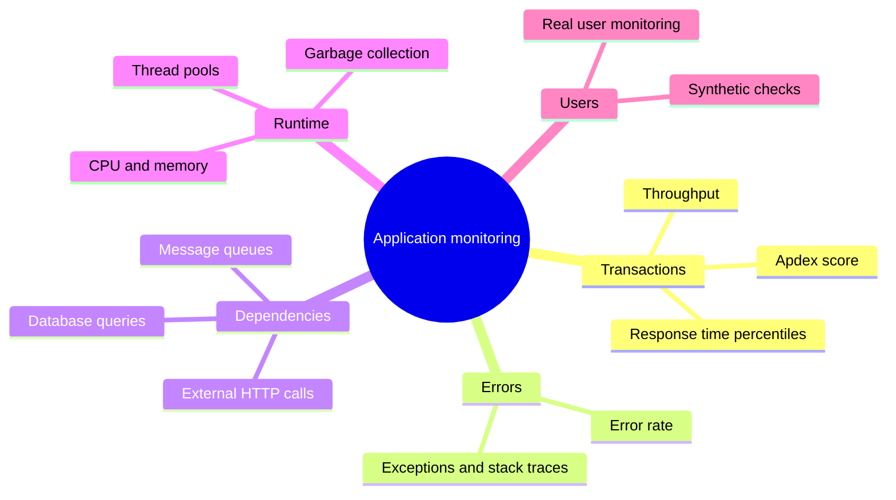
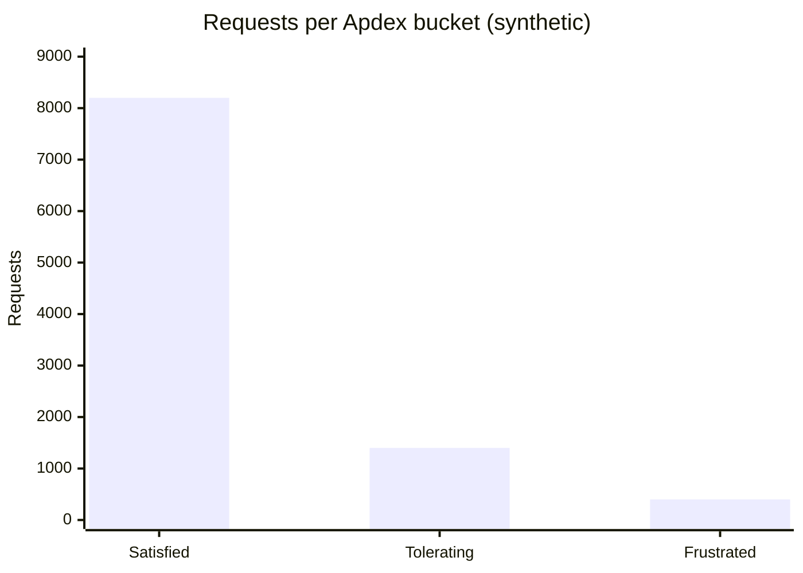

# Application monitoring

## Summary

Application monitoring is the continuous observation and analysis of software applications to keep them performing well, to find issues and to understand how they behave in production. It tracks response times, error rates, throughput, resource use (CPU, memory, disk) and the performance of individual transactions, detects anomalies and alerts on potential problems. Application performance monitoring (APM) tools do this with agents or instrumentation libraries inside the application, so they can see code-level detail (slow methods, database queries, external calls) that infrastructure monitoring cannot. The goal is to address issues before users notice, optimize performance and improve user experience.

## Prerequisites

- [Monitoring](../monitoring.md) for the categories of monitoring and the golden signals.

## Core concepts

### Definition and scope

Application monitoring involves the continuous observation and analysis of software applications to ensure they perform optimally, to identify issues and to provide insights into their operation. It includes tracking metrics such as response times, error rates, resource utilization (CPU, memory and disk) and transaction performance. Application monitoring tools collect and analyze the data to detect anomalies, alert on potential problems and give detailed insights into application behavior and performance. By monitoring applications, organizations can address issues proactively, optimize performance and improve user experience, which keeps their software reliable and efficient.

*Analogy.* Infrastructure monitoring checks that the stage, lights and sound system of a theater work. Application monitoring watches the play itself: whether actors say their lines on time, which scene runs long and where the audience leaves. A perfect stage does not guarantee a good performance. The analogy breaks because in software the "play" can be traced line by line, which theaters cannot do.

### What APM tools measure

- **Transaction metrics.** Response time (as percentiles), throughput (requests per minute) and Apdex, a 0 to 1 score of satisfied, tolerating and frustrated requests relative to a target time T.
- **Errors.** Error rate, exception types and stack traces.
- **Dependencies.** Time spent in database queries, external calls and queues; slow query detection.
- **Runtime health.** CPU, memory, garbage collection pauses, thread and connection pools.
- **User experience.** Real user monitoring in browsers and apps, and synthetic checks from outside.

### How instrumentation works

- **Language agents** attach to the runtime (for example a Java agent with `-javaagent`, or a .NET profiler) and wrap known framework methods (HTTP handlers, JDBC drivers, HTTP clients) to time them and propagate trace context. This is automatic instrumentation.
- **SDKs and manual instrumentation** add custom spans and attributes for business logic.
- **OpenTelemetry** standardizes both, so the same instrumentation can send data to any compatible backend.
- **eBPF-based tools** observe applications from the kernel without changing them, at the cost of less application context.

### Tools

Commercial APM platforms in this area: [New Relic](new-relic.md), [AppDynamics](appdynamics.md), [Instana](instana.md), Dynatrace and Datadog APM. [Splunk](splunk.md) covers APM through Splunk Observability Cloud and AppDynamics. Open source options: OpenTelemetry for instrumentation with Jaeger, Grafana Tempo or Elastic APM as backends. Infrastructure-centric monitoring such as [Nagios](nagios.md) complements APM but does not replace it.

## Worked example

Computing Apdex for an endpoint with a target time T = 0.5 seconds (synthetic data). Requests up to T are *satisfied*, requests between T and 4T (2 seconds) are *tolerating*, slower requests and errors are *frustrated*.

| Bucket | Rule | Requests |
| --- | --- | --- |
| Satisfied | duration <= 0.5 s | 8,200 |
| Tolerating | 0.5 s < duration <= 2 s | 1,400 |
| Frustrated | duration > 2 s or error | 400 |
| Total | | 10,000 |

Apdex = (satisfied + tolerating / 2) / total = (8,200 + 700) / 10,000 = 0.89.

A score of 0.89 is usually labeled "good" (0.85 to 0.94). The 400 frustrated requests are where to look: the APM tool's slowest transaction traces show whether they share a database query, an external call or a host.

## Trade offs and when to use it

- **APM is worth it** for user-facing services with several dependencies, where knowing which call is slow saves hours per incident.
- **Overhead.** Agents add some CPU and memory overhead and latency; measure it under load.
- **Cost.** Commercial APM is priced per host, per GB or per user; open source needs operating effort.
- **Lock-in.** Proprietary agents tie instrumentation to a vendor; OpenTelemetry keeps it portable.

## Common mistakes

- **Monitoring only infrastructure.** All hosts are green while checkout fails. Fix: monitor transactions and errors per service.
- **Averages instead of percentiles.** Fix: track p95 and p99.
- **No context propagation across services.** Traces break at every hop. Fix: consistent W3C Trace Context headers through gateways and queues.

## Practice

1. Which metrics does application monitoring track that infrastructure monitoring does not see?
2. Compute Apdex for T = 1 s with 900 satisfied, 80 tolerating and 20 frustrated requests.
3. What is the advantage of OpenTelemetry for application monitoring?

Answers:

1. Transaction response times and throughput, error rates and exceptions, time spent in database queries and external calls, and user-perceived performance.
2. (900 + 80 / 2) / 1,000 = 0.94.
3. Instrumentation is vendor neutral, so the backend can change without re-instrumenting the code.

## Further reading

- [Apdex specification](https://www.apdex.org/) (Apdex Alliance): the definition of the Apdex score.
- [OpenTelemetry documentation](https://opentelemetry.io/docs/) (OpenTelemetry, CNCF): instrumentation and context propagation.
- [W3C Trace Context](https://www.w3.org/TR/trace-context/) (W3C Recommendation): the header format for propagating traces across services.
