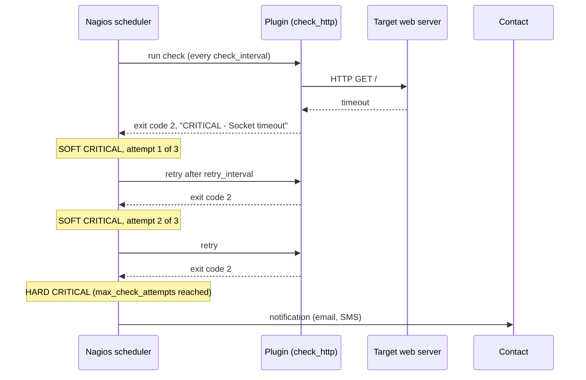

# Nagios

## Summary

Nagios is an open source monitoring system for hosts, network devices and services, first released in 1999 as NetSaint. It works by running small *plugins* on a schedule: each plugin checks one thing (ping, HTTP, disk space) and returns a state of OK, WARNING, CRITICAL or UNKNOWN. When a state changes and is confirmed, Nagios notifies the responsible contacts by email, SMS or chat. It is reliable and extensible and still common in traditional infrastructure, but its text-file configuration, check-based (rather than metric-based) model and dated interface have made Prometheus and Grafana the usual choice for new, dynamic environments.

## Prerequisites

- [Monitoring](../monitoring.md) for categories of monitoring and alerting principles.
- Basic Linux administration and shell ([Operating system overview](../../operating-systems/operating-system-overview.md)).

## Core concepts

### Purpose

Nagios is used to:

- **Monitor system health.** Track servers, network devices, applications and services for uptime and performance.
- **Detect failures** before they escalate, reducing downtime.
- **Alert** teams by email, SMS or other channels when problems occur.
- **Record performance trends.** Collect performance data and visualize it over time.
- **Plan capacity.** Analyze resource usage to anticipate future needs.

*Analogy.* Nagios is a night watchman with a checklist. Every few minutes he walks the same route, tries each door (check), writes down whether it was locked (state) and phones the owner only if a door is still open on the second try (hard state). He is dependable but only knows about the doors on his list; a new door added during the day stays unchecked until someone updates the list, which is the weakness of Nagios in elastic cloud environments.

### Architecture

The first figure shows the overall picture: monitored objects on the left, Nagios with its plugins and performance data in the middle, and status outputs (browser, mail, SMS, graphs from the RRD database) on the right.


The second figure shows the check cycle inside the Nagios server: the process scheduler executes plugins (1), plugins check a local or remote resource and get a result (2), send it back to the scheduler (3), and the scheduler notifies the administrator (4).


The same flow as a sequence, including the soft and hard state logic that keeps one failed check from paging anyone:



### Objects and vocabulary

- **Host.** A physical or virtual system being monitored (server, router, switch). Host states are UP, DOWN and UNREACHABLE (unreachable when a parent device on the path is down, which suppresses a flood of notifications).
- **Service.** A specific check performed on a host (CPU load, disk space, HTTP availability).
- **Plugin.** An executable that performs one check. Plugins can be written in any language; the contract is the exit code and one line of output.
- **Command.** Defines how a plugin is executed, with macros such as `$HOSTADDRESS$`:

  ```text
  define command {
      command_name    check_http
      command_line    /usr/lib/nagios/plugins/check_http -H $HOSTADDRESS$
  }
  ```

- **Contact and contact group.** Who is notified, how and when (time periods).
- **Notification.** The message sent when a problem is detected. *Notification escalations* notify different groups depending on severity or how long the problem lasts.

### Check states and the plugin contract

Every host and service check results in one of four states. The plugin reports it through its exit code:

| Exit code | Status | Description |
| --- | --- | --- |
| 0 | OK | Everything is working |
| 1 | WARNING | A potential issue is detected |
| 2 | CRITICAL | A problem is confirmed |
| 3 | UNKNOWN | The status cannot be determined (wrong arguments, plugin error) |

The text after the state may include *performance data* after a pipe character, for example `DISK OK - free space: / 3326 MB (56%) | /=2643MB;5948;5958;0;5968`, which graphing add-ons store and plot.

Common plugins from the standard Monitoring Plugins package: `check_ping` (ping check), `check_http` (web server check), `check_disk` (disk space), `check_load` (CPU load average), `check_procs`, `check_ssh`. A `check_cpu` plugin exists only as a community plugin. The community plugin repository is [Nagios Exchange](https://exchange.nagios.org/).

### Active and passive checks

- **Active checks** are started by Nagios on its schedule; the plugin queries the service directly.
- **Passive checks** receive results from external sources (for example a backup job that reports its own success, or events from logs and other systems). They suit event-based monitoring and hosts that Nagios cannot reach.

### Remote and distributed monitoring

- **NRPE (Nagios Remote Plugin Executor).** Lets Nagios execute plugins on remote Linux or Unix hosts, for metrics that are only visible locally (CPU, disk, memory). Requires the NRPE daemon on each remote system; Nagios runs `check_nrpe -H host -c check_disk`.
- **NRDP (Nagios Remote Data Processor).** A modern replacement for NSCA that sends passive check results over HTTP(S) from distributed systems to a central Nagios server.
- **Distributed monitoring.** Large environments spread checks over several Nagios instances: *remote pollers* collect data for specific regions or networks and send passive results to a *central server*, which aggregates them and sends notifications.

### Configuration files and directories

Nagios Core is configured with text files:

- `nagios.cfg`: the main configuration file.
- `hosts.cfg`: host definitions.
- `services.cfg`: service definitions.
- `commands.cfg`: command definitions.
- `contacts.cfg`: contacts and contact groups.

The exact names are a convention; `nagios.cfg` includes any files or directories with `cfg_file` and `cfg_dir`. Paths for a source installation:

| File or directory | Purpose |
| --- | --- |
| `/usr/local/nagios/etc/` | Configuration files |
| `/usr/local/nagios/libexec/` | Plugins |
| `/usr/local/nagios/var/` | Logs and runtime data (status, retention, command pipe) |
| `/usr/local/nagios/sbin/` | CGI programs of the web interface |

Distribution packages use other paths (for example `/etc/nagios4/` and `/usr/lib/nagios/plugins/` on Debian and Ubuntu).

### Web interface

Nagios Core has a basic web interface (CGI programs) to view host and service status, acknowledge problems, schedule downtime and read historical logs. The commercial Nagios XI adds a modern UI, configuration wizards and reporting.

### Advantages

- **Broad monitoring.** Servers, network devices, applications and services.
- **Extensible through plugins.** Any script with the right exit codes is a check; thousands of community plugins exist.
- **Open source with an active community.**
- **Flexible alerting.** Email, SMS, Slack or custom scripts, with escalations and time periods.
- **Scalable** through distributed monitoring with NRPE and NRDP.
- **Historical data and reporting** for availability analysis and audits.

### Disadvantages

- **Configuration complexity.** Manual text configuration is time-consuming and error-prone.
- **Learning curve.** Requires Linux skills and Nagios-specific syntax (object inheritance, templates, macros).
- **Dated user interface** compared with Grafana and modern SaaS tools.
- **Limited visualization.** Basic graphs and reports; advanced graphs need add-ons such as NagiosGraph or PNP4Nagios.
- **Resource use.** Large environments need tuning, because every check forks a process.
- **Static inventory.** Hosts must be defined in advance, which fits poorly with autoscaling and containers.

Forks and successors with the same plugin model: Icinga (forked in 2009, now Icinga 2 with an API and better clustering), Naemon and Shinken.

### Comparison with Prometheus

| Feature | Nagios | Prometheus |
| --- | --- | --- |
| Monitoring approach | Host and service checks with states | Time series metrics with labels |
| Data collection | Active and passive checks | Pull (scraping) |
| Visualization | Basic | Advanced (with Grafana) |
| Alerting | Built in | Separate Alertmanager |
| Distributed monitoring | Manual setup | Built-in federation, remote write |
| Service discovery | Static configuration | Dynamic (Kubernetes, cloud APIs, Consul) |

## Worked example

Monitor the HTTPS endpoint and disk space of one web server. Untested; Nagios Core 4.5 object syntax with Monitoring Plugins 2.x, checked 2026-11.

```text
# /usr/local/nagios/etc/objects/web1.cfg
define host {
    use                     linux-server          ; inherit defaults from a template
    host_name               web1
    address                 192.0.2.10
    max_check_attempts      3
}

define service {
    use                     generic-service
    host_name               web1
    service_description     HTTPS
    check_command           check_https_url!/health
    check_interval          1                     ; minutes
    retry_interval          1
    max_check_attempts      3                     ; three failures before a HARD state and a notification
}

define service {
    use                     generic-service
    host_name               web1
    service_description     Root disk
    check_command           check_nrpe!check_root_disk   ; executed on web1 by the NRPE daemon
}

define command {
    command_name    check_https_url
    command_line    $USER1$/check_http -H $HOSTADDRESS$ -S -u $ARG1$ -w 1 -c 3
}
```

Validate before reloading, because a syntax error stops Nagios from starting:

```bash
/usr/local/nagios/bin/nagios -v /usr/local/nagios/etc/nagios.cfg
systemctl reload nagios
```

The HTTPS check reports WARNING if the response takes more than 1 second and CRITICAL above 3 seconds or on an error. A single timeout produces a SOFT state; three in a row (about three minutes) produce a HARD CRITICAL and a notification.

## Trade offs and when to use it

- **Use Nagios** (or Icinga) for stable, mostly static infrastructure, network devices and legacy systems where simple up or down checks with escalations are what you need.
- **Prefer Prometheus and Grafana** for dynamic, containerized or cloud environments that need service discovery, labels and metric queries.
- **Commercial Nagios XI** removes much of the configuration pain at a license cost.
- Nagios plugins can still be reused elsewhere: Icinga, Sensu and several other tools run the same plugin contract.

## Common mistakes

- **`max_check_attempts 1`.** Every transient blip pages someone. Fix: three attempts with a short retry interval.
- **No parent relationships.** A failed core switch produces hundreds of DOWN notifications. Fix: define `parents` so hosts behind it become UNREACHABLE and are suppressed.
- **Reloading without validation.** Fix: always run `nagios -v` first, or in the configuration management pipeline.
- **Exposing NRPE with command arguments enabled** (`dont_blame_nrpe=1`). It allows remote command injection. Fix: keep arguments disabled, restrict `allowed_hosts`, use TLS.

## Practice

1. Which exit code does a plugin return for WARNING, and what does UNKNOWN mean?
2. What is the difference between a SOFT and a HARD state?
3. When would you use a passive check instead of an active one?
4. Why does Nagios fit poorly with Kubernetes workloads?

Answers:

1. Exit code 1. UNKNOWN (exit code 3) means the plugin could not determine the state, for example because of wrong arguments.
2. A SOFT state is a problem that has not yet been confirmed by `max_check_attempts` checks; only a HARD state triggers notifications.
3. When the monitored system cannot be reached by Nagios or reports its own results (batch jobs, events), so it sends results in instead.
4. Pods are short-lived and created dynamically, while Nagios needs hosts and services defined in configuration in advance.

## Further reading

- [Nagios Core documentation](https://assets.nagios.com/downloads/nagioscore/docs/nagioscore/4/en/) (Nagios Enterprises): object definitions, state types and notifications.
- [Monitoring Plugins](https://www.monitoring-plugins.org/) (Monitoring Plugins project): the standard plugins and the plugin development guidelines.
- [Nagios Exchange](https://exchange.nagios.org/) (Nagios Enterprises): the community plugin repository.
- [Icinga documentation](https://icinga.com/docs/) (Icinga): the most active fork, useful for comparison.
