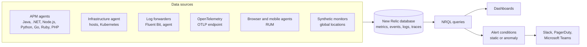
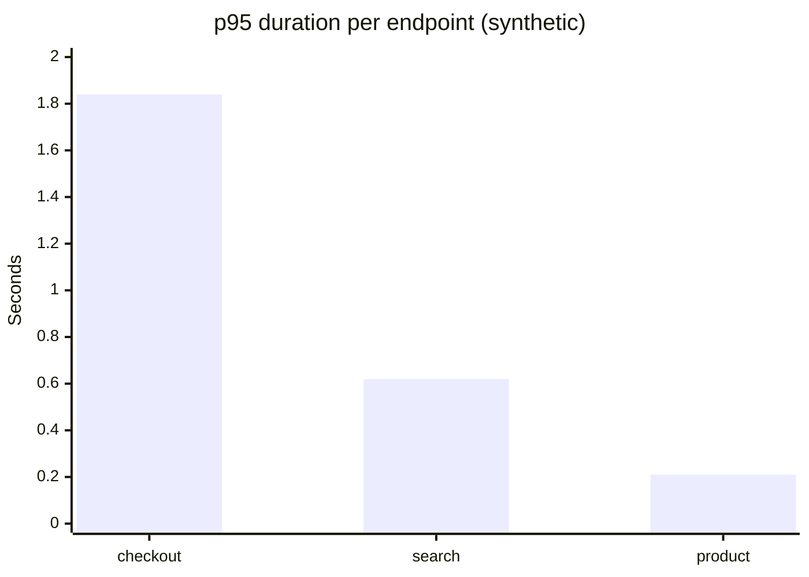

# New Relic

## Summary

New Relic is a cloud-based (SaaS) observability platform, founded in 2008, that collects metrics, events, logs and traces from applications, infrastructure and end users into one data store and makes them queryable with its own SQL-like language, NRQL. Its core is application performance monitoring (APM): language agents instrument code and show transactions, errors, slow database queries and distributed traces. Around it sit infrastructure monitoring, log management, synthetic checks, real user monitoring and alerting. It needs no servers of your own; the price for that convenience is a usage-based bill that grows with data volume and users.

## Prerequisites

- [Monitoring](../monitoring.md) for APM, RUM and synthetic monitoring as categories.
- [Application monitoring](application-monitoring.md) for what an APM tool does in general.

## Core concepts

### Purpose

New Relic is designed to:

- **Monitor application performance.** Application behavior, transactions and latency.
- **Track infrastructure health.** Servers, containers and cloud services in real time.
- **Provide full-stack observability.** Correlate applications, infrastructure, logs and users in one view.
- **Improve customer experience.** Analyze end-user interactions and front-end responsiveness.
- **Support incident response.** Detect anomalies, troubleshoot errors and reduce mean time to resolution (MTTR).

*Analogy.* New Relic is a hospital with every department in one building: the lab (metrics), the radiology archive (logs), the cardiology monitor (APM) and the ambulance service (synthetic checks) share one patient record (the telemetry database). A doctor can follow one patient across all of them with a single query. The analogy breaks on cost: hospital fees do not grow with how many measurements are taken, while New Relic bills by data ingested.

### Architecture

The diagram shows the data sources, the shared database and the ways data is used.



The storage layer was marketed as the *Telemetry Data Platform*; today it is usually called the New Relic database (NRDB). It stores:

- **Metrics** (response time, CPU usage),
- **Events** (transactions, errors, page views),
- **Logs** (application and server logs),
- **Traces** (spans of distributed requests).

### Capabilities

**Application performance monitoring (APM).** The core feature, giving insight into application behavior:

- **Transaction tracing.** Tracks individual transactions (HTTP requests, background jobs) and the work inside them, including database queries and external calls.
- **Error analytics.** Captures, groups and categorizes application errors (Errors Inbox).
- **Response times and throughput.** Latency and transaction volume per endpoint.
- **Slow queries.** Identifies database bottlenecks.

**Distributed tracing.** Tracks requests across microservices to show a request's journey from start to finish: detects bottlenecks, shows the latency contribution of each service and reveals dependencies between services. New Relic accepts W3C Trace Context headers, so it interoperates with OpenTelemetry-instrumented services.

**Infrastructure monitoring.** Health and performance of servers (CPU, memory, disk), containers (Docker, Kubernetes) and cloud platforms (AWS, Azure, Google Cloud) with real-time dashboards, host and cluster metrics, and automatic discovery of cloud resources through cloud integrations.

**Logs.** Aggregates and analyzes logs in real time: filtering and search, pattern detection that groups similar log lines and spots anomalies, and *logs in context*, which links log lines to APM transactions and traces for root cause analysis.

**Synthetic monitoring.** Simulates user behavior to test performance and availability from many locations: simple uptime (ping) monitors, scripted browsers that automate user journeys, API tests, and tests from public or private locations.

**Real user monitoring (RUM).** Captures real user interactions in browsers and mobile apps: page load time and Core Web Vitals, session traces of user journeys, and performance by geography and device.

**Alerts and incident intelligence.** Alert policies contain conditions based on:

- **Static thresholds** (metric above a value),
- **Anomaly detection** (baselines learned from history),
- **NRQL conditions** (any query result).

Notifications go to Slack, PagerDuty, Microsoft Teams, email or webhooks. Incident intelligence correlates related alerts into one issue.

**Dashboards and NRQL.** Dashboards visualize any NRQL query. An example query:

```sql
SELECT average(duration) FROM Transaction WHERE appName = 'myApp' SINCE 30 minutes ago
```

### Key components

| Component | Description |
| --- | --- |
| APM | Application performance monitoring |
| Infrastructure | Server, container and cloud monitoring |
| Logs | Log aggregation and analysis |
| Distributed tracing | Tracking of a request's journey across services |
| Synthetic monitoring | Simulated user behavior and uptime checks |
| Real user monitoring (RUM) | Real user interactions in browsers and apps |
| Alerts | Conditions, policies and notifications |
| NRQL | Query language for custom analysis |
| Dashboards | Visualization of any queried data |

### Advantages

- **Full-stack observability** across applications, infrastructure, logs and user experience in one data store.
- **Real-time insights**: metrics, traces and errors are available within seconds.
- **Easy setup as SaaS**: install an agent and data appears; nothing to host, which suits small teams.
- **Advanced analytics with NRQL** for custom queries and dashboards.
- **Integrated APM, infrastructure and logs** in one product.
- **Distributed tracing** across microservices.
- **Alerts and anomaly detection** with AI-assisted incident correlation.
- **Integrations** with Kubernetes, AWS, Azure, Google Cloud, Docker, Jenkins and many more.

### Disadvantages

- **Cost.** Pay-as-you-go pricing based on data ingested and on user licenses can become expensive in high-traffic environments.
- **Learning curve.** NRQL, custom instrumentation and distributed tracing need technical expertise.
- **Data overload.** Many metrics and logs can overwhelm; dashboards and alerts need tuning.
- **Dashboard customization.** Less flexible than Grafana for complex visualizations.
- **Vendor lock-in.** Proprietary agents and NRQL; using OpenTelemetry for instrumentation reduces it.

### Comparison with alternatives

| Feature | New Relic | Datadog | Prometheus and Grafana |
| --- | --- | --- | --- |
| Full-stack observability | Yes | Yes | Partly: metrics-focused, logs and traces need Loki and Tempo |
| APM | Yes | Yes | No built-in APM; traces through Tempo or Jaeger |
| Infrastructure | Yes | Yes | Yes |
| Logs | Yes | Yes | Not in Prometheus; Loki adds them |
| Distributed tracing | Yes | Yes | Yes, with Tempo or Jaeger |
| Dashboards | Yes | Yes | Yes |
| Ease of setup | Easy (SaaS) | Easy (SaaS) | Complex (self-hosted), easier with Grafana Cloud |
| Pricing | High (usage and users) | Medium to high (hosts and usage) | Free software, you pay for operation |

The price ranking is a rough tendency; the real cost depends on data volume and contract.

## Worked example

Find the slowest endpoints of an application and alert when one of them degrades. Untested; NRQL syntax checked against the New Relic documentation, 2026-11.

Query for a dashboard widget: the 95th percentile duration per transaction name over the last hour.

```sql
SELECT percentile(duration, 95) AS 'p95 seconds', count(*) AS 'requests'
FROM Transaction
WHERE appName = 'shop-api' AND transactionType = 'Web'
FACET name
SINCE 1 hour ago
LIMIT 10
```

Example result (synthetic):

| name | p95 seconds | requests |
| --- | --- | --- |
| WebTransaction/Controller/checkout | 1.84 | 12,410 |
| WebTransaction/Controller/search | 0.62 | 98,233 |
| WebTransaction/Controller/product | 0.21 | 155,904 |



Alert condition (NRQL condition): `SELECT percentile(duration, 95) FROM Transaction WHERE appName = 'shop-api' AND name = 'WebTransaction/Controller/checkout'` with a critical threshold above 1.5 seconds for at least 5 minutes. When it fires, the transaction trace of a slow checkout shows which database query or external call took the time, and logs in context show the related log lines.

## Trade offs and when to use it

- **Choose New Relic** when you want APM, infrastructure, logs and RUM in one SaaS product with little operational effort, and the data volume keeps the bill predictable.
- **Choose Prometheus and Grafana** (or Grafana Cloud) for cost control and open standards, accepting more assembly.
- **Choose Datadog, Dynatrace, AppDynamics or Instana** after comparing agent coverage for your languages, automatic discovery and pricing model; all four overlap heavily with New Relic.
- **Control cost** with drop rules for noisy data, sampling, and log volume limits.

## Common mistakes

- **Sending every debug log.** The ingest bill explodes. Fix: filter at the forwarder, use drop rules.
- **Averages in dashboards.** Fix: percentiles (`percentile(duration, 95)`), as in the example.
- **No deployment markers.** Regressions cannot be tied to releases. Fix: record deployments (change tracking) from the CI pipeline.
- **Alerting on every APM default.** Fix: alert on user-facing symptoms per key transaction.

## Practice

1. What are the four kinds of telemetry New Relic stores?
2. Write an NRQL query for the error count per application over the last day.
3. What is the difference between synthetic monitoring and RUM?
4. How can you reduce lock-in when adopting New Relic?

Answers:

1. Metrics, events, logs and traces.
2. `SELECT count(*) FROM TransactionError FACET appName SINCE 1 day ago`.
3. Synthetic monitoring runs scripted checks from known locations on a schedule, even when no users are active; RUM measures what real users experience.
4. Instrument with OpenTelemetry and send OTLP to New Relic, so instrumentation can be redirected to another backend later.

## Further reading

- [New Relic documentation](https://docs.newrelic.com/) (New Relic): agents, data types and features.
- [NRQL reference](https://docs.newrelic.com/docs/nrql/get-started/introduction-nrql-new-relics-query-language/) (New Relic): syntax and functions used in the example.
- [New Relic pricing](https://newrelic.com/pricing) (New Relic): the current ingest and user pricing (check before decisions; prices change).
- [OpenTelemetry with New Relic](https://docs.newrelic.com/docs/opentelemetry/opentelemetry-introduction/) (New Relic): sending vendor neutral telemetry.
