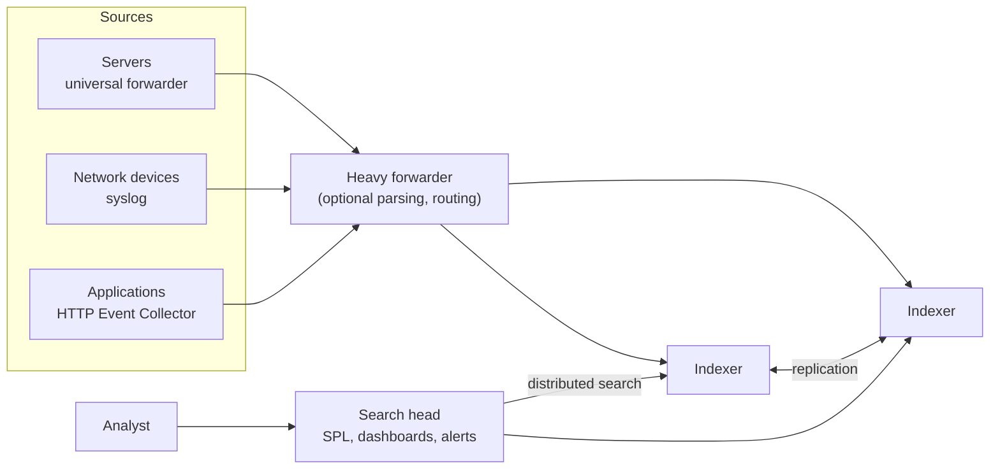
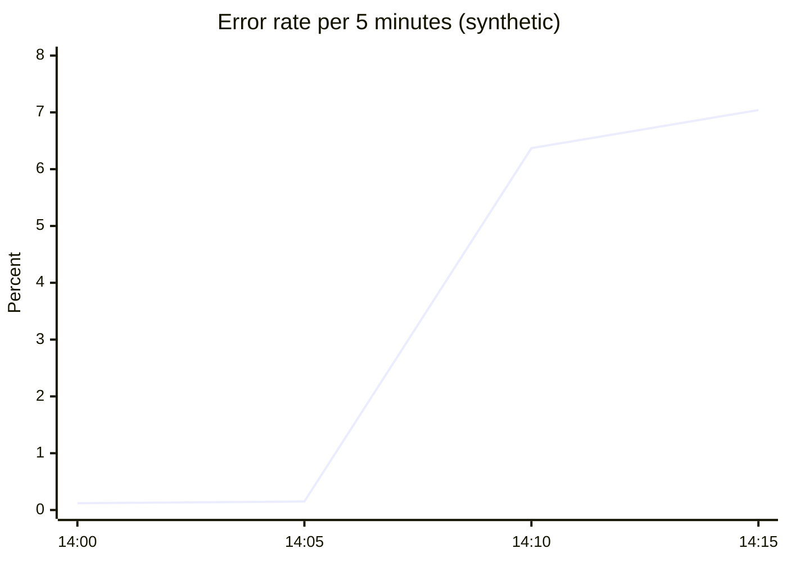

# Splunk

## Summary

Splunk is a data analysis and observability platform that collects, indexes, searches, analyzes and visualizes machine-generated data (logs, metrics, traces) from many sources in real time. Founded in 2003 and acquired by Cisco in 2024, it is a market leader in log management and in security information and event management (SIEM). Its central idea is "index everything, define the structure at search time": raw events are stored as they arrive, and fields are extracted when a query in the Splunk Processing Language (SPL) runs. That makes Splunk extremely flexible and fast to search, and also expensive, because pricing follows the volume of data ingested.

## Prerequisites

- [Log management](../log-management/log-management-overview.md) for collection, parsing and retention of logs.
- [Monitoring](../monitoring.md) for alerting concepts.

## Core concepts

### Purpose

Splunk is used to:

- **Collect and analyze logs** from servers, applications and network devices for troubleshooting and performance monitoring.
- **Provide security and compliance (SIEM).** Detect threats with correlation searches and keep audit evidence (Splunk Enterprise Security).
- **Monitor in real time.** Visualize metrics and detect operational issues as they occur.
- **Produce data-driven insights.** Dashboards and reports from logs and machine data.
- **Support business analytics.** Insights from operational data, for example orders per minute from application logs.

Use cases: application performance monitoring, log analysis for troubleshooting, security event monitoring (SIEM), infrastructure monitoring, compliance auditing.

*Analogy.* Splunk is a library that shelves every document the moment it arrives, without cataloging it, but builds a complete word index. Finding every page that mentions a name is instant; deciding what counts as an "author" or a "date" happens when you ask. The analogy breaks on cost: a library pays for shelves once, while Splunk licenses are typically priced per gigabyte indexed per day (or by compute in the workload pricing model).

### Architecture

The diagram shows the three tiers of a distributed Splunk Enterprise deployment.



- **Forwarders** collect and send data. The *universal forwarder* is a lightweight agent that ships raw data; a *heavy forwarder* can parse, filter and route.
- **Indexers** parse events, extract timestamps, write the data into *indexes* (stored in time-bucketed directories) and answer searches. Indexer clusters replicate data for availability.
- **Search heads** accept SPL queries, distribute them to indexers, merge the results and host dashboards, reports and alerts.
- **Splunk Cloud Platform** is the SaaS version; **Splunk Observability Cloud** is a separate, metrics-and-traces product built on OpenTelemetry (from the SignalFx acquisition).

### Core vocabulary

| Concept | Description |
| --- | --- |
| Index | Storage location for machine data, with its own retention and access control |
| Event | A single log entry or data point, with a timestamp |
| Search | A query in SPL |
| Field extraction | Pulling named fields out of raw events, usually at search time |
| Source, source type, host | Default fields that say where an event came from and how to parse it |
| Dashboard | A visual representation of search results |
| Alert | An automated notification triggered by a scheduled or real-time search |
| Forwarder | An agent that collects data and sends it to Splunk |
| Splunk apps and add-ons | Prebuilt dashboards, inputs and parsing for specific technologies (from Splunkbase) |

### SPL

The Splunk Processing Language chains commands with pipes, like a Unix shell. A simple example:

```text
index=web_logs status=500 | stats count by source_ip
```

It retrieves all events in `web_logs` with `status=500` and counts them per source IP. A search always starts by selecting events (index, time range, keywords, field values), then transforms them (`stats`, `timechart`, `top`, `eval`, `rex`).

### Advantages

- **Powerful search and indexing** over very large data volumes, with fast queries.
- **Real-time analysis** of logs and events.
- **Custom dashboards and visualizations** for specific operational needs.
- **SPL**, an advanced language for detailed analysis.
- **Extensibility and integration** with cloud platforms, security tools and infrastructure monitoring (thousands of apps on Splunkbase).
- **Alerting and automation** on patterns or anomalies, and SOAR playbooks for security response.

### Disadvantages

- **High cost.** Pricing based on ingested volume makes it expensive at large scale.
- **Complex setup and maintenance.** On-premises deployments need substantial infrastructure (indexer clusters, storage) and expertise.
- **Steep learning curve.** SPL is powerful but takes time to master.

## Worked example

Investigate a spike of HTTP 500 errors and turn the search into an alert. Untested; SPL checked against the Splunk documentation, 2026-11. The index and field names assume web access logs with an extracted `status` and `uri_path`.

```text
index=web_logs sourcetype=access_combined earliest=-1h
| eval is_error = if(status >= 500, 1, 0)
| timechart span=5m sum(is_error) AS errors, count AS requests
| eval error_rate = round(errors / requests * 100, 2)
```

Example result (synthetic):

| _time | errors | requests | error_rate |
| --- | --- | --- | --- |
| 14:00 | 12 | 9,800 | 0.12 |
| 14:05 | 15 | 10,120 | 0.15 |
| 14:10 | 640 | 10,050 | 6.37 |
| 14:15 | 702 | 9,970 | 7.04 |



Drill down to the cause:

```text
index=web_logs status>=500 earliest=-20m
| stats count by uri_path, host
| sort - count
```

If all errors come from one host and one path, the problem is local (one bad node); if they come from all hosts, look at a shared dependency or the last deployment. Saving the first search as an alert that triggers when `error_rate > 5` for two consecutive runs turns the investigation into monitoring.

## Trade offs and when to use it

- **Choose Splunk** when security (SIEM), compliance and ad hoc search over heterogeneous logs are central, and the budget allows ingest-based pricing.
- **Choose the Elastic Stack or OpenSearch** for similar search capabilities with self-hosting and different pricing, at the cost of operating clusters.
- **Choose Grafana Loki** for cheap, label-indexed log storage when full-text indexing is not needed.
- **Reduce cost** by filtering at forwarders, routing low-value data to cheaper storage (Splunk ingest actions, federated search over object storage) and setting index retention deliberately.

## Common mistakes

- **Searching `index=*` over all time.** It scans everything and slows the whole cluster. Fix: always name the index and limit the time range.
- **Wrong source types.** Timestamps and line breaking go wrong and events merge or split. Fix: define source types for custom logs before onboarding.
- **Indexing debug logs at full volume.** Fix: filter at the forwarder or route to cheaper storage.
- **Real-time searches for everything.** They hold resources continuously. Fix: scheduled searches every few minutes for most alerts.

## Practice

1. What does "schema on read" mean in Splunk, and what is its benefit?
2. What is the role of a universal forwarder compared with an indexer?
3. Write an SPL search that shows the top 5 hosts by number of failed SSH logins in the last 24 hours, assuming events contain "Failed password".
4. Why is restricting the time range the single most important search optimization?

Answers:

1. Fields are extracted when a search runs, not when data is indexed. New questions can be asked of old data without re-ingesting it.
2. The forwarder collects and ships raw data from a source; the indexer parses, stores and searches it.
3. `index=os_logs "Failed password" earliest=-24h | stats count by host | sort - count | head 5`.
4. Indexes are organized in time buckets, so a narrow time range lets Splunk skip most of the data on disk.

## Further reading

- [Splunk documentation](https://docs.splunk.com/Documentation) (Splunk, a Cisco company): architecture, forwarders and administration.
- [Search Reference](https://docs.splunk.com/Documentation/Splunk/latest/SearchReference/WhatsInThisManual) (Splunk): every SPL command.
- [Splunkbase](https://splunkbase.splunk.com/) (Splunk): apps and add-ons for data sources.
- [Cisco completes acquisition of Splunk](https://newsroom.cisco.com/) (Cisco, March 2024): background on the ownership change.
