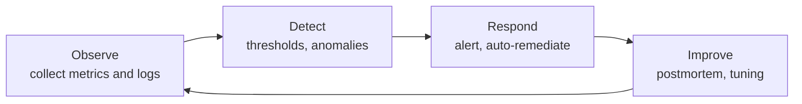
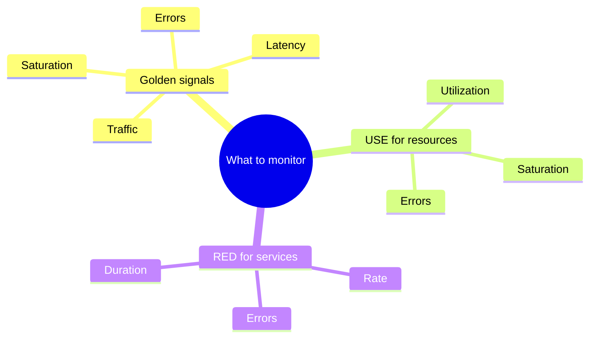

# Monitoring

## Summary

Monitoring in DevOps is the continuous collection, analysis and visualization of metrics and logs to keep applications, infrastructure and services performant, available and reliable. It watches for predefined conditions and raises alerts when they occur, so that issues, bottlenecks, security problems and failures are found before they hurt users. Monitoring covers several categories (infrastructure, application performance, logs, pipelines, security, real users), and a few well-chosen signals, such as the four golden signals of Google SRE, carry most of the value. Good monitoring is judged by whether its alerts lead to action, not by how much it collects.

## Prerequisites

- [Observability overview](observability-overview.md) for the telemetry signals and how monitoring fits into observability.

## Core concepts

### Why monitoring matters

Monitoring supports the core DevOps principles of automation, collaboration, continuous delivery and reliability by giving real-time visibility into applications and infrastructure. It leads to:

- faster incident detection and response,
- better reliability and uptime,
- data-driven decisions,
- early detection and prevention of performance problems,
- security and compliance monitoring,
- better resource usage and lower cost.

*Analogy.* Monitoring is the set of smoke detectors, thermometers and water-leak sensors in a building. Each one watches for a known danger and rings when its threshold is crossed. They do not explain why the fire started (that is investigation, or observability), and a detector that rings every day for burnt toast gets unplugged, which is alert fatigue. The analogy breaks in that software can also act on the alarm automatically, for example by scaling out or rolling back.

### The monitoring cycle

DevOps monitoring follows an observe, detect, respond, improve cycle:

1. **Observe.** Collect data from applications, infrastructure and services.
2. **Detect.** Identify performance issues, anomalies or failures.
3. **Respond.** Trigger alerts and automated responses.
4. **Improve.** Analyze trends continuously to improve performance and stability.



Key characteristics:

- **Continuous and automated.** Always running, with automated collection and alerting.
- **End to end.** Covers applications, databases, networks and cloud resources.
- **Integrated with CI/CD.** Deployments and production changes are monitored and marked on dashboards.
- **Actionable.** Real-time data supports decisions; every alert has an owner and a runbook.

### Pull and push collection

Collectors get data in one of two ways:

- **Pull.** The monitoring server scrapes an HTTP endpoint on each target at a fixed interval (Prometheus, every 15 to 60 seconds typically). The server knows when a target is down because the scrape fails.
- **Push.** Agents or applications send data to the server (StatsD, Graphite, most SaaS agents, OpenTelemetry OTLP). Better for short-lived jobs and targets behind NAT.

### Monitoring compared with observability

Monitoring tells you what is happening; observability helps you understand why it is happening.

| Aspect | Monitoring | Observability |
| --- | --- | --- |
| Definition | Tracks system health and detects failures | Explores unknown issues and root causes |
| Focus | Metrics, logs, alerts | Logs, traces, debugging, insights |
| Approach | Predefined thresholds and alerts | Data correlation and deep analysis |
| Tools | Prometheus, Nagios, Zabbix | OpenTelemetry, Jaeger, Splunk |

The tool column is a tendency, not a rule: Prometheus data is used for exploration and Splunk for alerting.

### Categories of monitoring

| Category | Watches | Typical data | Tools |
| --- | --- | --- | --- |
| Infrastructure monitoring | Servers, networks, databases, containers, cloud resources | CPU, memory, disk, network traffic, pod health, cloud billing | Prometheus, Grafana, Datadog, Zabbix, Nagios, Amazon CloudWatch |
| Application performance monitoring (APM) | Response times, error rates, dependencies, user experience | Latency, throughput, error rates, request duration | New Relic, AppDynamics, Dynatrace, OpenTelemetry |
| Log monitoring | Logs for troubleshooting and security | Application, system and event logs | Elastic Stack (Elasticsearch, Logstash, Kibana), Loki, Splunk, Fluentd |
| CI/CD pipeline monitoring | Builds, deployments, failures | Build success rate, deployment frequency, failure rate | Jenkins, GitLab CI/CD, Azure DevOps, CircleCI, Tekton |
| Security monitoring | Threats, vulnerabilities, breaches | Intrusion detection, access logs, anomaly detection | Falco, OSSEC, Wazuh, Amazon GuardDuty, Microsoft Defender for Cloud (formerly Azure Security Center) |
| Real user monitoring (RUM) and synthetic monitoring | Real user interactions and scripted checks | Page load time, session duration, errors, uptime from outside | Google Lighthouse (lab audits), Raygun, Pingdom, New Relic Browser |

Lighthouse measures a page in a lab run, so strictly it is synthetic testing, not RUM; RUM data comes from real browsers (for example through the browser SDK of an APM tool).

### Metrics by category

| Category | Example metrics |
| --- | --- |
| Infrastructure | CPU, RAM, disk, network traffic, pod health |
| Application | Request latency, throughput, error rates |
| Security | Failed logins, unauthorized API access, suspicious traffic |
| CI/CD pipelines | Deployment frequency, build failure rate |
| User experience | Page load time, response time, downtime |

### The four golden signals, USE and RED

Three well-known methods tell you which metrics to watch first.

**The four golden signals** (Google SRE book) for user-facing services:

1. **Latency.** The time to serve a request; track successful and failed requests separately, because fast errors distort the picture.
2. **Traffic.** Demand on the system: requests per second, sessions, bandwidth.
3. **Errors.** The rate of failed requests, explicit (HTTP 5xx) or implicit (wrong content, too slow).
4. **Saturation.** How full the system is: the most constrained resource (CPU, memory, I/O, queue length), ideally with a prediction of when it runs out.

**USE** (Brendan Gregg) for resources such as CPUs, disks and network interfaces: Utilization, Saturation, Errors.

**RED** (Tom Wilkie) for request-driven services: Rate, Errors, Duration.



### Alerting

An alert should be urgent, actionable and tied to user impact. Rules of thumb:

- Alert on symptoms (users see errors) rather than causes (one disk is 80 percent full), and keep cause-based checks as dashboards or tickets.
- Prioritize alerts by business impact and use different channels: a page (SMS, phone) for high-priority, email or tickets for low-priority.
- Every paging alert has a runbook and an owner.
- Use multi-window burn-rate alerts on SLOs for mature services (see [Site reliability engineering](../site-reliability-engineering/README.md)).

### Best practices

- **Monitor everything that matters.** Applications, infrastructure, databases, network and security, but prioritize user-facing signals.
- **Set meaningful alerts.** Avoid alert fatigue by alerting only on critical issues.
- **Aggregate logs centrally** (Elastic Stack, Loki).
- **Use autoscaling** driven by performance trends.
- **Monitor in real time.** Quick detection reduces downtime.
- **Analyze historical data.** Identify trends and prevent future failures (capacity planning).
- **Automate incident response.** Self-healing (restarts, failover, rollbacks) reduces manual intervention.

### Effective monitoring

- **Automate where possible.** Automated discovery, configuration and baselining eliminate blind spots, reduce manual work and free teams for higher-value tasks.
- **Optimize alert configuration.** Define only necessary alerts; automatic baselining can reduce false positives, prioritize critical alerts and speed up root cause analysis.
- **Prioritize alerts** by business impact and route them to suitable channels.
- **Customize dashboards** per role so each team sees relevant data, while keeping data consistent across dashboards.
- **Test the monitoring system.** Validate monitoring and alert configuration in a test environment before production, and fine-tune alerting and reports.
- **Review metrics and KPIs regularly** as business needs change; find new baselines and blind spots.
- **Use vendor expertise.** Monitoring vendors can advise on setup and help train internal teams.

### Tools by category

| Category | Tools |
| --- | --- |
| Infrastructure monitoring | Prometheus, Grafana, Datadog, Zabbix, [Nagios](monitoring-tools/nagios.md) |
| Application performance monitoring | [New Relic](monitoring-tools/new-relic.md), Dynatrace, [AppDynamics](monitoring-tools/appdynamics.md), [Instana](monitoring-tools/instana.md) |
| Log monitoring | [Elastic Stack](log-management/elastic-stack.md), [Loki](log-management/loki.md), [Splunk](monitoring-tools/splunk.md) |
| Security monitoring | Falco, Wazuh, AWS Security Hub |
| CI/CD monitoring | Jenkins, GitLab CI/CD, Azure DevOps |
| User experience monitoring | Google Lighthouse, Pingdom, Raygun |

## Worked example

A Prometheus alerting rule for the error signal of a web service. It fires when more than 5 percent of requests fail for 10 minutes. Untested; Prometheus 2.x or 3.x rule syntax, checked 2026-11.

```yaml
groups:
  - name: shop-api
    rules:
      - alert: HighErrorRate
        # ratio of 5xx responses to all responses over the last 5 minutes
        expr: |
          sum(rate(http_requests_total{job="shop-api", status=~"5.."}[5m]))
            /
          sum(rate(http_requests_total{job="shop-api"}[5m]))
          > 0.05
        for: 10m          # ignore short spikes; page only on a sustained problem
        labels:
          severity: page
        annotations:
          summary: "shop-api error rate above 5 percent"
          runbook_url: "https://runbooks.example.com/shop-api/high-error-rate"
```

With 2,000 requests per second and 150 of them failing, the ratio is 150 / 2,000 = 7.5 percent. The rule enters the `pending` state, and if the ratio stays above 5 percent for 10 minutes it becomes `firing` and Alertmanager pages the on-call engineer with the runbook link. A 30-second spike to 20 percent never fires, which is intended.

## Trade offs and when to use it

- **Threshold alerts** are simple and transparent but need tuning per service; **anomaly detection** adapts to patterns but can be opaque and noisy.
- **Self-hosted stacks** (Prometheus, Grafana, Zabbix) avoid per-host or per-GB fees but cost operating time; **SaaS** (Datadog, New Relic) is quick to adopt and expensive at volume.
- **Too little monitoring** means users report outages first; **too much** means alert fatigue and ignored pages. Start with the golden signals per user-facing service.

## Common mistakes

- **Alerting on every cause.** Hundreds of CPU and disk alerts that need no action train people to ignore pages. Fix: page on symptoms, ticket on causes.
- **Monitoring only the happy path.** Health checks that return 200 while the database is down. Fix: health checks that test dependencies, and synthetic transactions.
- **Dashboards nobody reads.** Fix: a small set of service dashboards built around golden signals, linked from alerts.
- **No monitoring of the monitoring.** Fix: a dead man's switch alert that fires when the alerting pipeline stops sending its heartbeat.

## Practice

1. Name the four golden signals and give one metric for each for a web API.
2. When should you prefer push over pull collection?
3. Why should an alert usually be about a symptom rather than a cause?
4. In the worked example, why is `for: 10m` used?

Answers:

1. Latency (p99 request duration), traffic (requests per second), errors (share of 5xx responses), saturation (CPU or connection pool usage).
2. For short-lived jobs that may finish before a scrape, and for targets that the server cannot reach (behind NAT or firewalls).
3. Symptoms reflect user impact and always need action; many causes resolve themselves or have no user impact, so alerting on them creates noise.
4. To avoid paging on short spikes; the alert fires only if the condition persists for ten minutes.

## Further reading

- [Monitoring distributed systems](https://sre.google/sre-book/monitoring-distributed-systems/) (Google, *Site Reliability Engineering*, 2016): the four golden signals and alerting philosophy.
- [The USE Method](https://www.brendangregg.com/usemethod.html) (Brendan Gregg): the resource checklist.
- [The RED Method](https://grafana.com/blog/2018/08/02/the-red-method-how-to-instrument-your-services/) (Tom Wilkie, Grafana Labs, 2018): the service checklist.
- [Prometheus documentation: alerting rules](https://prometheus.io/docs/prometheus/latest/configuration/alerting_rules/) (Prometheus project): the syntax used in the worked example.
- [My Philosophy on Alerting](https://docs.google.com/document/d/199PqyG3UsyXlwieHaqbGiWVa8eMWi8zzAn0YfcApr8Q/) (Rob Ewaschuk, Google): the origin of symptom-based alerting.
