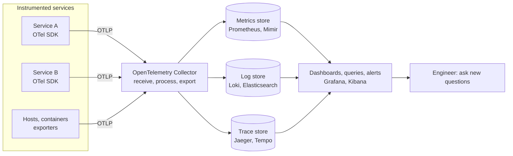
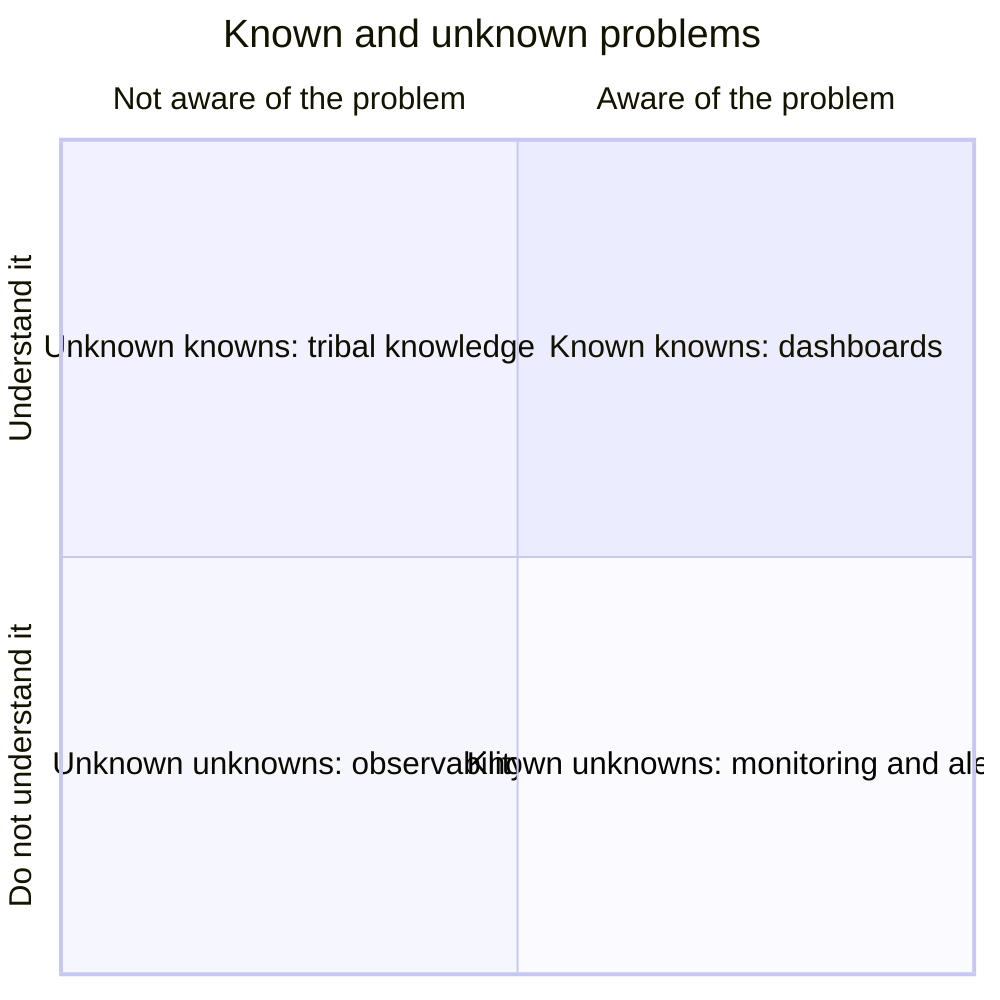
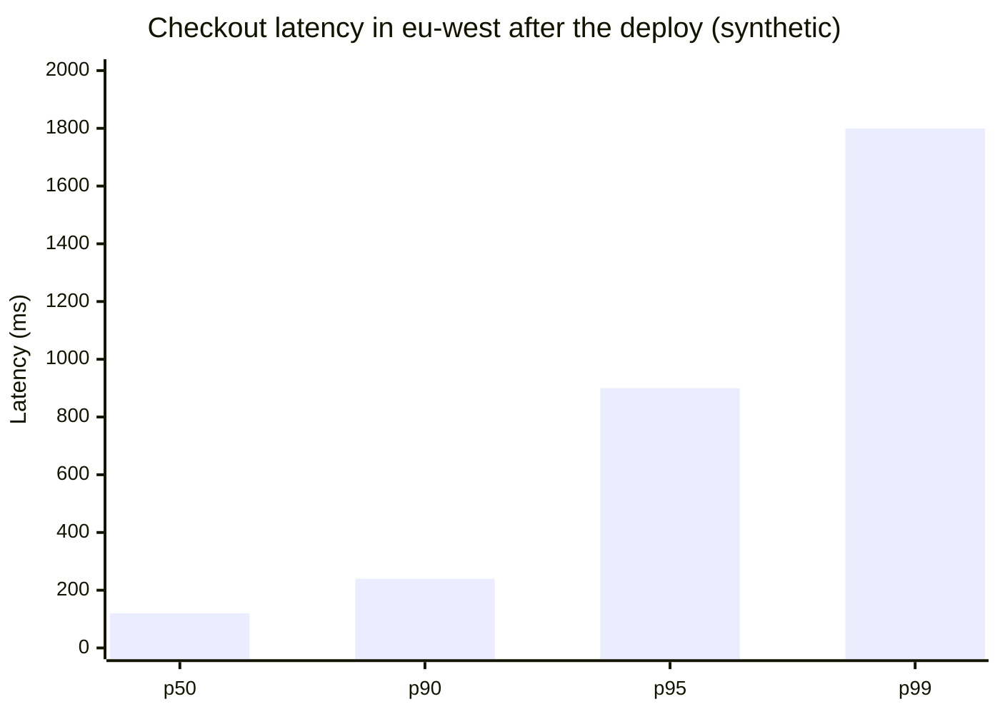

# Observability overview

## Summary

Observability is the ability to understand the internal state of a system from the data it emits: metrics, events, logs and traces (often shortened to MELT). In DevOps it is the continuous process of collecting, correlating and exploring that telemetry to find out where, when and why something happens, including problems nobody predicted. Monitoring is a part of it: monitoring checks predefined conditions ("is CPU above 90 percent?"), while observability lets you ask new questions of the data after the fact ("why are checkout requests from one region slow since the last deploy?"). Observability matters most in distributed systems, where a failure in one service shows up as a symptom in another.

## Prerequisites

- [DevOps overview](../foundations/devops-overview.md) for the feedback loop that observability closes.
- Read together with [Monitoring](monitoring.md).

## Core concepts

### Origin of the term

Observability comes from control theory. Rudolf E. Kálmán defined it in 1960 for linear dynamic systems: a system is *observable* if its internal state can be determined from its outputs over a finite time. Software borrowed the word for the same idea: instead of attaching a debugger to production, you design the system to emit enough output (telemetry) that its state can be reconstructed from outside.

### Definition

Observability is the continuous process of using the metrics, events, logs and trace data that a system generates to identify, understand and optimize its health and performance. It involves collecting, visualizing and acting on a system's output data. In DevOps it gives a way to collect, analyze and pinpoint strengths, weaknesses and their root causes in a complex system.

*Analogy.* A car dashboard compared with a mechanic's diagnostic computer. The dashboard (monitoring) shows a fixed set of gauges and warning lights chosen by the designer; it tells you that the engine light is on. The diagnostic computer (observability) reads detailed data from every sensor and lets the mechanic ask new questions until the cause is found. The analogy breaks because a car's sensors are fixed at the factory, while in software you can add instrumentation with the next deployment, and you have to, when a question cannot be answered.

### The telemetry signals

| Signal | What it is | Strength | Weakness |
| --- | --- | --- | --- |
| Metrics | Numeric measurements aggregated over time (request rate, latency percentiles, CPU) | Cheap to store, fast to query, ideal for alerts and trends | Lose detail: an average hides the single slow request |
| Events | Discrete records of something that happened (deploy, config change, scaling) | Explain changes in other signals | Need a time correlation to be useful |
| Logs | Timestamped text or structured records written by software | Rich context for one occurrence | Expensive at volume, hard to correlate across services without IDs |
| Traces | The path of one request across services, made of spans with timing | Show where time is spent and which call failed in a distributed system | Need instrumentation in every service; usually sampled |

Profiles (continuous CPU and memory profiling) are increasingly treated as a fifth signal. The common practice is to correlate signals through shared identifiers: a trace ID in each log line, exemplars that link a latency metric to a sample trace.

The diagram shows the typical telemetry pipeline with OpenTelemetry, the vendor neutral CNCF standard for instrumentation and transport.

### Observability compared with monitoring

Monitoring and observability are often used interchangeably, but they differ:

- **Questions.** Observability focuses on where, when and why an event happens; monitoring on what is happening and how.
- **Root cause.** Observability plays the central role in root cause analysis (cause-and-effect assessment across components). Conventional application or infrastructure monitoring mostly shows the current state of specific components.
- **Granularity.** Observability emphasizes high granularity and *high cardinality* (per user, per request, per build version) rather than totals or averages.
- **Emergence.** Observability studies variables, patterns and changes as they emerge in a system; monitoring gathers predefined telemetry.
- **Known and unknown problems.** Monitoring collects and analyzes data already known to relate to application, infrastructure or network issues ("known unknowns"). Observability gives the context to detect, understand and respond to issues you were not aware of ("unknown unknowns").
- **Point in time and overall health.** Monitoring tracks and reports the state of a system at a given time. Observability uses multiple streams of intelligence, including monitoring data, to understand overall health and performance.
- **Reactive and proactive.** Monitoring is mostly reactive; observability supports continuous improvement and prevention.
- **Scope.** Monitoring consists of specific tasks (application performance, network performance, security monitoring). Observability takes a context-based approach in which teams analyze many factors to infer a system's health.

The quadrant chart places the two practices: monitoring alerts on problems you know can happen; observability is for the quadrant of problems you neither predicted nor understand.

## Worked example

A checkout service has a latency alert: the 99th percentile latency (p99) is above 1 second. The monitoring dashboard shows average latency at 180 ms, which looks fine. The investigation with observability data (synthetic numbers):

| Step | Question | Signal used | Finding |
| --- | --- | --- | --- |
| 1 | Is it everyone? | Metric split by region | Only `eu-west`, p99 1.8 s; other regions 0.3 s |
| 2 | Since when? | Events (deploys) | Started at 14:02, deploy of `payments v2.41` at 14:00 |
| 3 | Where is the time spent? | Traces of slow requests | 1.5 s in the span `payments -> fraud-api` |
| 4 | Why? | Logs with the trace ID | `fraud-api` retries 3 times with a 500 ms timeout for cards from one issuer |
| 5 | Fix | Config change | Timeout and retry budget corrected, p99 back to 0.3 s |

The chart shows why the average hid the problem: most requests were fast, a minority was very slow.

No predefined dashboard contained "latency by card issuer"; the answer came from slicing high-cardinality data after the fact. That is the practical difference between the two practices.

## Trade offs and when to use it

- **Cost.** Telemetry volume grows with traffic and cardinality; logs and traces can cost more than the systems they observe. Sampling, retention tiers and dropping noisy data are part of the design.
- **Instrumentation effort.** Every service must propagate trace context and emit useful attributes. OpenTelemetry auto-instrumentation lowers the effort but does not add business context.
- **Small, simple systems** (one service, one database) often need only good monitoring and logs; full tracing pays off with many interacting services.
- **Tool sprawl.** Separate tools per signal make correlation hard; choose tools that link signals or share identifiers.

## Common mistakes

- **Relying on averages.** They hide tail latency. Fix: percentiles and histograms.
- **Unstructured logs without request IDs.** They cannot be joined with traces. Fix: structured (JSON) logs with trace and span IDs.
- **"Three pillars" as three silos.** Collecting metrics, logs and traces in unconnected tools is not observability. Fix: correlate through shared IDs, labels and exemplars.
- **Collecting everything forever.** Costs explode. Fix: define retention per signal and sample traces (head or tail sampling).

## Practice

1. What does "observable" mean in control theory, and how does the idea carry over to software?
2. Why can an average latency of 180 ms coexist with a severe user-facing problem?
3. Which signal tells you which downstream call is slow in a distributed request?
4. What is high cardinality, and why does it matter for observability?

Answers:

1. A system is observable if its internal state can be determined from its outputs. In software, the outputs are telemetry, so the system must emit enough of it to reconstruct its state without attaching a debugger.
2. The average is dominated by many fast requests; a small share of very slow requests barely moves it but affects real users. Percentiles reveal it.
3. Traces, because their spans record the timing of each call along the request path.
4. Many distinct values of an attribute (user ID, request ID, version). It lets you slice data finely enough to find the specific group that has a problem.

## Further reading

- *Observability Engineering* (Charity Majors, Liz Fong-Jones, George Miranda, O'Reilly, 2022): the case for high-cardinality, event-based observability.
- [OpenTelemetry documentation](https://opentelemetry.io/docs/) (OpenTelemetry, CNCF): signals, SDKs, the collector and the OTLP protocol.
- [Monitoring distributed systems](https://sre.google/sre-book/monitoring-distributed-systems/) (Google, *Site Reliability Engineering*, 2016): the chapter that defined the four golden signals.
- "On the general theory of control systems" (R. E. Kálmán, Proceedings of the First IFAC Congress, 1960): the origin of the observability concept in control theory.
