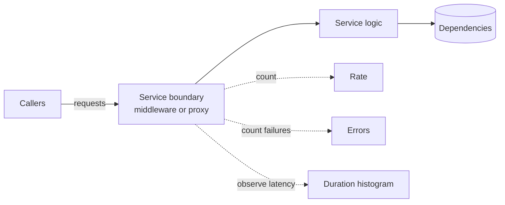
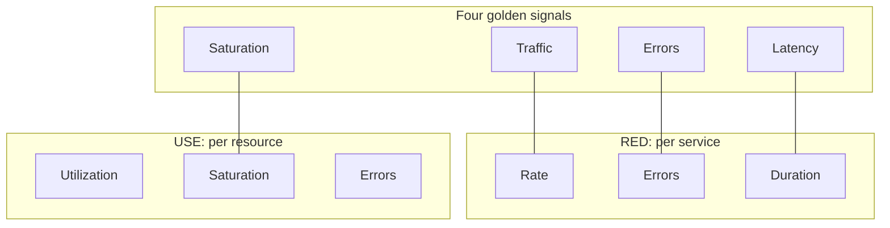
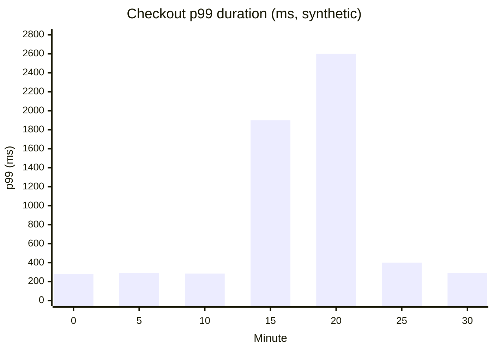
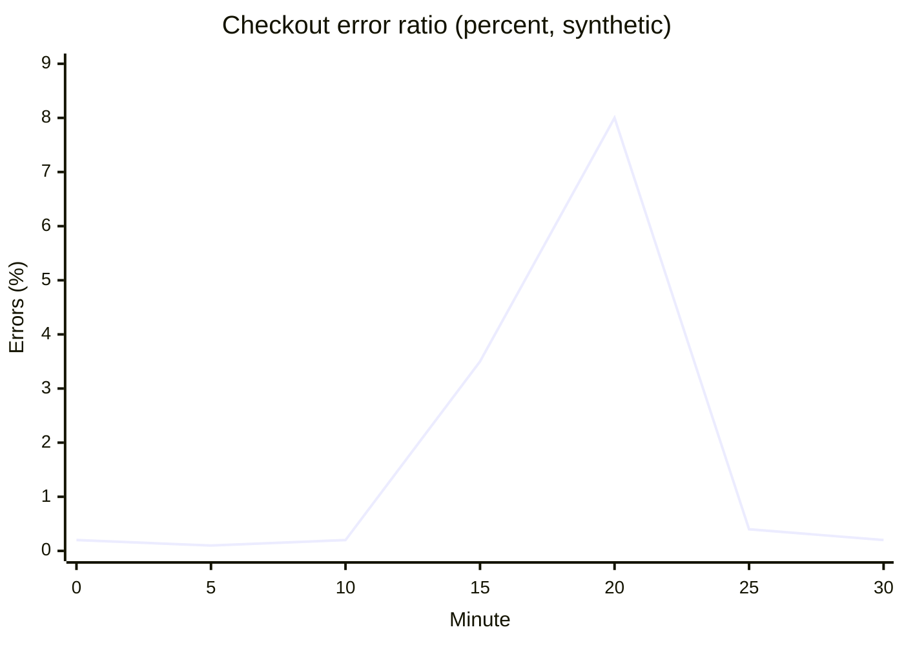

# RED method

## Summary

The RED method says that every request-driven service should be monitored with three metrics: the **R**ate of requests it serves, the **E**rrors among them, and the **D**uration (latency distribution) of those requests. Tom Wilkie formulated it around 2015 while running microservices at Weaveworks, as a service-level counterpart to Brendan Gregg's resource-level USE method. The three metrics describe what callers experience, they are the same for every service regardless of its language or purpose, and they map directly onto service level indicators. A consistent RED dashboard per service lets an on-call engineer see at a glance which service in a call chain is failing or slow, and makes alerts on user impact straightforward.

## Prerequisites

- [Monitoring](monitoring.md), in particular the golden signals and the section on alerting.
- [Observability overview](observability-overview.md) for metrics, logs and traces.
- [USE method](use-method.md), the resource-level counterpart.

## Core concepts

### The problem the method solves

In a system with dozens or hundreds of services, each team instruments its service differently: one exports queue sizes, another JVM heap, a third only logs. During an incident, nobody can compare services, and dashboards answer "how is my process doing" instead of "are my callers being served". RED fixes this by defining the same three metrics for every service, measured at the service boundary.

*Analogy.* A restaurant kitchen measured from the pass: how many dishes go out per hour (rate), how many come back to the kitchen (errors), and how long guests wait for their food (duration). These three numbers say whether the kitchen is doing its job without knowing anything about the ovens. The analogy breaks on causes: the pass does not show that the oven is overloaded; for that you need to look inside, at the resources (the USE method).

### Definitions

| Metric | Definition | Unit | Typical instrument |
| --- | --- | --- | --- |
| **Rate** | The number of requests the service handles per second | requests per second | Counter of requests, derived with `rate()` |
| **Errors** | The number of those requests that fail, per second (often shown as a ratio of the rate) | failed requests per second, or percent | Counter of requests with an error label |
| **Duration** | The distribution of the time each request takes | seconds | Histogram (not an average) |

Points that make the difference between a useful and a misleading RED dashboard:

- **Duration is a distribution.** Track percentiles (p50, p90, p99) or the full histogram, never only the mean. A mean of 120 ms can hide that 1 percent of users wait 4 seconds.
- **Separate successful and failed durations.** Failed requests are often very fast (an immediate 503) and pull latency down exactly when things are worst.
- **Define "error" deliberately.** Server errors (HTTP 5xx, gRPC `UNAVAILABLE`, `INTERNAL`) count against the service; client errors (HTTP 4xx) usually do not, except those that indicate a service fault (for example 429 when the service sheds load). Wrong content and timeouts seen by the caller are errors too, even if the server logged success.
- **Measure at the boundary.** Instrument where the request enters the service (HTTP server middleware, gRPC interceptor, ingress or service mesh proxy). Mesh proxies such as Envoy and Linkerd emit RED metrics without code changes.



The diagram shows where RED measures: at the boundary, from the caller's point of view, independent of what happens inside.

### Origin and relation to other methods

- **USE** (Brendan Gregg, 2012) examines *resources*: utilization, saturation and errors of CPUs, disks, pools ([USE method](use-method.md)).
- **The four golden signals** (Google SRE book, 2016) examine user-facing systems: latency, traffic, errors and saturation.
- **RED** takes three of the golden signals (traffic as rate, errors, latency as duration) and leaves out saturation, which is a resource property and belongs to USE. Tom Wilkie's argument was that a service owner needs a uniform, minimal set for every service, and that saturation is hard to define uniformly for services.



The diagram maps the three methods onto each other: RED covers the request side of the golden signals, USE covers saturation from the resource side.

### Instrumenting RED with Prometheus

A conventional instrumentation uses one counter and one histogram, labeled by service, route, method and status. The OpenTelemetry semantic conventions define the equivalent stable metric `http.server.request.duration` (a histogram in seconds, whose count also gives the rate), so a single histogram can serve all three metrics.

```text
# HELP http_server_requests_total Requests handled, by route and status code.
# TYPE http_server_requests_total counter
http_server_requests_total{service="checkout",route="/api/orders",method="POST",code="201"} 184213
http_server_requests_total{service="checkout",route="/api/orders",method="POST",code="503"} 312
# TYPE http_server_request_duration_seconds histogram
http_server_request_duration_seconds_bucket{service="checkout",route="/api/orders",le="0.1"} 120911
http_server_request_duration_seconds_bucket{service="checkout",route="/api/orders",le="0.25"} 171040
...
```

PromQL for the three panels (Prometheus 2.x and 3.x):

```promql
# Rate: requests per second per service
sum by (service) (rate(http_server_requests_total[5m]))

# Errors: share of requests that failed with a server error
sum by (service) (rate(http_server_requests_total{code=~"5.."}[5m]))
  /
sum by (service) (rate(http_server_requests_total[5m]))

# Duration: 99th percentile latency per service, from the histogram
histogram_quantile(0.99,
  sum by (service, le) (rate(http_server_request_duration_seconds_bucket[5m])))
```

Rules that keep the numbers correct:

- **Aggregate buckets, then compute quantiles.** Averaging p99 values of several instances is mathematically meaningless; sum the bucket rates across instances and apply `histogram_quantile` once, as above.
- **Choose bucket boundaries around your objectives.** If the latency objective is 300 ms, a bucket boundary at 0.3 makes the share of fast requests exact. Native histograms (Prometheus 2.40+, stable in 3.x) remove most of the bucket choice.
- **Keep label cardinality bounded.** Use route templates (`/api/orders/{id}`), never raw paths or user IDs as labels.

### Dashboards

The method's practical value is a dashboard that looks the same for every service. A common layout, used in Grafana's RED dashboards:

```text
+--------------------------------------------------------------+
| Service: checkout                                            |
+----------------------+----------------------+----------------+
| Rate (req/s)         | Errors (% of rate)   | Duration       |
| by route             | by route and code    | p50 p90 p99    |
+----------------------+----------------------+----------------+
| next row: each downstream dependency with the same 3 panels  |
+--------------------------------------------------------------+
```

One row per service and one row per important dependency, ordered along the request path, turns "something is slow" into "the checkout service is slow because its calls to the payments service are slow" in one glance. Exemplars (trace IDs attached to histogram samples) link a latency spike directly to a trace of a slow request.

### From RED to SLIs, SLOs and alerts

RED metrics are natural service level indicators (SLIs):

- **availability SLI** = 1 - errors / rate, measured over a window;
- **latency SLI** = share of requests faster than a threshold, from the histogram: `sum(rate(..._bucket{le="0.3"}[5m])) / sum(rate(..._count[5m]))`.

Service level objectives and error budgets built on them belong to [Site reliability engineering](../site-reliability-engineering/README.md). For alerting, alert on the error ratio and the latency SLI against the objective (ideally as burn-rate alerts), not on rate alone; rate is mainly a diagnostic signal (a sudden drop to zero is an outage that produces no errors).

### Beyond request and response services

RED fits synchronous request-driven services best. For other workloads, adapt the definitions:

| Workload | Rate | Errors | Duration |
| --- | --- | --- | --- |
| Message consumer | Messages processed per second | Messages failed or dead-lettered | Processing time per message, plus age of the oldest message (queue lag) |
| Batch job | Records or jobs per run | Failed records or failed runs | Run time, time since last success |
| Stream processor | Events per second | Events dropped or rejected | End-to-end event latency, consumer lag |

For queues, consumer lag is the saturation signal that RED lacks; add it explicitly.

## Worked example

A checkout service is monitored with RED. During a 30-minute window (synthetic data, one sample every 5 minutes), a downstream payment provider degrades at minute 15 and recovers at minute 25.

| Minute | 0 | 5 | 10 | 15 | 20 | 25 | 30 |
| --- | --- | --- | --- | --- | --- | --- | --- |
| Rate (req/s) | 120 | 125 | 118 | 122 | 95 | 119 | 121 |
| Error ratio (%) | 0.2 | 0.1 | 0.2 | 3.5 | 8.0 | 0.4 | 0.2 |
| p99 duration (ms) | 280 | 290 | 285 | 1900 | 2600 | 400 | 290 |





The two charts plot the duration and error rows of the table. Reading them as an on-call engineer:

1. Duration rises first and sharply (p99 from 285 ms to 1,900 ms): requests wait for something.
2. Errors follow: timeouts to the provider turn into 5xx responses.
3. Rate drops at minute 20: clients give up or retry less, which is why rate alone is a poor alert signal.
4. The dependency row of the RED dashboard (calls from checkout to payments) shows the same spike, pointing at the provider rather than at checkout's own resources; a USE check of the checkout hosts confirms CPU, memory and pools are fine.

An alert defined as "error ratio above 1 percent for 5 minutes, or less than 99 percent of requests under 500 ms" would have paged at about minute 15 to 20.

## Trade offs and when to use it

- **Strengths.** Uniform across services, cheap to instrument (middleware or mesh), close to user experience, the basis for SLOs.
- **Limits.** It describes symptoms, not causes; it omits saturation; it does not suit batch and streaming workloads without adaptation; it says nothing about correctness of responses unless errors are defined to include wrong results.
- **Alternatives and complements.** The four golden signals add saturation; USE explains resource causes; distributed tracing explains where time goes inside a request chain.
- **When to use it.** Every request-driven service, as the default dashboard and the source of SLIs.

## Common mistakes

- **Average latency instead of percentiles.** Fix: histograms and p50, p90, p99.
- **Averaging percentiles across instances.** Fix: aggregate buckets, then compute the quantile.
- **Counting 4xx as service errors** (or ignoring 5xx produced by a proxy in front of the service). Fix: define errors from the caller's point of view and measure at the boundary.
- **Alerting on rate.** Traffic varies by hour and day. Fix: alert on error ratio and latency SLI; use rate for diagnosis and for "traffic dropped to zero" alerts with care.
- **Unbounded labels** (raw URLs, user IDs). Fix: route templates.
- **Mixing fast failures into duration.** Fix: label duration by outcome or plot successful requests separately.

## Practice

1. What does each letter of RED stand for, and what is the right metric type for each?
2. Why is the mean a bad duration metric?
3. Which of the four golden signals does RED leave out, and why?
4. Write a PromQL expression for the 95th percentile duration of the `orders` service.
5. How would you adapt RED for a message queue consumer?

Answers:

1. Rate (counter, derived per second), Errors (counter of failed requests, often as a ratio), Duration (histogram of request latency).
2. It hides the tail: a small share of very slow requests barely moves the mean but is what affected users experience; fast failures also pull it down.
3. Saturation, because it is a property of resources, not of requests, and is hard to define uniformly per service; it belongs to the USE method.
4. `histogram_quantile(0.95, sum by (le) (rate(http_server_request_duration_seconds_bucket{service="orders"}[5m])))`.
5. Rate as messages processed per second, errors as failed or dead-lettered messages, duration as processing time per message, and add consumer lag or age of the oldest message as saturation.

## Further reading

- [The RED Method: key metrics for microservices architecture](https://www.weave.works/blog/the-red-method-key-metrics-for-microservices-architecture/) (Tom Wilkie, Weaveworks, 2018; Weaveworks closed in 2024, so the page may only be available through archives).
- [The RED Method: How to Instrument Your Services](https://grafana.com/blog/2018/08/02/the-red-method-how-to-instrument-your-services/) (Tom Wilkie, Grafana Labs, 2018).
- [Monitoring Distributed Systems](https://sre.google/sre-book/monitoring-distributed-systems/) (Google SRE book, chapter 6, 2016): the four golden signals.
- [Histograms and summaries](https://prometheus.io/docs/practices/histograms/) (Prometheus documentation): quantile calculation and aggregation.
- [Semantic conventions for HTTP metrics](https://opentelemetry.io/docs/specs/semconv/http/http-metrics/) (OpenTelemetry).
