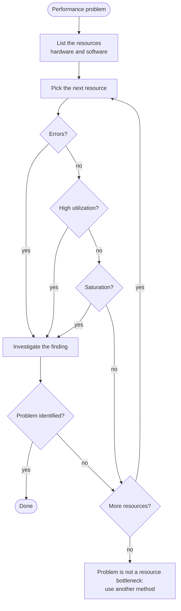
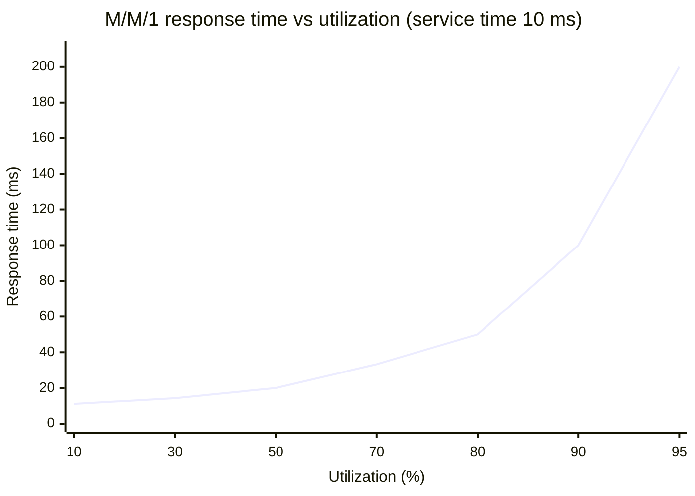

# USE method

## Summary

The USE method is a checklist for finding resource bottlenecks quickly: for every resource in a system, check its **U**tilization, **S**aturation and **E**rrors. Brendan Gregg published it in 2012 as a way to replace guesswork during performance investigations with a short, complete sweep of the hardware and software resources a workload depends on: CPUs, memory, disks, network interfaces, but also thread pools, connection pools, file descriptors and locks. Utilization says how busy a resource is, saturation says how much work is waiting because the resource is busy, and errors say whether it is failing. Applied systematically, USE finds most resource problems in minutes and, just as useful, rules out the resources that are fine. It complements the RED method, which looks at services from the outside.

## Prerequisites

- [Monitoring](monitoring.md), in particular the section on the golden signals, USE and RED.
- [CPU usage](../operating-systems/process-management/cpu-usage.md), [Memory management](../operating-systems/memory-management/memory-management.md) and [I/O management](../operating-systems/storage-and-io/io-management.md) for the Linux metrics used below.

## Core concepts

### The problem the method solves

Performance investigations often go wrong because people look where it is easy to look, not where the problem is. Brendan Gregg names these habits *anti-methods*:

- **Streetlight anti-method**: checking the tools you happen to know (`top`, a favorite dashboard) and concluding nothing is wrong, like the drunk who searches for his keys under the streetlight because the light is better there.
- **Random change anti-method**: changing settings until the problem seems to go away, which wastes time and leaves unexplained changes behind.
- **Blame-someone-else anti-method**: declaring that the problem is in the network, the database or the other team's service, without evidence.

The USE method replaces these with a short, ordered checklist that covers every resource. It does not need deep knowledge of each component to start; it tells you *which* component deserves deep analysis.

*Analogy.* A doctor's routine check: pulse, blood pressure, temperature, for every patient, before any specialist examination. The routine does not diagnose rare diseases, but it quickly shows whether something is out of range and where to look next. The analogy breaks on coverage: a doctor measures a few vital signs of one body, while USE asks for three measurements of *every* resource, including software resources that have no obvious "vital signs" and must be instrumented first.

### Definitions

Gregg's definitions, as published in 2012:

| Term | Definition | Typical form |
| --- | --- | --- |
| **Resource** | All physical server functional components (CPUs, disks, buses, ...) and, by extension, software resources with a limited capacity | CPU, memory, disk, NIC, mutex, thread pool |
| **Utilization** | The average time that the resource was busy servicing work, or for capacity resources the proportion of the capacity that is used | Percent busy over an interval |
| **Saturation** | The degree to which the resource has extra work that it cannot service, often queued | Queue length, wait time, pressure |
| **Errors** | The count of error events | Error counters, error rate |

Two kinds of utilization exist:

- **Time-based utilization** (busy percent) for resources that service one request at a time or in parallel lanes: a CPU, a disk, a network link. At 100 percent the resource is busy all the time.
- **Capacity-based utilization** for resources with a size: memory, a file system, a connection pool. At 100 percent the resource cannot accept more, and requests fail or wait.

A resource can be at 100 percent utilization without problems if nothing waits for it; saturation is what turns utilization into latency. A resource with any saturation is a candidate bottleneck, and errors deserve investigation even when they look harmless, because retries silently consume capacity.

### The procedure



The flowchart is the procedure from the original article: iterate over resources, check errors first because they are usually quick to interpret, then utilization and saturation, and stop when a finding explains the problem.

1. **Draw a functional diagram** of the system and list its resources. On a single server: CPUs, memory, network interfaces, storage devices, storage controllers, interconnects (buses, links between CPU sockets). Add software resources: thread pools, process and file descriptor limits, connection pools, locks.
2. **For each resource, find the three metrics.** Some will be easy (CPU utilization), some hard (bus saturation). Write down where each metric comes from; a missing metric is a *known unknown*, which is itself a useful finding.
3. **Interpret** each metric against what is normal: high utilization, any sustained saturation, any errors.
4. **Investigate** the resources with findings, using deeper tools (profilers, tracing).
5. **If nothing is found**, the problem is probably not a resource bottleneck: switch to latency analysis, workload characterization or the RED method on the services.

### Utilization, queueing and why 70 percent is not 100 percent

Saturation and latency do not grow linearly with utilization. A simple single-server queue (the M/M/1 model from queueing theory) shows why: with a service time `S` and utilization `U`, the average response time is

```text
R = S / (1 - U)
```

With `S` = 10 ms the response time is:

| Utilization | 10 % | 30 % | 50 % | 70 % | 80 % | 90 % | 95 % |
| --- | --- | --- | --- | --- | --- | --- | --- |
| Response time (ms) | 11.1 | 14.3 | 20.0 | 33.3 | 50.0 | 100.0 | 200.0 |



The chart plots the table: up to about 70 percent, response time grows slowly; beyond 80 percent it explodes. Real systems are not M/M/1 queues (arrivals are burstier, many resources have several servers), so the exact numbers differ, but the knee is real. This is why capacity planning targets utilization well below 100 percent, and why saturation (the queue) is the metric that predicts user-visible latency.

Two more traps:

- **Averages hide bursts.** A disk at 60 percent utilization over one minute may have been at 100 percent for 30 seconds and idle for 30. Use short intervals (1 second) when investigating, and look at saturation, which captures the queueing during the burst.
- **Utilization of a multi-lane resource.** Eight CPUs at 50 percent average can mean four CPUs at 100 percent (a single-threaded bottleneck per core) and four idle. Check per-CPU utilization (`mpstat -P ALL`).

### Linux checklist

The table is a condensed version of Gregg's Linux checklist for physical resources, with the Prometheus node_exporter metrics that expose the same data. Commands are from procps, sysstat and iproute2 (checked on Ubuntu 24.04 and RHEL 9, 2026-11); node_exporter metric names are from node_exporter 1.x.

| Resource | Type | Command line | Prometheus (node_exporter) |
| --- | --- | --- | --- |
| CPU | Utilization | `mpstat -P ALL 1` (per CPU `%idle`), `vmstat 1` (`us` + `sy`) | `1 - avg by (instance) (rate(node_cpu_seconds_total{mode="idle"}[5m]))` |
| CPU | Saturation | `vmstat 1` (`r` greater than the number of CPUs), load average, `/proc/pressure/cpu` | `node_load1 / count by (instance) (node_cpu_seconds_total{mode="idle"})`, `rate(node_pressure_cpu_waiting_seconds_total[5m])` |
| CPU | Errors | `dmesg` (machine check exceptions), `perf` for CPU error events | `node_edac_*` (where EDAC is available) |
| Memory | Utilization | `free -m` (`available`), `vmstat 1` | `1 - node_memory_MemAvailable_bytes / node_memory_MemTotal_bytes` |
| Memory | Saturation | `vmstat 1` (`si`, `so` swapping), `/proc/pressure/memory`, OOM killer in `dmesg` | `rate(node_vmstat_pswpin[5m])`, `rate(node_vmstat_oom_kill[5m])`, `rate(node_pressure_memory_waiting_seconds_total[5m])` |
| Memory | Errors | `dmesg` (ECC errors), `edac-util` | `node_edac_correctable_errors_total`, `node_edac_uncorrectable_errors_total` |
| Network interface | Utilization | `sar -n DEV 1` (`rxkB/s`, `txkB/s` against link speed), `ip -s link` | `rate(node_network_receive_bytes_total[5m]) * 8 / (node_network_speed_bytes * 8)` |
| Network interface | Saturation | `ip -s link` (dropped, overruns), `nstat` (TCP retransmits), `ss -tin` | `rate(node_network_receive_drop_total[5m])`, `rate(node_netstat_Tcp_RetransSegs[5m])` |
| Network interface | Errors | `ip -s link` (errors), `ethtool -S eth0` | `rate(node_network_receive_errs_total[5m])`, `rate(node_network_transmit_errs_total[5m])` |
| Storage device | Utilization | `iostat -xz 1` (`%util`) | `rate(node_disk_io_time_seconds_total[5m])` |
| Storage device | Saturation | `iostat -xz 1` (`aqu-sz` above 1, rising `r_await`, `w_await`), `/proc/pressure/io` | `rate(node_disk_io_time_weighted_seconds_total[5m])`, `rate(node_pressure_io_waiting_seconds_total[5m])` |
| Storage device | Errors | `dmesg`, `smartctl -a /dev/sda`, `/sys/block/*/device/ioerr_cnt` | smartctl_exporter metrics |
| Storage capacity | Utilization | `df -h`, `df -i` (inodes) | `1 - node_filesystem_avail_bytes / node_filesystem_size_bytes` |
| Storage capacity | Saturation | Not applicable in the time sense; a full file system returns errors | none |
| Storage capacity | Errors | `ENOSPC` errors in application logs, `dmesg` | application metrics |

Notes on interpretation:

- `%util` of modern SSDs and RAID volumes is misleading: these devices serve many requests in parallel, so a device can report 100 percent busy time and still have spare capacity. Prefer saturation (`aqu-sz`, await) for them.
- Pressure stall information (PSI, `/proc/pressure/*`, Linux 4.20+) is a direct saturation metric: the share of time in which some (or all) tasks were stalled waiting for CPU, memory or I/O. It is the best single saturation signal on modern kernels.
- In containers, check the cgroup limits too: CPU throttling (`nr_throttled` and `throttled_usec` in `cpu.stat`, `container_cpu_cfs_throttled_periods_total` in cAdvisor) is saturation of the CPU quota even when the host CPUs are idle.

### Software resources

The method applies to anything with a limited capacity:

| Software resource | Utilization | Saturation | Errors |
| --- | --- | --- | --- |
| Thread pool or worker pool | Busy workers / pool size | Requests queued for a worker | Rejected tasks |
| Connection pool (database, HTTP) | Connections in use / maximum | Time waiting for a connection | Pool timeouts |
| File descriptors | Open descriptors / `ulimit -n` | (none, failure is immediate) | `EMFILE` errors |
| Process or thread limit | Tasks / `pids.max` or `kernel.pid_max` | (none) | `EAGAIN` from `fork` |
| Mutex lock | Time held | Threads waiting for the lock | Deadlock detections |
| Kubernetes resource quota | Requests / quota | Pods pending for capacity | Admission rejections |

Instrumenting these is the work that makes USE most valuable: hardware metrics are usually available, but an exhausted connection pool often hides behind "the database is slow".

### USE compared with RED and the golden signals

| Method | Perspective | Question | Best for |
| --- | --- | --- | --- |
| USE | Inside, per resource | Is any resource a bottleneck or failing? | Hosts, nodes, databases, infrastructure |
| RED | Outside, per service | Is the service doing its job for callers? | Request-driven services, microservices |
| Four golden signals | Outside, per user-facing system | Latency, traffic, errors, saturation | User-facing systems (Google SRE) |

The methods meet at saturation and errors: RED tells you which service is slow, USE tells you which resource under it is the cause ([RED method](red-method.md)).

## Worked example

A web API on one Linux VM (4 vCPU, 8 GB memory, one network-attached SSD) has slow responses since a release. The USE sweep, with 1-second samples (output shortened, values illustrative; commands checked on Ubuntu 24.04 with sysstat 12.6, 2026-11):

```bash
uptime                 # load average: 7.91, 7.40, 5.12
vmstat 1 5             # r: 7-9 runnable, us: 48, sy: 4, wa: 35, si/so: 0
mpstat -P ALL 1 3      # %idle per CPU: 50, 48, 53, 49
iostat -xz 1 3         # nvme1n1: r/s 2900, r_await 18.4 ms, aqu-sz 31.0, %util 99.8
free -m                # available 5100 of 7900
sar -n DEV 1 3         # eth0: rxkB/s 9800 on a 10 Gbit/s link
ip -s link show eth0   # errors 0, dropped 0
cat /proc/pressure/io  # some avg10=61.20
```

| Resource | Utilization | Saturation | Errors | Finding |
| --- | --- | --- | --- | --- |
| CPU | about 50 % | load 7.9 on 4 CPUs, but `wa` 35 % | none | Runnable count is inflated by I/O wait on Linux; not the bottleneck |
| Memory | 35 % | no swapping | none | Fine |
| Network | under 1 % of link | no drops | none | Fine |
| Disk | 99.8 % busy | `aqu-sz` 31, await 18 ms, PSI io 61 % | none | **Saturated** |

The sweep points at the disk within a minute. The next step is deeper analysis of *who* issues the reads (`pidstat -d 1`, `biotop` from bcc), which in this example shows the new release dropped an index and turned lookups into table scans. Note the false lead: the Linux load average counts tasks in uninterruptible I/O sleep, so a high load average alone suggested a CPU problem.

## Trade offs and when to use it

- **Strengths.** Fast, complete, teachable; works without knowing the application; finds known unknowns (resources you cannot measure yet).
- **Limits.** It finds resource bottlenecks only. Problems in application logic, lock design that is not instrumented, or downstream dependencies show up only indirectly. Combine it with latency analysis and RED.
- **Cost.** Building the full per-resource checklist (including software resources and container limits) for your platform takes effort, but it is reusable and becomes a dashboard.
- **When to use it.** First pass in an incident on a host, node or database; regular capacity reviews; building an infrastructure dashboard (one row per resource, three columns).

## Common mistakes

- **Reading the load average as CPU saturation on Linux.** It includes tasks waiting for disk I/O. Fix: use `vmstat` `r`, per-CPU utilization and PSI.
- **Trusting `%util` on SSDs and arrays.** Fix: look at queue length and latency.
- **Averaging over long intervals** and missing bursts. Fix: 1-second samples during investigations, histograms or maximums in dashboards.
- **Checking utilization only.** A resource at 60 percent with a long queue is a problem; one at 100 percent without a queue may not be. Fix: always check all three metrics.
- **Ignoring container limits.** Fix: check cgroup throttling and memory limits, not only host metrics.
- **Skipping software resources.** Fix: instrument pools, limits and locks.

## Practice

1. Define utilization and saturation, and explain why saturation is the better predictor of latency.
2. In the M/M/1 model with a service time of 10 ms, what is the response time at 80 percent and at 90 percent utilization?
3. Why can the Linux load average be high when the CPUs are half idle?
4. What are the three USE metrics for a database connection pool?
5. A container's application is slow, and the host CPU is at 30 percent. Which USE metric would you check first?

Answers:

1. Utilization is the share of time a resource was busy (or the share of its capacity used); saturation is the amount of work waiting because the resource is busy. Waiting work directly adds latency, while high utilization alone does not.
2. 10 / (1 - 0.8) = 50 ms and 10 / (1 - 0.9) = 100 ms.
3. On Linux it counts tasks in uninterruptible sleep, typically waiting for disk I/O, in addition to runnable tasks.
4. Utilization: connections in use divided by the maximum; saturation: time or number of requests waiting for a connection; errors: acquisition timeouts.
5. Saturation of the container's CPU quota: cgroup CPU throttling.

## Further reading

- [The USE Method](https://www.brendangregg.com/usemethod.html) (Brendan Gregg, 2012): the original description with the procedure and links to checklists.
- [USE Method: Linux Performance Checklist](https://www.brendangregg.com/USEmethod/use-linux.html) (Brendan Gregg): the full per-resource command list.
- [Thinking Methodically about Performance](https://queue.acm.org/detail.cfm?id=2413037) (Brendan Gregg, ACM Queue, 2012): the article that introduced USE and the anti-methods.
- *Systems Performance: Enterprise and the Cloud*, 2nd edition (Brendan Gregg, Addison-Wesley, 2020): methodologies, queueing theory and Linux tools in depth.
- [Linux Performance Analysis in 60,000 Milliseconds](https://netflixtechblog.com/linux-performance-analysis-in-60-000-milliseconds-accc10403c55) (Netflix Technology Blog, 2015): a ten-command first sweep based on USE.
- [Pressure Stall Information](https://docs.kernel.org/accounting/psi.html) (Linux kernel documentation).
