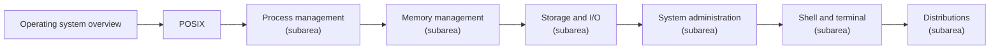

# Operating systems

Operating system concepts and Linux administration: what the kernel manages, processes and threads, memory, storage and I/O, permissions, boot and services, the shell, and the major distributions. Subareas follow the classic textbook division (process, memory, storage and I/O management, protection) plus administration topics.

## Map of the area

The diagram shows the notes in reading order; subareas are marked with (subarea).

## Notes in reading order

1. [Operating system overview](operating-system-overview.md): definition, responsibilities, architecture, generations and types of operating systems.
2. [POSIX](posix.md): the portable interface standard behind Unix-like systems, its C API, shell, locales and regular expressions.
3. [Process management](process-management/README.md): processes, threads, process monitoring, CPU usage and Unix sockets.
4. [Memory management](memory-management/README.md): allocation, virtual memory, paging, segmentation, swapping and fragmentation.
5. [Storage and I/O](storage-and-io/README.md): file systems, file descriptors and I/O management.
6. [System administration](system-administration/README.md): boot and startup with systemd, and permissions.
7. [Shell and terminal](shell-and-terminal/README.md): the terminal toolbox and Bash.
8. [Distributions](distributions/README.md): Debian and Ubuntu, RHEL, SUSE and FreeBSD compared.

## Planned topics

- Kernel architecture and system calls in depth
- Linux namespaces and cgroups (container foundations)
- Performance analysis methodology
