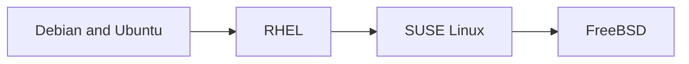

# Distributions

Linux distributions and BSD compared: package managers, defaults, release models and administration differences.

| Aspect | Debian and Ubuntu | RHEL family | SUSE | FreeBSD |
| --- | --- | --- | --- | --- |
| Packages | `.deb`, `apt` | `.rpm`, `dnf` | `.rpm`, `zypper` | `pkg`, ports |
| Default file system | ext4 | XFS | Btrfs root, XFS data | UFS or ZFS |
| Mandatory access control | AppArmor | SELinux | AppArmor (SELinux in newer releases) | MAC framework, Capsicum |
| Auth log | `/var/log/auth.log` | `/var/log/secure` | journal | `/var/log/auth.log` |
| Init | systemd | systemd | systemd | rc.d |

## Map

The diagram shows the notes in reading order; subareas are marked with (subarea).

## Notes in reading order

1. [Debian and Ubuntu](debian-and-ubuntu.md): APT, release model, defaults and administration.
2. [RHEL](rhel.md): dnf, BaseOS and AppStream, SELinux, rebuilds such as AlmaLinux and Rocky Linux.
3. [SUSE Linux](suse-linux.md): SLE, openSUSE Leap and Tumbleweed, zypper, Btrfs snapshots.
4. [FreeBSD](freebsd.md): base system, pkg and ports, jails, ZFS.

## Planned topics

- Alpine Linux and minimal container images
- Fedora and CentOS Stream
- Arch Linux
- Choosing a distribution for servers and containers
