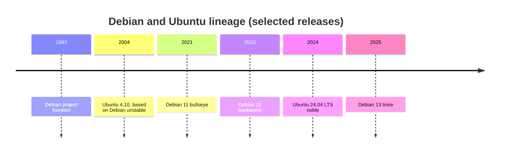

# Debian and Ubuntu

## Summary

Debian is a community-built Linux distribution, first released in 1993, known for stability, a strict commitment to free software and the `.deb` package format with the APT package manager. Ubuntu, released by Canonical in 2004, is a Debian derivative aimed at ease of use, with predictable releases every six months, a long-term support (LTS) release every two years and commercial support. Together they form the most widespread Linux family on cloud servers and in container base images. Administration is the same at the core: `apt` for packages, `adduser` for users, systemd for services, ext4 by default, logs in the journal and `/var/log`.

## Prerequisites

- [Operating system overview](../operating-system-overview.md), [Terminal](../shell-and-terminal/terminal.md) and [Permissions](../system-administration/permissions.md).

## Core concepts

### Debian and Ubuntu compared

| Aspect | Debian | Ubuntu |
| --- | --- | --- |
| Governance | Community project with a social contract and elected leader | Canonical Ltd. with community contributors |
| Target users | Administrators, developers and users who prioritize stability, reliability and free software | Desktop users, developers and businesses who want ease of use and optional professional support |
| Release model | Branches: stable, testing, unstable (sid); a new stable roughly every two years | Every six months; LTS every two years (April of even years) with 5 years of standard support, extendable with Ubuntu Pro |
| Repositories | `main`, `contrib`, `non-free`, `non-free-firmware` | `main` (Canonical-supported), `universe` (community-maintained), `restricted` (proprietary drivers), `multiverse` (software restricted by copyright or legal issues) |
| Extras | Very conservative package versions | `snap` packages, Ubuntu Pro (livepatch, extended security), App Center (formerly Ubuntu Software Center), cloud-init origin |

*Analogy.* Debian is the reference recipe book maintained by a cooks' association; Ubuntu is a restaurant chain that takes those recipes, adds its own dishes, opens on a fixed schedule and sells a support contract. The analogy breaks because Ubuntu also sends many improvements back to Debian.



### Command line

- **Shell.** Bash is the default interactive login shell; `/bin/sh` is dash, a smaller POSIX shell used for scripts.
- **Common commands.** Navigation `cd`, `ls`, `pwd`; files `cp`, `mv`, `rm`, `touch`, `cat`; directories `mkdir`, `rmdir`; monitoring `top`, `htop`, `ps`, `df`, `du`; network `ip` and `ss` (the older `ifconfig` and `netstat` from net-tools are no longer installed by default), `ping`, `ssh`; editors `nano`, `vi`, `vim`; packages `apt`, `apt-get`.

### User management

| Task | Command |
| --- | --- |
| Add a user (interactive, creates home) | `adduser username` (Debian's friendly wrapper around `useradd`) |
| Remove a user | `deluser username` (`--remove-home` to delete the home) |
| Modify a user | `usermod` |
| Change a password | `passwd` |
| Add a group | `addgroup groupname` |
| Add a user to a group | `usermod -aG groupname username` (or `adduser username groupname`) |
| Remove a user from a group | `deluser username groupname` |
| User information | `id`, `whoami`, `groups` |

Administrators get root rights through `sudo`; on Ubuntu the root account is locked by default and the first user is in the `sudo` group.

### Permissions and processes

Standard Linux permissions (read, write, execute for owner, group and others) with `chmod` (symbolic `chmod u+x file`, numeric `chmod 755 file`), `chown user file`, `chown :group file` and `ls -l`. See [Permissions](../system-administration/permissions.md). AppArmor is the mandatory access control system enabled by default.

Processes: view with `ps`, `top`, `htop`; start in the background with `command &`; `fg` and `bg` for job control; `kill`, `killall`, `pkill` to signal; `nice`, `renice` for priority. See [Processes](../process-management/processes.md).

### Package management

APT (Advanced Package Tool) works with `.deb` packages and repositories defined in `/etc/apt/sources.list` or, in newer releases, `.sources` files in `/etc/apt/sources.list.d/`.

| Task | Command |
| --- | --- |
| Update the package list | `sudo apt update` |
| Upgrade installed packages | `sudo apt upgrade` (`full-upgrade` also removes packages if needed) |
| Install | `sudo apt install package-name` |
| Remove | `sudo apt remove package-name` (`purge` also removes configuration) |
| Search | `apt search package-name` |
| Clean up | `sudo apt autoremove`, `sudo apt clean` |
| Low level | `dpkg -i file.deb`, `dpkg -L package`, `dpkg -S /path/file` |

`apt` is the interactive front end; `apt-get` has a stable interface for scripts. `unattended-upgrades` installs security updates automatically.

### Devices and file systems

- Device files in `/dev`: block devices `/dev/sda`, `/dev/sdb`, `/dev/nvme0n1`; character devices `/dev/tty`, `/dev/null`.
- Device tools: `lsblk`, `blkid`, `fdisk`, `mkfs`; mounting with `mount`, `umount`; persistent mounts in `/etc/fstab`.
- Default file system: ext4. Others supported: ext3, ext2, XFS, Btrfs, and ZFS (Ubuntu ships ZFS modules; Debian provides them through DKMS in `contrib`).
- Management: `mkfs` to create, `fsck` to check, `resize2fs` to resize ext file systems, `mount` and `umount`.

### Kernel

- Monolithic, modular Linux kernel. Version with `uname -r`; modules with `lsmod`, `modprobe`, `insmod`, `rmmod`.
- Kernel updates come as packages through `apt`.
- Boot configuration: GRUB in `/boot/grub/grub.cfg`, generated by `update-grub` from `/etc/default/grub`; kernels and initramfs images in `/boot`.

### Logging

- Logs in `/var/log`: system logs `/var/log/syslog`, authentication `/var/log/auth.log`, kernel `/var/log/kern.log` (written by rsyslog; Debian 12 and later no longer install rsyslog by default, so only the systemd journal exists unless rsyslog is added). `/var/log/messages` is the Red Hat-style name and is not used by default here.
- Tools: `journalctl`, `dmesg`; rotation with `logrotate`.

### Default applications (desktop)

Editors `nano`, `vim`, `gedit` (GNOME Text Editor in newer releases); browsers Firefox (a snap on Ubuntu) and Chromium; email Thunderbird; office LibreOffice; file managers Nautilus (GNOME) and Dolphin (KDE).

### Why use them

Debian: stability and reliability, long release cycles with stable, testing and unstable branches, strong community involvement, free software principles.

Ubuntu: ease of use, regular six-month releases with LTS every two years, backing by Canonical, additional tools such as snap packages and the App Center, and the most common default image in public clouds.

## Worked example

Prepare a fresh Ubuntu 24.04 server: updates, an admin user, automatic security updates and a firewall. Untested; Ubuntu 24.04 LTS, checked 2026-11.

```bash
sudo apt update && sudo apt full-upgrade -y
sudo adduser deploy                       # interactive: password, full name
sudo usermod -aG sudo deploy
sudo apt install -y unattended-upgrades ufw
sudo dpkg-reconfigure -plow unattended-upgrades   # enable automatic security updates
sudo ufw allow OpenSSH
sudo ufw enable
lsb_release -a; uname -r                  # distribution release and kernel version
journalctl -u ssh --since today           # the unit is "ssh" on Debian and Ubuntu, "sshd" on RHEL
```

## Trade offs and when to use it

- **Debian stable** for servers that must change as little as possible; older package versions are the price.
- **Ubuntu LTS** for broad hardware and cloud support, newer kernels and commercial support options.
- **Debian slim images** for containers when size and minimal attack surface matter; Ubuntu images when matching the host distribution matters.

## Common mistakes

- **Mixing Debian and Ubuntu repositories** ("FrankenDebian"). Dependency breakage. Fix: only official repositories for your release.
- **`apt upgrade` across major releases.** Fix: `do-release-upgrade` on Ubuntu, documented release upgrade steps on Debian.
- **Expecting `/var/log/syslog` on Debian 12.** Fix: `journalctl`, or install rsyslog.

## Practice

1. Which Ubuntu repository holds community-maintained software?
2. What is the difference between `apt remove` and `apt purge`?
3. Which shell is `/bin/sh` on Debian and Ubuntu, and why does it matter?

Answers:

1. `universe`.
2. `purge` also deletes the package's configuration files.
3. dash; scripts with `#!/bin/sh` that use Bash features fail.

## Further reading

- [Debian Administrator's Handbook](https://debian-handbook.info/) (Raphaël Hertzog, Roland Mas): Debian administration in depth.
- [Debian releases](https://www.debian.org/releases/) (Debian project): branches and support periods.
- [Ubuntu release cycle](https://ubuntu.com/about/release-cycle) (Canonical): LTS and interim releases.
- [Ubuntu Server documentation](https://documentation.ubuntu.com/server/) (Canonical).
