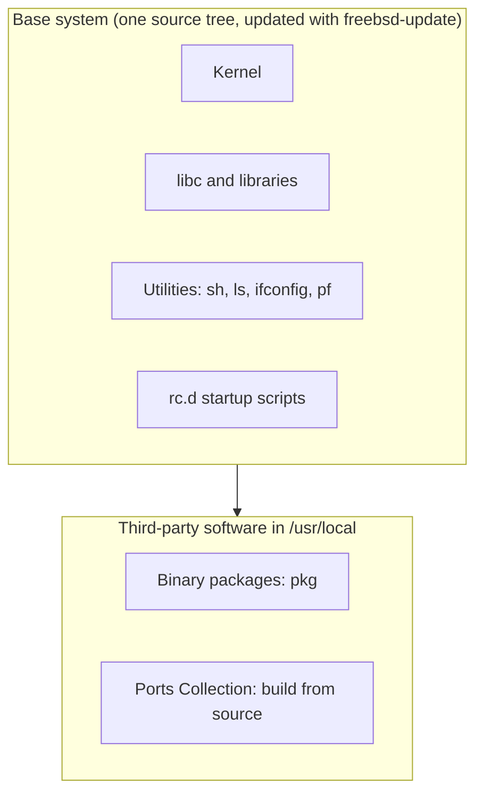

# FreeBSD

## Summary

FreeBSD is a complete Unix-like operating system descended from the Berkeley Software Distribution (BSD), developed since 1993. Unlike Linux distributions, which assemble a kernel and separate user-space projects, FreeBSD develops the kernel and the base system (libraries, utilities, compiler toolchain) together as one coherent system, and adds third-party software through binary packages (`pkg`) and the Ports Collection. It is known for performance, an advanced network stack, native ZFS, jails for OS-level virtualization, excellent documentation (the Handbook) and the permissive BSD license, which allows proprietary use without sharing changes. Netflix's content delivery appliances and the operating systems of products such as Sony's PlayStation consoles build on it.

## Prerequisites

- [Operating system overview](../operating-system-overview.md), [POSIX](../posix.md).

## Core concepts

### Target users and license

FreeBSD targets administrators, network engineers and developers who need a high-performance, secure and flexible OS for servers and embedded systems, and organizations that need a permissive license for proprietary products. The BSD license (two-clause) permits modification and redistribution in closed products; the GPL used by the Linux kernel requires sharing source of distributed modifications.

*Analogy.* A Linux distribution is a car assembled from parts by many manufacturers; FreeBSD is a car built by one factory, engine and chassis designed together, with optional accessories bought separately (packages). The analogy breaks because FreeBSD also uses many external components, such as the LLVM compiler and OpenSSH, imported into its base.



### Command line and users

- **Shell**: `sh` is the default for users and, since FreeBSD 14, also for root (earlier releases used `tcsh` for root). Bash is an optional package installed in `/usr/local/bin/bash`.
- **Common commands**: `cd`, `ls`, `pwd`, `cp`, `mv`, `rm`, `touch`, `cat`, `mkdir`, `rmdir`, `top`, `ps`, `df`, `du`; networking with `ifconfig` (the native, current tool on BSD), `ping`, `netstat`, `sockstat`, `ssh`; editors `ee` (easy editor), `vi`; `vim` from packages.
- **Users** with `pw`: `pw useradd username -m`, `pw userdel username`, `pw usermod username`, `passwd`; groups `pw groupadd groupname`, add a member with `pw groupmod groupname -m username`, remove a member with `pw groupmod groupname -d username` (`pw groupdel groupname` deletes the group); `id`, `whoami`, `groups`. The interactive `adduser` script also exists. Administrators use `su` with the `wheel` group, or install `sudo` or `doas`.

### Permissions and processes

Standard Unix permissions (`chmod u+x`, `chmod 755`, `chown user file`, `chown :group file`, `ls -l`), plus file flags (`chflags schg` for immutable files) and securelevels. Processes: `ps`, `top`, `command &`, `fg`, `bg`, `kill`, `killall`, `pkill`, `nice`, `renice`, `procstat`.

### Package management

`pkg` manages binary packages (run as root; `sudo` is not part of the base system):

| Task | Command |
| --- | --- |
| Update the catalog | `pkg update` |
| Upgrade packages | `pkg upgrade` |
| Install | `pkg install package-name` |
| Remove | `pkg delete package-name` (`remove` is an alias) |
| Search | `pkg search package-name` |
| Clean the cache | `pkg clean` |
| Check for vulnerabilities | `pkg audit -F` |

The **Ports Collection** builds software from source with custom options: the tree in `/usr/ports` is updated with Git (`git clone https://git.FreeBSD.org/ports.git /usr/ports`; the older `portsnap fetch update` was removed in FreeBSD 14), then `make install clean` in a port directory such as `/usr/ports/www/nginx`. The base system is updated separately with `freebsd-update fetch install`.

### Devices and file systems

- Devices in `/dev` managed by devfs: disks `/dev/ada0` (SATA), `/dev/da0` (SCSI and USB), `/dev/nvd0` or `/dev/nda0` (NVMe); `/dev/tty`, `/dev/null`. FreeBSD has no block device nodes in the Linux sense; disks are character devices accessed through the GEOM framework.
- Tools: `camcontrol`, `geom`, `gpart` (partitioning), `devinfo` and `pciconf` for hardware; mounts with `mount`, `umount` and `/etc/fstab`.
- File systems: UFS2 (Unix File System) or ZFS as the default at installation; others: ext2, ext3 and ext4 (native `ext2fs` driver), NTFS through FUSE, MSDOSFS (FAT).
- Management: `newfs` (UFS), `zpool create` and `zfs create` (ZFS), `fsck` and `zpool scrub`, `growfs` (UFS), and for ZFS `zfs set quota=` or `zpool online -e` to expand.

### Kernel

- A monolithic kernel with loadable modules: `uname -r`, `kldstat`, `kldload`, `kldunload`.
- Updates of kernel and base system with `freebsd-update`; custom kernels built from `/usr/src`.
- Files: kernel and modules in `/boot/kernel`, extra modules in `/boot/modules`; boot-time settings and modules to load in `/boot/loader.conf`; runtime tunables in `/etc/sysctl.conf`; services and network configuration in `/etc/rc.conf` (managed with `sysrc` and `service`).

### Logging

- `/var/log/messages` (system), `/var/log/auth.log` (authentication), `/var/log/security`, `dmesg` and `/var/log/dmesg.today`; FreeBSD has no `/var/log/kern.log` by default.
- `syslogd` writes logs; rotation is configured in `/etc/newsyslog.conf` and done by `newsyslog`.

### Default applications

The base system has no desktop. Editors `ee`, `vi`; Firefox, Mutt, Thunderbird, LibreOffice, Thunar and PCManFM come from `pkg` or ports.

### Why use it

- **License**: permissive BSD license, unlike the GPL of Linux.
- **System architecture**: the base system is developed and maintained separately from third-party applications, which gives a consistent, well-documented core.
- **Ports Collection**: a large catalog of software buildable from source (and as packages).
- **Jails**: OS-level virtualization since FreeBSD 4.0 (2000), a precursor of containers.
- **ZFS**: native support with snapshots, clones and boot environments (`bectl`) for safe upgrades.
- **Network stack**: highly regarded for robustness and performance.
- **Documentation**: the FreeBSD Handbook and man pages.
- **Security**: `pf` (Packet Filter), `ipfw` (IP firewall), Capsicum capability sandboxing, securelevels.

## Worked example

Run nginx in a jail on ZFS. Untested; FreeBSD 14.x, checked 2026-11.

```sh
pkg install -y nginx
sysrc nginx_enable=YES                        # writes to /etc/rc.conf
service nginx start
sockstat -4l | grep :80                       # nginx listening on port 80

# a minimal jail for isolation
zfs create -o mountpoint=/usr/local/jails zroot/jails
bsdinstall jail /usr/local/jails/web          # installs a base system into the jail directory
cat >> /etc/jail.conf <<'EOF'
web {
  path = "/usr/local/jails/web";
  host.hostname = "web";
  ip4.addr = "192.0.2.20";
  exec.start = "/bin/sh /etc/rc";
  exec.stop  = "/bin/sh /etc/rc.shutdown";
}
EOF
sysrc jail_enable=YES
service jail start web
jls                                           # lists running jails
```

## Trade offs and when to use it

- **Choose FreeBSD** for network appliances, storage servers with ZFS, firewalls (pf, as in pfSense and OPNsense) and products that need a permissive license.
- **Choose Linux** for the largest ecosystem: containers and Kubernetes, vendor support, hardware drivers and cloud images.
- Linux binaries can run through the Linuxulator compatibility layer, but containers in the Docker sense are not native.

## Common mistakes

- **Expecting GNU tool options.** BSD `sed -i` needs an argument (`sed -i ''`), `ls` and `grep` options differ. Fix: write POSIX scripts or install GNU tools (`gsed`).
- **Mixing ports and packages carelessly.** Version conflicts. Fix: use one method per system, or build your own package repository with poudriere.
- **Forgetting `freebsd-update` for the base system.** `pkg upgrade` updates only third-party software.

## Practice

1. What is the difference between the base system and packages on FreeBSD?
2. Which mechanism provides OS-level virtualization on FreeBSD?
3. Where are services enabled at boot?

Answers:

1. The base system (kernel, libraries, core utilities) is developed as one unit and updated with `freebsd-update`; packages are third-party software in `/usr/local` managed with `pkg`.
2. Jails.
3. In `/etc/rc.conf`, for example with `sysrc nginx_enable=YES`.

## Further reading

- [FreeBSD Handbook](https://docs.freebsd.org/en/books/handbook/) (FreeBSD Project): installation, administration, jails, ZFS and networking.
- [FreeBSD release information](https://www.freebsd.org/releases/) (FreeBSD Project): supported versions.
- *The Design and Implementation of the FreeBSD Operating System*, 2nd edition (Marshall Kirk McKusick, George V. Neville-Neil, Robert N. M. Watson, Addison-Wesley, 2014).
