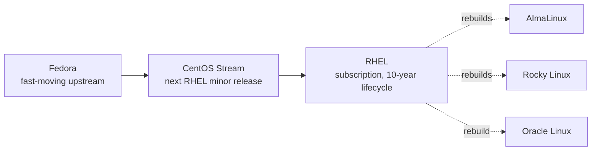

# RHEL

## Summary

Red Hat Enterprise Linux (RHEL) is the leading commercial enterprise Linux distribution: stable, security-focused and certified by a large ecosystem of hardware and software vendors, sold by subscription with professional support and about ten years of lifecycle per major version. It uses RPM packages managed with `dnf` (the successor of `yum`), XFS as the default file system, SELinux enforcing by default and systemd. Fedora is its upstream, CentOS Stream sits just ahead of each RHEL release, and rebuilds such as AlmaLinux and Rocky Linux provide compatible free alternatives. Skills transfer across this whole "Red Hat family".

## Prerequisites

- [Operating system overview](../operating-system-overview.md), [Permissions](../system-administration/permissions.md), [Startup management](../system-administration/startup-management.md).

## Core concepts

### Position and target users

RHEL is used in large enterprises, government agencies and businesses that need a stable, secure and certified platform with long-term support and professional services.



CentOS Linux, once the free rebuild of RHEL, reached end of life (CentOS Linux 8 at the end of 2021, CentOS Linux 7 in June 2024); AlmaLinux and Rocky Linux replaced it.

*Analogy.* Fedora is the test kitchen, CentOS Stream the dress rehearsal, RHEL the dish served with a guarantee. The analogy breaks because the "guarantee" (support, certifications, security errata) is what customers pay for, while the code is open source.

### Command line and users

- **Shell**: Bash. Common commands as elsewhere; networking with `ip`, `ss` (net-tools are not installed by default) and NetworkManager's `nmcli`; packages with `dnf` (and `yum` as an alias).
- **Users**: `useradd username`, `userdel username`, `usermod`, `passwd`; groups with `groupadd groupname`, add a user with `usermod -aG groupname username`, remove a user from a group with `gpasswd -d username groupname` (`groupdel` deletes the group); `id`, `whoami`, `groups`. Administrators use `sudo` through the `wheel` group.

### Permissions and processes

Standard permissions (`chmod u+x`, `chmod 755`, `chown user file`, `chown :group file`, `ls -l`) plus SELinux labels (`ls -Z`, `restorecon`, `semanage`), enforcing by default. Processes: `ps`, `top`, `htop` (from EPEL), `command &`, `fg`, `bg`, `kill`, `killall`, `pkill`, `nice`, `renice`.

### Package management

`dnf` (Dandified YUM) replaced `yum` (Yellowdog Updater, Modified) in RHEL 8; `yum` remains as a compatible command.

| Task | Command |
| --- | --- |
| Check for updates | `sudo dnf check-update` |
| Upgrade packages | `sudo dnf update` (same as `dnf upgrade`) |
| Install | `sudo dnf install package-name` |
| Remove | `sudo dnf remove package-name` |
| Search | `dnf search package-name` |
| Clean caches | `sudo dnf clean all` |
| History and undo | `dnf history`, `sudo dnf history undo N` |
| Security errata only | `sudo dnf update --security` |

Repositories: **BaseOS** (core system packages with the full lifecycle), **AppStream** (applications, languages and databases, some as modules or with shorter lifecycles), **CodeReady Linux Builder** (developer packages), and **EPEL** (Extra Packages for Enterprise Linux), maintained by the Fedora project and not supported by Red Hat. Systems are registered with `subscription-manager register` to receive content.

### Devices and file systems

- Devices in `/dev`; tools `lsblk`, `blkid`, `fdisk`, `mkfs`, `mount`, `umount`, `/etc/fstab`. Storage is usually managed with LVM.
- Default file system: XFS. Others: ext4, ext3, vfat; Btrfs is not supported in RHEL (removed in RHEL 8), although Fedora uses it.
- Management: `mkfs`, `xfs_repair` (instead of `fsck` for XFS), `xfs_growfs` (grow only), `resize2fs` for ext4.

### Kernel

- Monolithic modular kernel with Red Hat's stable kernel ABI across a major release; `uname -r`, `lsmod`, `modprobe`, `insmod`, `rmmod`; updates with `dnf`; live patching with kpatch.
- Boot configuration: `/boot/grub2/grub.cfg` (BLS entries in `/boot/loader/entries/`); change kernel arguments with `grubby`.

### Logging

- `/var/log/messages` (general system log), `/var/log/secure` (authentication), `/var/log/cron`, `/var/log/maillog`, written by rsyslog; there is no `/var/log/syslog` or `/var/log/kern.log` by default (kernel messages go to `messages` and the journal).
- `journalctl` and `dmesg`; rotation with `logrotate`.

### Default applications (workstation)

Editors `nano`, `vim`, `gedit`; Firefox; Thunderbird; LibreOffice (removed from RHEL 10 repositories, available as Flatpak); Nautilus (GNOME).

### Why use it

- Enterprise support from Red Hat, Inc.; stability, security and long-term support; certification of hardware and software stacks.
- Subscription model for updates and support (free developer subscriptions exist for up to 16 systems).
- SELinux enabled by default.
- Management tools: Red Hat Satellite for many systems, Cockpit web console for single servers, RHEL system roles (Ansible) and Insights.
- Regular minor releases about every six months, with Extended Update Support (EUS) for selected minor releases.

## Worked example

Install and expose a web server with SELinux and firewalld on RHEL 9 or a rebuild. Untested; RHEL 9.x, checked 2026-11.

```bash
sudo dnf install -y nginx
sudo systemctl enable --now nginx
sudo firewall-cmd --permanent --add-service=http && sudo firewall-cmd --reload
# serve content from a non-default directory: label it for SELinux, do not disable SELinux
sudo mkdir -p /srv/www && echo ok | sudo tee /srv/www/index.html
sudo semanage fcontext -a -t httpd_sys_content_t '/srv/www(/.*)?'
sudo restorecon -Rv /srv/www
sudo ausearch -m avc -ts recent          # check for SELinux denials if nginx returns 403
```

## Trade offs and when to use it

- **RHEL** when certifications, vendor support and a ten-year lifecycle matter; costs a subscription.
- **AlmaLinux or Rocky Linux** for the same platform without support costs.
- **CentOS Stream** to develop against the next RHEL minor release; not for long-lived production servers.
- **Fedora** for workstations and to preview future RHEL features.

## Common mistakes

- **Disabling SELinux** to make something work. Fix: correct labels (`semanage fcontext`, `restorecon`) or booleans (`setsebool`).
- **Expecting Debian log paths.** Fix: `/var/log/messages` and `/var/log/secure`.
- **Trying to shrink XFS.** Not possible. Fix: plan sizes with LVM and grow later.

## Practice

1. Which RHEL repository holds core OS packages, and which one applications?
2. What replaced CentOS Linux as a free RHEL-compatible distribution?
3. Where are authentication logs on RHEL?

Answers:

1. BaseOS for core packages, AppStream for applications.
2. Rebuilds such as AlmaLinux and Rocky Linux (CentOS Stream became the upstream preview).
3. `/var/log/secure` (and the journal).

## Further reading

- [Red Hat Enterprise Linux documentation](https://docs.redhat.com/en/documentation/red_hat_enterprise_linux/) (Red Hat).
- [Red Hat Enterprise Linux life cycle](https://access.redhat.com/support/policy/updates/errata) (Red Hat).
- [EPEL](https://docs.fedoraproject.org/en-US/epel/) (Fedora project).
- [AlmaLinux](https://almalinux.org/) and [Rocky Linux](https://rockylinux.org/) (community projects).
