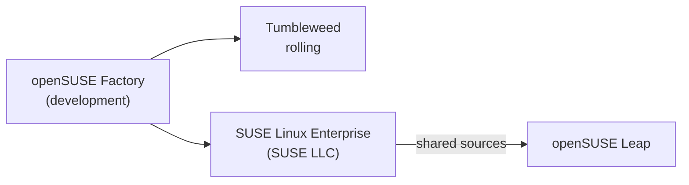

# SUSE Linux

## Summary

SUSE Linux comes in two families. SUSE Linux Enterprise (SLE, with SUSE Linux Enterprise Server as its server edition) is a commercially supported enterprise distribution focused on stability, security and long support, common in SAP and mainframe environments. openSUSE is the community project with two editions: Leap, a stable release built from SLE sources, and Tumbleweed, a tested rolling release with the newest software. Both use RPM packages with the `zypper` package manager, the YaST administration tool, Btrfs with snapshots for the root file system and systemd.

## Prerequisites

- [Operating system overview](../operating-system-overview.md), [Permissions](../system-administration/permissions.md), [File systems](../storage-and-io/file-systems.md).

## Core concepts

### Editions and target users

| Edition | Character | Target users |
| --- | --- | --- |
| SUSE Linux Enterprise (SLES, SLED, SLE Micro) | Enterprise grade, long support, certified for SAP and many vendors | Businesses needing a reliable, secure, professionally supported OS |
| openSUSE Leap | Stable, point releases based on SLE packages | Administrators and users who want SLE-like stability for free |
| openSUSE Tumbleweed | Rolling release, automatically tested with openQA | Developers and users who want the latest software |

*Analogy.* SLE is a certified commercial airliner with a maintenance contract; Leap is the same airframe flown by a club; Tumbleweed is the test aircraft where new parts are fitted first. The analogy breaks because Tumbleweed is used daily by many people and is tested before every snapshot.



### Command line and user management

- **Shell**: Bash. Common commands are the same as on other distributions (`cd`, `ls`, `cp`, `top`, `htop`, `df`, `ssh`, `nano`, `vim`); networking with `ip`, `ss` (net-tools `ifconfig` and `netstat` are optional packages); packages with `zypper`.
- **Users**: `useradd username`, `userdel username`, `usermod`, `passwd`; groups with `groupadd groupname`, add a user to a group with `usermod -aG groupname username`, remove a user from a group with `gpasswd -d username groupname` (`groupdel groupname` deletes the whole group); information with `id`, `whoami`, `groups`. YaST offers the same in a text or graphical UI.

### Permissions and processes

Standard Linux permissions (`chmod u+x`, `chmod 755`, `chown user file`, `chown :group file`, `ls -l`) and process control (`ps`, `top`, `htop`, `command &`, `fg`, `bg`, `kill`, `killall`, `pkill`, `nice`, `renice`). AppArmor is the default mandatory access control on SLE 15 and older openSUSE releases; newer releases (openSUSE Tumbleweed since 2025, SLE 16) switch to SELinux (TODO: verify the SLE 16 default).

### Package management

`zypper` is the command-line front end for RPM packages and libzypp:

| Task | Command |
| --- | --- |
| Refresh repositories | `sudo zypper refresh` |
| Update packages | `sudo zypper update` (on Tumbleweed use `sudo zypper dup` for distribution upgrades) |
| Install | `sudo zypper install package-name` |
| Remove | `sudo zypper remove package-name` |
| Search | `zypper search package-name` |
| Clean caches | `sudo zypper clean` |
| Add a repository | `sudo zypper ar URL alias` |
| Install patches | `sudo zypper patch` |

Repositories: the main official repositories, community repositories such as Packman (multimedia), and additional repositories from the Open Build Service added with `zypper ar`. SLE systems are registered with `SUSEConnect` to receive updates.

### Devices and file systems

- Device files in `/dev` (`/dev/sda`, `/dev/tty`, `/dev/null`), tools `lsblk`, `blkid`, `fdisk`, `mkfs`, mounts with `mount`, `umount` and `/etc/fstab`.
- Default file systems: Btrfs for the root file system (with snapper snapshots before and after every zypper transaction and bootable from GRUB), XFS for data partitions. Others: ext4, ext3, ext2, JFS; ReiserFS was supported historically but has been removed from current kernels.
- Management: `mkfs`, `fsck`, `resize2fs` (ext4), `btrfs filesystem resize`, `snapper list` and `snapper rollback`.

### Kernel and logging

- Monolithic modular Linux kernel; `uname -r`, `lsmod`, `modprobe`, `insmod`, `rmmod`; kernel updates through `zypper` (SLE keeps several kernels installed and supports live patching).
- Boot configuration in `/boot/grub2/grub.cfg`, generated by `grub2-mkconfig`.
- Logging: the systemd journal is the primary log (`journalctl`), with `/var/log/messages` when rsyslog is installed; rotation with `logrotate`; `dmesg` for kernel messages. Separate `/var/log/auth.log` and `/var/log/kern.log` files are not created by default.

### Default applications (desktop)

Editors `nano`, `vim`, `kate`; browsers Firefox, Chromium; email Thunderbird, Evolution; office LibreOffice; file managers Dolphin (KDE, the traditional openSUSE default desktop) and Nautilus (GNOME).

### Why use it

SLE: enterprise focus with strong support, stability, YaST (Yet another Setup Tool) for comprehensive system management, professional support from SUSE, SAP certification. openSUSE: community driven, Leap and Tumbleweed for stable or rolling use, flexible installation through YaST, and a development platform for features that later appear in SLE.

## Worked example

Safe update with automatic rollback on openSUSE Leap or SLE. Untested; zypper and snapper on openSUSE Leap 15.6, checked 2026-11.

```bash
sudo zypper refresh
sudo zypper patch                     # security and recommended patches
sudo snapper list | tail -3           # pre and post snapshots created around the transaction
# if the update broke the system: boot the previous snapshot from the GRUB menu, then
sudo snapper rollback                 # make the read-only snapshot the new default
sudo reboot
```

## Trade offs and when to use it

- **SLE** when vendor certification (SAP HANA, mainframes) and long support matter.
- **Leap** for a free SLE-like server; **Tumbleweed** for developer workstations that need current toolchains.
- Smaller cloud and container ecosystem than Ubuntu and RHEL.

## Common mistakes

- **Using `groupdel` to remove a user from a group.** It deletes the group. Fix: `gpasswd -d user group`.
- **Using `zypper update` on Tumbleweed.** It does not handle all distribution changes. Fix: `zypper dup`.
- **Filling the root Btrfs with snapshots.** Fix: tune snapper cleanup limits.

## Practice

1. How does openSUSE Leap relate to SLE?
2. Which feature lets you roll back a failed update on SUSE systems?

Answers:

1. Leap is built from the same sources as SLE, which makes it a free, community-supported equivalent.
2. Btrfs snapshots managed by snapper, taken automatically around zypper transactions.

## Further reading

- [SUSE Linux Enterprise Server documentation](https://documentation.suse.com/sles/) (SUSE).
- [openSUSE documentation](https://doc.opensuse.org/) (openSUSE project).
- [zypper usage](https://en.opensuse.org/SDB:Zypper_usage) (openSUSE wiki).
