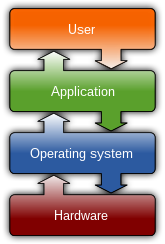
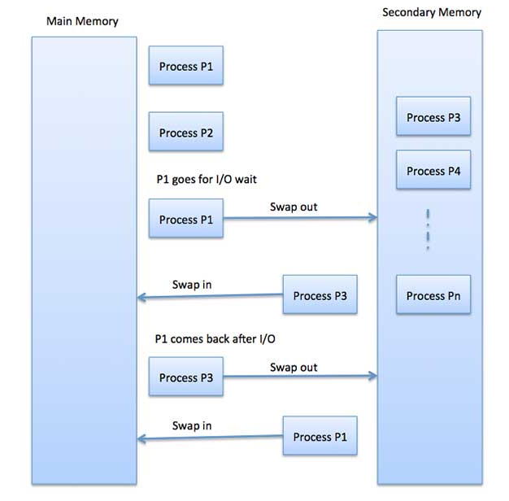
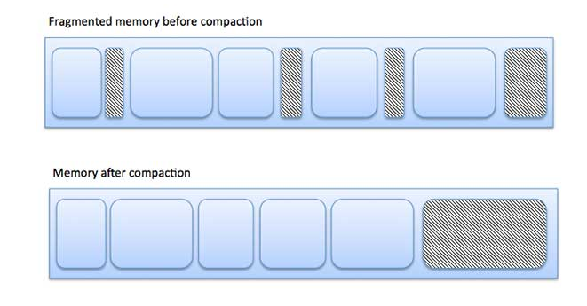
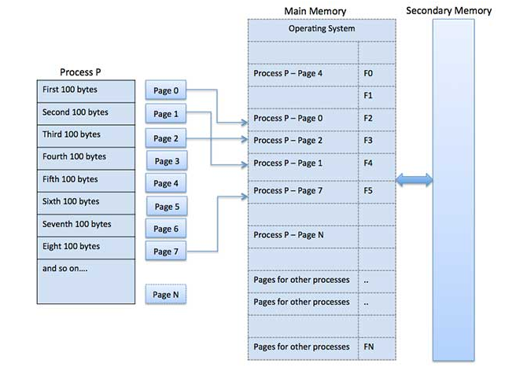
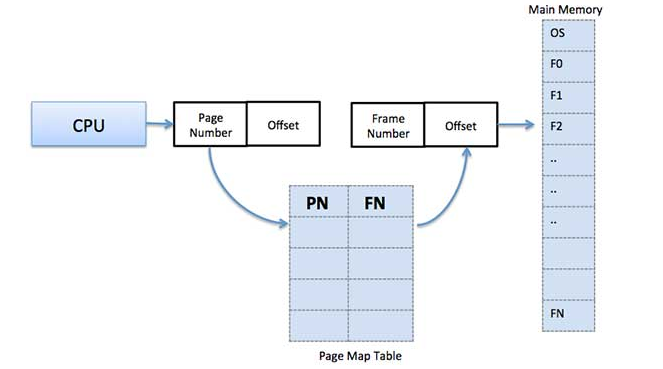
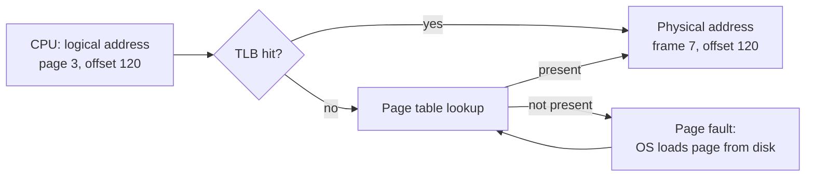

# Memory management

## Summary

Memory management is resource management applied to computer memory: allocating portions of memory to programs on request and freeing them for reuse when they are no longer needed. The operating system gives each process its own *virtual* (logical) address space and translates it to physical addresses with the hardware memory management unit (MMU), using *paging* (fixed-size pages mapped to frames) and, historically, *segmentation*. Inside a process, allocators manage the *heap* with techniques such as memory pools, buddy blocks and slabs, while runtimes may reclaim memory automatically with garbage collection. Problems to understand are fragmentation, swapping and memory leaks.

## Prerequisites

- [Operating system overview](../operating-system-overview.md) and [Processes](../process-management/processes.md).

## Core concepts

### Definition

The essential requirement of memory management is to allocate memory dynamically to programs at their request and free it for reuse. This is critical whenever more than one process runs at a time. Virtual memory separates the addresses a process uses from physical addresses and lets the virtual address space exceed RAM through paging or swapping, which strongly affects performance.



*Analogy.* A hotel with numbered room keys. Guests (processes) use their own room numbers (virtual addresses); reception (the MMU and page tables) maps them to real rooms (physical frames) and can move a guest to storage in the basement (swap) when the hotel is full. The analogy breaks on speed: fetching a guest back from the basement takes thousands of times longer than walking to a room, which is why heavy swapping cripples a system.

### Heap allocation

An allocation request is fulfilled by locating a block of unused memory of sufficient size in a large pool called the *heap* or *free store*; at any time parts of it are used and parts are free. Complications: *external fragmentation* (many small gaps between allocated blocks that are individually too small), allocator metadata that inflates small allocations (managed by chunking), and the need to track allocations so they never overlap and no memory is lost (*memory leaks*).

**Efficiency.** The allocation algorithm affects performance significantly. A 1994 study at Digital Equipment Corporation (Detlefs, Dosser, Zorn) measured allocator overheads; the lowest average instruction path length to allocate a single slot was 52 instructions.

**Implementations.** Because the location is not known in advance, memory is accessed indirectly through pointers. Methods:

- **Fixed-size blocks (memory pools).** A free list of uniform blocks. Ideal for embedded systems without large allocations and for frequently allocated objects (common in games); wasteful when objects vary in size.
- **Buddy blocks.** Pools of block sizes, usually powers of two. A larger block is split repeatedly until it fits the request; when freed, a block merges with its "buddy" if that is free and moves to the larger size list. The Linux page allocator uses this.
- **Slab allocation.** Preallocated caches for specific object types or sizes with a list of free slots; any free slot fits, which reduces fragmentation (Linux SLUB for kernel objects).
- **Stack allocation.** `alloca` allocates on the stack like `malloc` and is freed on function return; compilers inline it as stack pointer arithmetic. It can overflow the stack with undefined behavior and is not standardized by POSIX or ISO C.

**The heap** is also called the free store or pool, distinct from the stack and static variables. `malloc`/`calloc` and `free` (C), `new` and `delete` (C++) manage it manually; Java and C# reclaim it with garbage collection.

### Automatic memory management

Runtimes allocate local variables on the call stack automatically when a subroutine is called and release them on return, which enables recursion up to the stack limit. *Garbage collection* identifies and recycles memory of objects no longer reachable. It removes manual bookkeeping and a class of bugs (double free, dangling pointers) but costs extra memory and CPU time that competes with the application (pauses).

### Process termination

When a process ends, all its virtual memory (code, data, heap) is released by the kernel. Leaks inside a process are irrelevant to the kernel once the address space is gone, so a terminated process cannot leak memory; leaks matter in long-running processes.

### Addresses and address binding

A process's *address space* is the set of logical addresses it refers to. With 32-bit addressing, a user space from 0 to 0x7fffffff gives 2^31 addresses, 2 GB in theory.

Addresses go through three forms:

- **Symbolic addresses** in source code: variable names, constants, instruction labels.
- **Relative (relocatable) addresses** produced by the compiler.
- **Absolute (physical) addresses** produced when the loader places the program in memory.

With compile-time and load-time binding, virtual and physical addresses are identical; with execution-time binding they differ. The set of all logical addresses is the *logical address space*; the corresponding physical addresses form the *physical address space*. The MMU performs the run-time mapping. In the simplest scheme, a base (relocation) register is added to every address: with base 10000, address 100 maps to 10100. The program only ever sees logical addresses.

### Static and dynamic loading and linking

- **Static loading** loads the whole program and data into memory before execution. **Dynamic loading** keeps routines on disk in relocatable form and loads them only when needed.
- **Static linking** combines all required modules into one executable with no runtime dependencies. **Dynamic linking** records only references, resolved at run time; Windows DLLs and Unix shared objects (`.so`) are examples. Shared libraries save memory because one copy is mapped into many processes.

### Swapping

Swapping temporarily moves a process (or, in modern systems, individual pages) from main memory to secondary storage and back later, so that memory is available to other processes. It hurts performance but lets more and larger processes run than fit in RAM.



Swap time includes moving the process out and back in. Example: a 2048 KB process on a disk with 1 MB/s transfer rate needs 2048 KB / 1024 KB per second = 2 s = 2000 ms each way, so 4000 ms in and out, plus time waiting for memory. (A modern NVMe disk at about 2 GB/s does the same in about 1 ms each way.)

### Memory layout and partition allocation

Main memory traditionally has two parts: *low memory* holds the operating system, *high memory* holds user processes.

- **Single-partition allocation.** A relocation register (smallest physical address) and a limit register (range of valid logical addresses) protect processes from each other and from changes to OS code and data; every logical address must be below the limit.
- **Multiple-partition allocation.** Memory is divided into partitions, each holding one process. When a partition is free, a process from the input queue is loaded into it; when the process ends, the partition becomes available.

### Fragmentation

As processes are loaded and removed, free memory breaks into small pieces that are too small for new processes; this is *fragmentation*.

- **External fragmentation.** Total free memory is enough, but not contiguous. Reduced by *compaction* (moving contents so free memory forms one block), which requires dynamic relocation.
- **Internal fragmentation.** A block given to a process is larger than needed; the remainder is unused. Reduced by assigning the smallest partition large enough.



### Paging

Virtual memory lets a computer address more memory than is physically installed, using disk to extend RAM. *Paging* divides a process's address space into equal blocks called *pages* (a power of two; classic textbooks give 512 to 8192 bytes, x86-64 Linux uses 4 KB with 2 MB and 1 GB huge pages). Main memory is divided into *frames* of the same size, which uses memory well and avoids external fragmentation.



**Address translation.**

- Logical address = page number + page offset.
- Physical address = frame number + page offset.

The *page table* (page map table) records which frame holds each page. The CPU generates a page number and offset; the MMU looks up the frame (cached in the translation lookaside buffer, TLB) and keeps the offset.





Pros and cons of paging:

- Removes external fragmentation, but keeps some internal fragmentation (the last page of a process).
- Simple and effective to implement.
- Equal page and frame sizes make swapping easy.
- Page tables use memory themselves, a concern on systems with little RAM (multi-level page tables reduce this).

### Segmentation

Segmentation divides a program into variable-sized *segments* that correspond to logical parts: main program, functions, data structures, stack. Each segment is a separate address space. Segments are loaded into non-contiguous memory, but each segment is contiguous. It works like paging with variable-length units. The OS keeps a *segment map table* per process with the start address (base) and length (limit) of each segment, and a list of free memory blocks. A memory reference consists of a segment number and an offset.


Modern x86-64 operating systems use paging almost exclusively; segmentation survives only vestigially (for example for thread-local storage registers).

## Worked example

Translate a logical address with 4 KB pages (synthetic page table). Logical address 13,000: page number = 13000 div 4096 = 3, offset = 13000 mod 4096 = 712. If the page table maps page 3 to frame 9, the physical address is 9 x 4096 + 712 = 37,576.

On Linux, observe memory and swapping (untested; procps-ng, checked 2026-11):

```bash
free -h                         # use the "available" column, not "free"
vmstat 1 5                      # si/so > 0 means active swapping
grep -E 'VmRSS|VmSwap' /proc/$(pgrep -o nginx)/status
cat /proc/sys/vm/swappiness     # kernel preference for swapping (default 60)
```

## Trade offs and when to use it

- **Manual management** gives control and predictable latency; **garbage collection** gives safety at the cost of memory and pauses.
- **Swap** protects against sudden out-of-memory kills but can make a system unresponsive; many Kubernetes nodes historically run without swap for predictable performance.
- **Huge pages** reduce TLB misses for databases and JVMs, but transparent huge pages can cause latency spikes for some workloads.

## Common mistakes

- **Reading "free" as available memory.** Linux uses spare RAM as page cache. Fix: read `available`.
- **Ignoring leaks in long-running services.** Fix: track RSS over time ([Process monitoring](../process-management/process-monitoring.md)).
- **Confusing internal and external fragmentation.** Paging removes external, not internal, fragmentation.

## Practice

1. Translate logical address 9,000 with 4 KB pages if page 2 maps to frame 5.
2. What is the difference between paging and segmentation?
3. Why can a terminated process not leak memory?

Answers:

1. Page 2, offset 9000 - 8192 = 808; physical = 5 x 4096 + 808 = 21,288.
2. Paging uses fixed-size pages invisible to the programmer; segmentation uses variable-sized logical segments.
3. The kernel frees its entire address space on exit.

## Further reading

- *Operating System Concepts*, 10th edition (Silberschatz, Galvin, Gagne, Wiley, 2018): main memory and virtual memory chapters.
- [Operating Systems: Three Easy Pieces](https://pages.cs.wisc.edu/~remzi/OSTEP/) (Arpaci-Dusseau, 2023): paging, TLBs and swapping.
- "Memory allocation costs in large C and C++ programs" (Detlefs, Dosser, Zorn, Software: Practice and Experience, 1994): the allocator cost study.
- [Memory Management](https://docs.kernel.org/admin-guide/mm/index.html) (Linux kernel documentation): swap, huge pages and tuning.
