# Operating system overview

## Summary

An operating system (OS) is the layer of system software between users and applications on one side and the hardware on the other. It gives programs a convenient, safe environment to run in and manages every shared resource: the processor (scheduling processes), main memory, devices and files, plus security, accounting and error handling. The core of the OS that runs with full hardware privileges is the *kernel*. Operating systems evolved from none at all (programmers feeding machine code) through batch systems, multiprogramming and time-sharing to today's multitasking, multiprocessor, networked and distributed systems; real-time operating systems form a separate family for deadline-bound devices. For DevOps work the OS is the ground everything stands on: containers are OS features, performance problems are OS resource problems, and most servers run Linux.

## Prerequisites

- Basic computer architecture: CPU, RAM, disks, I/O devices.
- No other note is required. This note is the entry point of the [Operating systems](README.md) area.

## Core concepts

### Definition and function

An operating system acts as a bridge between a computer's user and its hardware. Hardware only understands machine code (binary instructions), which means nothing to a typical user; a system is needed that acts as an intermediary and manages all processes and resources. The OS is therefore defined as an *interface between user and hardware* and as a *resource manager*: it executes processes, allocates resources, manages the CPU, files and many other tasks. Its purpose is to provide an environment in which users can execute programs conveniently and efficiently.

The *kernel* is the piece of software that contains the fundamental parts of the OS. It runs in *kernel mode* (privileged CPU mode with direct hardware access); applications run in *user mode* and request kernel services through *system calls* such as `read`, `write`, `fork` and `mmap`.

*Analogy.* A hotel management. Guests (applications) never enter the boiler room, the kitchen or the key office (hardware); they call reception (system calls), which assigns rooms (memory), schedules the shared gym (CPU time), handles luggage storage (files) and keeps other guests out of their room (protection). The analogy breaks on speed: reception handles one guest at a time, while a kernel switches between thousands of processes per second.

The figure shows the nested view: hardware in the center, the OS around it, then system software and utilities, and application software (games, browsers, databases) on the outside.

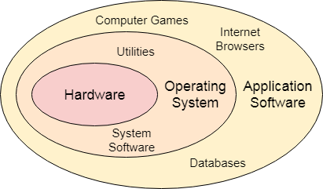

### Structure of a computer system

A computer system consists of:

- **Users**: the people using the computer.
- **Application programs**: compilers, databases, games, video players, browsers.
- **System programs**: shells, editors, compilers and other utilities.
- **Operating system**: the special program that acts as the interface between user and hardware.
- **Hardware**: CPU, disks, memory and other devices.


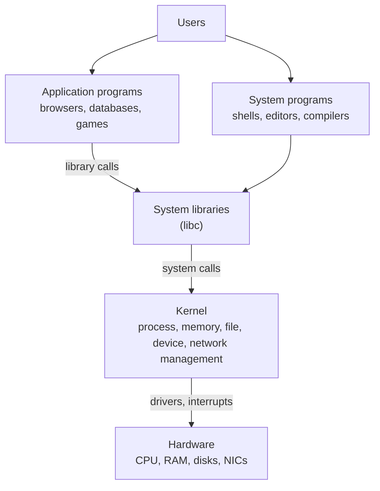

### Responsibilities

**Memory management.** Management of primary (main) memory, a large array of bytes in which each byte has an address and which the CPU can access directly. A program must be in main memory to execute. The OS:

- keeps track of which parts of memory are in use and by whom, and which are free,
- decides in multiprogramming which process gets memory, when and how much,
- allocates memory when a process requests it,
- deallocates it when the process no longer needs it or terminates.

See [Memory management](memory-management/memory-management.md).

**Processor management.** In a multiprogramming environment the OS decides which process gets the processor, when and for how long. This function is called *process scheduling*. The OS:

- keeps track of the processor and the status of processes (the component doing this is called the *traffic controller* in classic textbooks),
- allocates the CPU to a process,
- deallocates it when the process no longer needs it.

See [Processes](process-management/processes.md).

**Device management.** The OS manages device communication through device drivers. It:

- keeps track of all devices (the component is called the *I/O controller*),
- decides which process gets a device, when and for how long,
- allocates devices efficiently,
- deallocates them.

See [I/O management](storage-and-io/io-management.md).

**File management.** A file system is organized into directories for easy navigation; directories contain files and other directories. The OS:

- keeps track of information, location, use and status of files (the collective facilities are the *file system*),
- decides who gets the resources,
- allocates and deallocates them.

See [File systems](storage-and-io/file-systems.md).

**Other responsibilities.**

- **Security.** Passwords, permissions and similar techniques prevent unauthorized access to programs and data (see [Permissions](system-administration/permissions.md)).
- **Control over system performance.** Recording delays between a request for a service and the system's response.
- **Job accounting.** Keeping track of time and resources used by jobs and users.
- **Error detecting aids.** Dumps, traces, error messages and other debugging and error detection aids.
- **Coordination between software and users.** Assigning compilers, interpreters, assemblers and other software to users.

### Architecture

A generic OS architecture: many users work with system software and application software, which use the operating system, which manages the hardware (CPU, RAM, I/O).

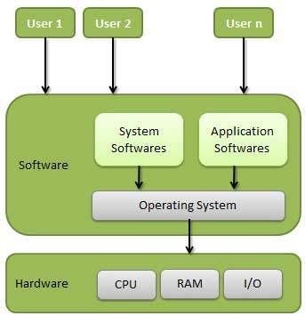

Kernel designs differ in how much runs in kernel mode:

| Design | What runs in kernel mode | Examples | Trade off |
| --- | --- | --- | --- |
| Monolithic | Scheduling, memory, file systems, drivers, networking | Linux, traditional Unix, FreeBSD | Fast (no message passing), but a driver bug can crash the whole kernel |
| Microkernel | Only scheduling, memory basics and IPC; the rest in user-space servers | MINIX 3, QNX, seL4 | Robust and verifiable, but more overhead |
| Hybrid | A microkernel-like structure with many services in kernel mode | Windows NT, macOS XNU | A compromise between both |

Linux is monolithic but modular: drivers and file systems load as *kernel modules* at runtime.

### Generations

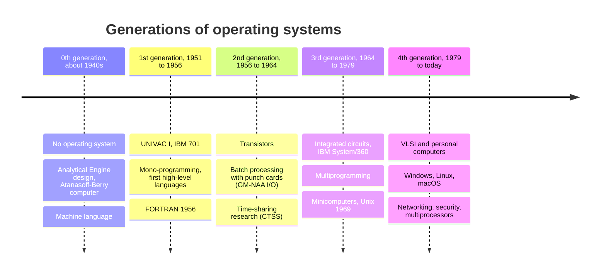

- **0th generation.** Computing began with Charles Babbage's Analytical Engine (designed in the 1830s) and John Atanasoff's computer (around 1940 to 1942) using vacuum tubes. There was no OS; programs were written in machine language.
- **First generation (1951 to 1956).** Commercial computing began with UNIVAC I and the IBM 701. Initially there was no OS; programming moved to higher-level languages and simple mono-programmed operating systems appeared. FORTRAN was developed in 1956 (released 1957).
- **Second generation (1956 to 1964).** Transistors replaced vacuum tubes. The first operating system, GM-NAA I/O (often shortened to GMOS), written by General Motors and North American Aviation for the IBM 704, enabled batch processing of jobs on punch cards. Research on multiprogramming led to time-sharing systems such as MIT's CTSS (1961).
- **Third generation (1964 to 1979).** IBM's System/360 started the generation, with integrated circuits for better performance. Multiprogramming became common, and minicomputers (the DEC PDP family, from the PDP-1 in 1959 to the PDP-8 and PDP-11) paved the way to personal computers. Unix was created at Bell Labs in 1969.
- **Fourth generation (1979 to today).** Personal computers powered by very large scale integration (VLSI). Current operating systems such as Windows and Linux were developed. Key OS functions: memory management, processor management, device management, file management, network management, security, system performance control, job accounting, error detection, and coordination between software and users.

### Types of operating systems

An operating system is an organized collection of programs that manages computer hardware: system software responsible for the smooth functioning of the computer. Over time several types emerged, shown in the figure: batch, multiprogramming, multiprocessing, multitasking, network, real-time, time-sharing and distributed.

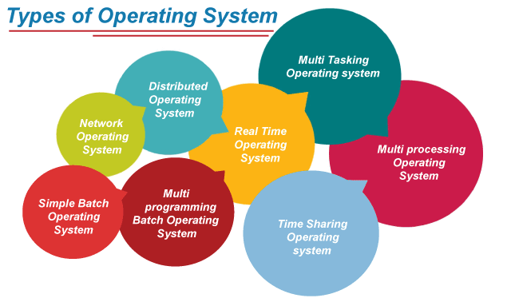

#### Batch operating system

In the 1960s and 1970s batch processing was very popular. Similar jobs were batched together and executed in sequence on a single large computer, the mainframe. Several people had access: they submitted jobs, the system queued them first come, first served and executed them one by one, and users collected their output when the jobs were done.

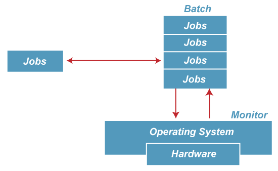

The purpose was to transfer control from one job to the next as soon as a job finished. A small set of programs called the *resident monitor* always stayed in one part of main memory; the rest was used for jobs.

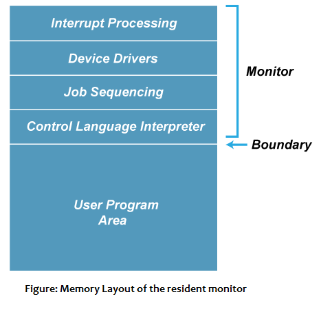

- Advantage: the resident monitor improves efficiency by removing idle CPU time between two jobs.
- Disadvantage, *starvation*: with five jobs J1 to J5 in a batch, if J1 runs very long, the other four wait a very long time or never run.
- Disadvantage, *not interactive*: jobs that need user input do not work, because the user is not present during execution; a job that asks for two numbers on the console never gets them.

#### Multiprogramming operating system

Multiprogramming extends batch processing so that the CPU is always busy. Each process needs CPU time and I/O time; when one process waits for I/O, the CPU executes another. This improves the efficiency of the system.


- Advantages: throughput increases because the CPU always has a program to run; response time can be reduced.
- Disadvantage: resources are used efficiently, but there is no user interaction with the computer.

#### Multiprocessing operating system

Multiprocessing achieves parallel computing: more than one processor is present, and several processes execute at the same time, which increases throughput.

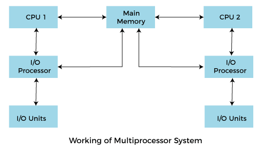

There are two kinds of multiprocessing systems: *symmetric multiprocessing* (SMP), in which all processors are equal and run both kernel and user code (all modern servers), and *asymmetric multiprocessing*, in which one master processor controls the system and assigns work to the others.

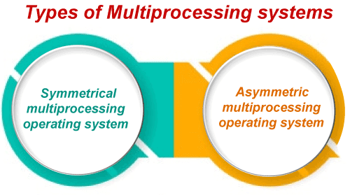

- Advantage, *increased reliability*: work is distributed among processors; if one fails, another can complete the task.
- Advantage, *increased throughput*: more processors do more work in less time (limited by the serial part of the work, as Amdahl's law states).
- Disadvantage: the OS is more complex because it coordinates several CPUs (locking, cache coherence, scheduling across cores).

#### Multitasking operating system

A multitasking OS is a logical extension of multiprogramming that runs multiple programs concurrently and lets a user perform several tasks at the same time. There are two kinds: in *preemptive multitasking*, the OS interrupts a running task when its time slice ends (Linux, Windows, macOS); in *cooperative multitasking*, each task must yield control voluntarily (Windows 3.x, classic Mac OS), so one misbehaving task can freeze the system.

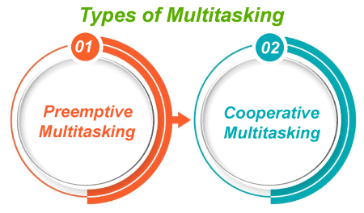

- Advantages: suited to supporting multiple users at once; well-defined memory management.
- Disadvantage: processors are busy more of the time, so the CPU generates more heat (and uses more power).

#### Network operating system

An OS that includes software and protocols to communicate with other computers over a network conveniently and cost-effectively is a *network operating system*. Typically a server with shared data and services is accessed by many client machines (agents), managed from an administrator panel.

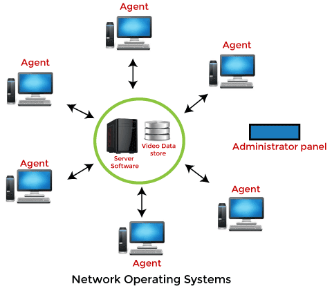

There are two kinds: *peer-to-peer* systems, in which every machine shares resources as an equal, and *client-server* systems, in which dedicated servers provide resources to clients.

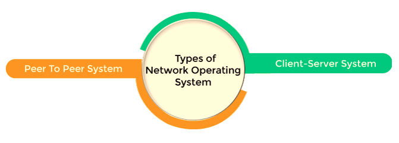

- Advantages: the division between clients and servers reduces network traffic; less expensive to set up and maintain.
- Disadvantages: the failure of a central node (the server) affects the whole system; security and performance need trained network administrators.

#### Real-time operating system

In real-time systems, each job has a deadline; missing it causes great loss, or makes the result useless even if it is produced. A real-time operating system (RTOS) provides deterministic task scheduling, resource management and device drivers on embedded hardware.

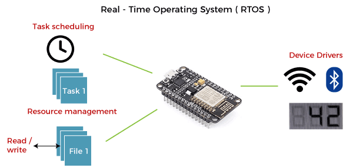

Real-time systems are used where timing is critical, for example in military applications (a missile must be released with precise timing), avionics, medical devices, industrial control and car engine control. There are three kinds: *hard* real-time (a missed deadline is a system failure, for example an airbag), *firm* real-time (a late result is useless but occasional misses are tolerable, for example a video frame) and *soft* real-time (late results lose value gradually, for example audio streaming).

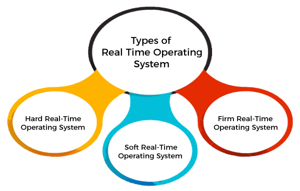

- Advantages: real-time applications are easier to lay out, develop and execute; devices and systems are used to the maximum.
- Disadvantages: costly to develop; complex, and can consume critical CPU cycles.
- Examples: FreeRTOS, Zephyr, VxWorks, QNX; Linux has a real-time mode (PREEMPT_RT, merged into the mainline kernel in version 6.12 in 2024).

#### Time-sharing operating system

In a time-sharing OS, computer resources are allocated in a time-dependent fashion to several programs at once, which gives many users direct access to the main computer. It is a logical extension of multiprogramming: the CPU switches among programs of different users on a schedule, so quickly that each user feels they have the machine to themselves.

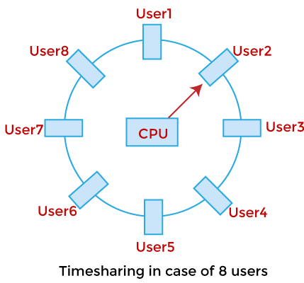

A time-sharing OS serves many users simultaneously, so it needs sophisticated CPU scheduling and I/O management, and it is difficult and expensive to build.

- Advantages: effective use and sharing of resources; less CPU idle time and shorter response time.
- Disadvantages: data communication between users and the system is intensive; the security and integrity of user programs and data in memory must be protected because many users access the system at the same time.

#### Distributed operating system

A distributed OS is not installed on a single machine: it is divided into parts that run on different machines and communicate over the network. It is more complex, larger and more sophisticated than a network OS because it must also handle varying network protocols and present the machines as one system.

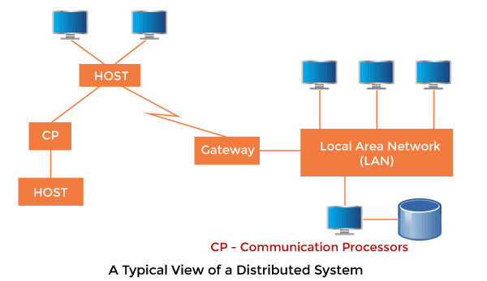

- Advantages: resource sharing; fault tolerance.
- Disadvantage: protocol overhead can dominate computation cost.

Pure distributed operating systems (Amoeba, Plan 9) stayed mostly in research. In practice, distribution is achieved by middleware and platforms on top of ordinary operating systems, for example Kubernetes, which schedules containers across many Linux machines.

## Worked example

Watching the OS manage resources on a Linux server. Untested; procps-ng and util-linux tools on Ubuntu 24.04, checked 2026-11. Output is shortened and illustrative.

```bash
uname -r            # kernel version
nproc               # CPUs available to the scheduler
uptime              # load average: runnable plus uninterruptible tasks over 1, 5 and 15 minutes
free -h             # memory: used, free, page cache (buff/cache), swap
vmstat 1 5          # every second: runnable (r), blocked (b), context switches (cs), CPU split
```

```text
$ vmstat 1 3
procs -----------memory---------- ---swap-- -----io---- -system-- ------cpu-----
 r  b   swpd   free   buff  cache   si   so    bi    bo   in   cs us sy id wa st
 2  0      0 812344  91240 5123400    0    0     5    40  610 1180 12  3 84  1  0
 9  1      0 806120  91240 5123512    0    0     0  2048 2210 9840 71 18  6  5  0
 8  0      0 805904  91240 5123600    0    0     0  1024 2105 9532 69 17 12  2  0
```

Reading it with the responsibilities above:

- **Processor management.** `r` jumps from 2 to 9 runnable processes; with `nproc` = 4, more processes want the CPU than there are cores, so the scheduler time-slices them (`cs`, context switches per second, rises from about 1,200 to about 9,800).
- **Memory management.** `free` stays high and `si`/`so` (swap in and out) stay at 0, so memory is not the bottleneck.
- **Device management.** `bo` (blocks written) rises and `wa` (CPU time waiting for I/O) reaches 5 percent: some processes block on disk writes (`b` = 1).
- **Kernel compared with user time.** `us` 71 percent is application code, `sy` 18 percent is kernel work on their behalf (system calls, scheduling, I/O).

## Trade offs and when to use it

- **General-purpose OS** (Linux, Windows, BSD) for servers and desktops: throughput and fairness, not guaranteed deadlines.
- **RTOS** for embedded and control systems: deterministic latency at the cost of features and throughput.
- **Monolithic kernels** dominate servers for performance; **microkernels** win where verified isolation matters (seL4 in safety-critical systems).
- **Distribution in middleware** (Kubernetes, distributed databases) rather than in the kernel is the practical path for clusters.

## Common mistakes

- **Reading load average as CPU usage.** On Linux it counts runnable and uninterruptible (usually I/O-blocked) tasks, so high load can mean slow disks. Fix: check `vmstat` (`r`, `b`, `wa`) or `top` to see which.
- **Treating "free" memory as available memory.** Linux uses idle RAM for the page cache. Fix: look at the `available` column of `free`.
- **Confusing multiprogramming, multitasking and multiprocessing.** Multiprogramming keeps the CPU busy during I/O, multitasking time-slices among tasks (interactively), multiprocessing uses several CPUs at once.
- **Assuming containers have their own kernel.** They share the host kernel ([Docker](../containers-and-virtualization/docker.md)).

## Practice

1. What is the difference between kernel mode and user mode, and how does an application cross from one to the other?
2. Which four resources does the OS manage in classic textbooks?
3. What problem of batch systems does multiprogramming solve, and what problem remains?
4. Give an example each of hard, firm and soft real-time requirements.
5. In the worked example, why is the CPU the bottleneck and not memory?

Answers:

1. Kernel mode has full hardware access; user mode is restricted. An application requests kernel services through a system call, which switches the CPU into kernel mode in a controlled way.
2. Processor, memory, devices (I/O) and files.
3. It keeps the CPU busy while a job waits for I/O (better throughput). It still offers no interaction with users, which time-sharing added.
4. Hard: airbag deployment. Firm: frames in a video conference. Soft: audio streaming or a web page load.
5. The run queue (`r` = 9) exceeds the number of CPUs (4) and idle time drops to 6 percent, while swap activity is zero and free memory stays high.

## Further reading

- *Operating System Concepts*, 10th edition (Abraham Silberschatz, Peter B. Galvin, Greg Gagne, Wiley, 2018): the standard textbook; its structure shapes this area.
- *Modern Operating Systems*, 5th edition (Andrew S. Tanenbaum, Herbert Bos, Pearson, 2022): history, kernel designs and case studies.
- [Operating Systems: Three Easy Pieces](https://pages.cs.wisc.edu/~remzi/OSTEP/) (Remzi H. Arpaci-Dusseau, Andrea C. Arpaci-Dusseau, free online, 2023): virtualization, concurrency and persistence explained clearly.
- [The Linux Kernel documentation](https://docs.kernel.org/) (kernel.org): authoritative reference for Linux internals.
- [vmstat(8)](https://man7.org/linux/man-pages/man8/vmstat.8.html) (Linux man-pages project): the fields used in the worked example.
