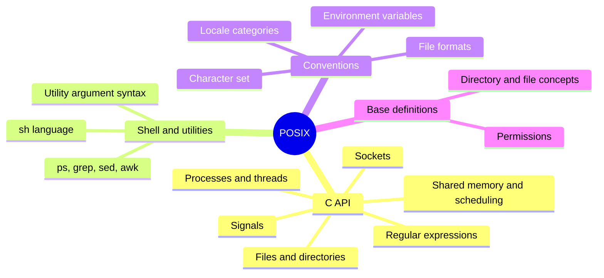

# POSIX

## Summary

POSIX (Portable Operating System Interface) is a family of IEEE standards (IEEE Std 1003.1, also published as ISO/IEC 9945 and as the Single UNIX Specification by The Open Group) that defines a common interface for Unix-like operating systems: a C programming interface, a shell language, a set of command line utilities and conventions such as environment variables, locales, character sets and regular expressions. Software that conforms to POSIX can be ported to any other conforming system at the source level. That is why tools like `ps`, `grep` or `sh` scripts behave almost the same on Debian, FreeBSD, OpenBSD and macOS, and why "is it POSIX?" is the first question when a shell script must run everywhere.

## Prerequisites

- [Operating system overview](operating-system-overview.md) for system calls and the kernel.
- Basic shell use ([Terminal](shell-and-terminal/terminal.md)).

## Core concepts

### The problem POSIX solves

In the 1980s, Unix had split into many incompatible variants (System V, BSD, and vendor versions such as SunOS, HP-UX, AIX). A program written for one did not compile on another, and scripts used options that only existed on one system. POSIX, first published in 1988, defined the common subset that all could implement, so developers could write once and recompile anywhere.

*Analogy.* Electrical plug standards. Within a country that follows one standard, any device fits any socket, even though the power plants and wiring behind the wall differ. POSIX is the socket shape for programs. The analogy breaks at the edges: many systems offer additional, non-standard sockets (GNU extensions, Linux-specific system calls), and programs that use them stop being portable.

### What the standard defines



The current edition is IEEE Std 1003.1-2024 (POSIX.1-2024), which replaced the 2017 edition (checked 2026-11).

### The C API

POSIX defines its interfaces in terms of the C language, so programs are portable at the source code level; the same interfaces can also be implemented and used from other standardized languages. The POSIX C API adds functions on top of the ANSI (ISO) C standard library for:

- file operations (`open`, `read`, `write`, `stat`, `opendir`),
- processes, threads, shared memory and scheduling parameters (`fork`, `exec`, `waitpid`, `pthread_create`, `shm_open`, `sched_setparam`),
- networking (`socket`, `bind`, `connect`, `getaddrinfo`),
- memory management (`mmap`, `mprotect`, `mlock`),
- regular expressions (`regcomp`, `regexec`).

The complete descriptions are defined with the POSIX headers (`<unistd.h>`, `<fcntl.h>`, `<pthread.h>`, `<regex.h>` and others).

### General concepts

Besides the C API, POSIX defines rules for writing programs, such as the safe initialization of pointer types and the behavior of concurrent execution. It specifies memory synchronization rules (which functions synchronize memory between threads, so that memory being modified by one thread is not accessed unsafely by another) and security mechanisms such as directory protection and file access permissions.

### File formats

POSIX defines rules for the format of strings written to files, standard output, standard error and read from standard input. An output description has the form:

```text
"<format>", <arg1>, ..., <argN>
```

The format can contain regular characters, escape sequences and *conversion specifications*. A conversion specification starts with a percent sign followed by the argument type and describes how the corresponding argument is printed, as in the `printf` utility and function: `printf "%s has %d files\n" "$dir" 42`.

### Environment variables

An environment variable is a name-value pair passed to every process; login shells typically set them from profile files at login. By convention names consist of uppercase letters, digits and underscores, and should not start with a digit. Each value is a string of characters from the portable character set. An example definition of a base directory for user files:

```bash
XDG_BASE_DIRECTORY="/home/user/"   # illustrative; the real XDG Base Directory spec uses XDG_CONFIG_HOME, XDG_DATA_HOME and similar
```

Names can be chosen freely, but you should avoid names that conflict with variables used by standard utilities. Names are case-sensitive: `home` and `Home` are different variables. Variables reserved by POSIX include:

| Variable | Meaning |
| --- | --- |
| `COLUMNS` | Width of the terminal screen in columns |
| `HOME` | Path of the user's home directory |
| `LOGNAME` | The user's login name |
| `LINES` | Preferred number of lines on the terminal screen |
| `PATH` | Colon-separated list of directories searched for executables |
| `PWD` | Current working directory |
| `SHELL` | The user's preferred shell |
| `TERM` | Terminal type |
| `TMPDIR` | Directory for temporary files |

### Locale

A *locale* defines the language and cultural conventions of the user's environment. It consists of categories that control parts of program behavior, such as date and time, money and number formatting. Every conforming implementation provides the *POSIX locale*, identical to the *C locale*. Programs should use the locale environment variables so that behavior is coherent, and if no locale is set, they fall back to the POSIX locale.

| Variable | Category |
| --- | --- |
| `LC_CTYPE` | Character classification and case conversion |
| `LC_COLLATE` | Order (collation) of characters |
| `LC_MONETARY` | Monetary formatting |
| `LC_NUMERIC` | Number formatting (decimal separator) |
| `LC_TIME` | Date and time formatting |
| `LC_MESSAGES` | Language of program messages |
| `LC_ALL` | Overrides all categories |
| `LANG` | Default for categories that are not set |

Locales matter for operations work: `sort` orders lines differently in `en_US.UTF-8` and `C`, and `[a-z]` in a regular expression can match uppercase letters in some locales. Scripts that need predictable results set `LC_ALL=C`.

### Character set

A character set assigns codes (bit patterns) to symbols; computers only understand binary, so text needs an agreed character set. POSIX requires a *portable character set* (letters, digits, punctuation, space and control characters such as newline) that every locale contains, and implementations provide at least one character set that includes it. The POSIX locale contains 256 single-byte characters, covering the portable character set plus implementation-defined characters.

TODO: Verify the statement that the first eight entries of the character set must be control characters against the Base Definitions, chapter 6.

### Regular expressions

A regular expression (RE) is a string that describes a search pattern. The C library implements POSIX REs, and utilities such as `awk`, `sed` and `grep` rely on this behavior.

POSIX defines two flavors:

- **Basic regular expressions (BRE)**: `grep` and `sed` by default. `?`, `+`, `|`, `{` and `(` are literal unless escaped (`\{2,3\}`, `\(group\)`).
- **Extended regular expressions (ERE)**: `grep -E`, `sed -E`, `awk`. `?`, `+`, `|`, `{m,n}` and `( )` have their special meaning without backslashes.

Most POSIX utilities use BRE; utilities for advanced text processing support ERE as well. Rules that apply to both:

- REs operate on strings that end with a NUL character, and an explicit NUL in the RE or the text is not allowed.
- Some sequences (for example certain backslash escapes and a literal newline inside an RE) have undefined results, so portable programs avoid them.
- Matching is case-sensitive by default; case-insensitive matching is requested explicitly (`REG_ICASE`, `grep -i`).
- Implementations must support REs of at least 256 bytes; longer patterns are not guaranteed to work portably.

Perl-style features (`\d`, `\w`, lookahead, lazy quantifiers) are not POSIX. `grep -P` is a GNU extension.

### Directory structure

POSIX itself defines few directories (`/`, `/dev`, `/tmp`, `/dev/null`); most Linux distributions follow the *Filesystem Hierarchy Standard* (FHS 3.0) of the Linux Foundation, which defines a tree that starts at the root directory `/`. The `tree` utility shows the top level:

```text
$ tree / -d -L 1
/
├── bin -> usr/bin
├── boot
├── dev
├── etc
├── home
├── lib64 -> usr/lib
├── mnt
├── opt
├── proc
├── root
├── run
├── sbin -> usr/bin
├── sys
├── usr
└── var
```

The links from `/bin` and `/sbin` to `/usr` reflect the "merged `/usr`" layout used by current distributions. Programs should not create files directly under `/` or `/dev`. They may create files under the user's directories (for example the XDG directories in the home directory) and temporary files under `/tmp` (or `$TMPDIR`). See [File systems](storage-and-io/file-systems.md) for the purpose of each directory.

### Utilities and their conventions

Most Unix utilities behave alike because POSIX defines conventions for utility programs (the *Utility Syntax Guidelines*):

- options are single letters preceded by `-` (`-l`), may be grouped (`-la`) and come before operands,
- `--` ends options, so a file named `-f` can be passed safely (`rm -- -f`),
- `-` as an operand means standard input or output,
- exit status 0 means success, non-zero means failure.

Options such as `-h` for help or long options (`--help`) are common conventions in GNU and BSD tools, but they are not POSIX requirements. POSIX also defines the shell command language (`sh`), which is why a script written for `/bin/sh` without Bash features runs on dash, Bash, ksh and BusyBox ash.

### Conformance in practice

| System | Status |
| --- | --- |
| macOS | Certified UNIX 03 (Single UNIX Specification) on Intel and Apple silicon releases |
| AIX, HP-UX, Solaris | Certified UNIX |
| Linux distributions | Largely compliant, mostly not certified (certification is expensive); GNU tools add extensions and `POSIXLY_CORRECT` makes some stricter |
| FreeBSD, OpenBSD, NetBSD | Largely compliant, not certified |
| Windows | Not POSIX; WSL runs a real Linux kernel, Cygwin and MSYS2 provide a compatibility layer |

## Worked example

The same task written non-portably and portably: count the lines that contain a version string like `1.2.3`. Untested; checked against POSIX.1-2024 utility definitions, 2026-11.

Non-portable (Bash and GNU grep only):

```bash
#!/bin/bash
count=$(grep -cP '\d+\.\d+\.\d+' release-notes.txt)   # -P (Perl RE) is a GNU extension
[[ $count -gt 0 ]] && echo "found $count"              # [[ ]] is a Bash feature
```

Portable (any POSIX shell and grep):

```sh
#!/bin/sh
LC_ALL=C; export LC_ALL                                  # predictable character classes
count=$(grep -cE '[0-9]+\.[0-9]+\.[0-9]+' release-notes.txt)
if [ "$count" -gt 0 ]; then
    printf 'found %d\n' "$count"                         # printf is portable, echo options are not
fi
```

On Alpine Linux (BusyBox) or on macOS without GNU tools, the first script fails (`grep: unrecognized option: P`, or `bash: not found` in minimal containers); the second runs everywhere. Running scripts through `shellcheck --shell=sh` or `checkbashisms` finds such issues.

## Trade offs and when to use it

- **Write POSIX shell** for scripts that must run in minimal containers, on BSD or macOS, and in init and CI scripts across distributions.
- **Use Bash or a real programming language** when you need arrays, robust string handling or complex logic; portability matters less than correctness.
- **Use POSIX C APIs** for portable system software; use Linux-specific APIs (`epoll`, `io_uring`, `inotify`) when performance or features justify losing portability.

## Common mistakes

- **Assuming `/bin/sh` is Bash.** On Debian and Ubuntu it is dash. Fix: `#!/bin/bash` when you use Bash features, or write POSIX `sh`.
- **Using `echo -e` or `echo -n`.** Behavior differs between shells. Fix: `printf`.
- **Using `\d` in `grep` or `sed`.** It is not POSIX. Fix: `[0-9]` or `[[:digit:]]`.
- **Locale-dependent surprises in `sort`, `tr` and ranges.** Fix: `LC_ALL=C` where byte order is intended.

## Practice

1. Why can a POSIX-conforming C program be moved to another conforming system without changes to its source?
2. What is the difference between BRE and ERE? Give one example where they differ.
3. Which variable overrides all locale categories?
4. Is matching in POSIX regular expressions case-sensitive by default?
5. Name two non-POSIX features that commonly break portable shell scripts.

Answers:

1. Because the system interfaces it uses are defined by the standard and implemented by every conforming system; only recompilation is needed.
2. ERE gives `+`, `?`, `|`, `{}` and `()` special meaning without backslashes; in BRE they are literal unless escaped. `grep 'a+'` matches the text `a+`, while `grep -E 'a+'` matches one or more `a`.
3. `LC_ALL`.
4. Yes. Case-insensitive matching must be requested.
5. Any two of: `[[ ]]`, arrays, `echo -e`, `grep -P`, `local` in some shells, `source` instead of `.`.

## Further reading

- [The Open Group Base Specifications, Issue 8 (IEEE Std 1003.1-2024)](https://pubs.opengroup.org/onlinepubs/9799919799/) (The Open Group and IEEE, 2024): the full standard, free online.
- [Utility Syntax Guidelines](https://pubs.opengroup.org/onlinepubs/9799919799/basedefs/V1_chap12.html) (The Open Group): option and operand conventions.
- [Filesystem Hierarchy Standard 3.0](https://refspecs.linuxfoundation.org/FHS_3.0/fhs/index.html) (Linux Foundation, 2015): the directory layout of Linux systems.
- [ShellCheck](https://www.shellcheck.net/) (Vidar Holen): a linter that flags non-portable shell constructs.
