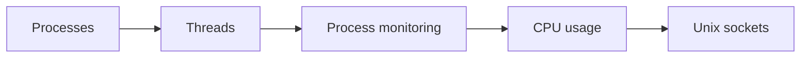

# Process management

How the operating system runs programs: processes, threads, their observation and control, CPU usage, and communication between processes through sockets.

## Map

The diagram shows the notes in reading order; subareas are marked with (subarea).

## Notes in reading order

1. [Processes](processes.md): creation with fork and exec, PIDs, states, signals and priorities.
2. [Threads](threads.md): what they share, user and kernel threads, multithreading and synchronization.
3. [Process monitoring](process-monitoring.md): Linux tools, monitoring systems and typical process problems.
4. [CPU usage](cpu-usage.md): CPU time categories, load average and the common causes of 100 percent CPU.
5. [Unix sockets](unix-sockets.md): network and Unix domain sockets, socket types and the sockets API.

## Planned topics

- CPU scheduling algorithms (CFS, EEVDF, real-time classes)
- Signals in depth
- Inter-process communication: pipes, message queues, shared memory
- Synchronization and deadlocks
- Control groups for resource limits
