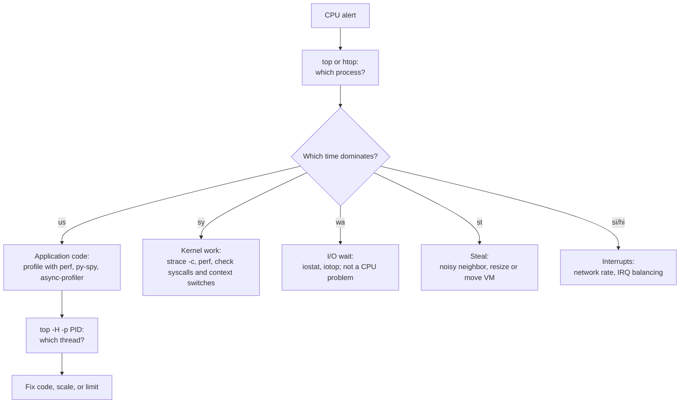
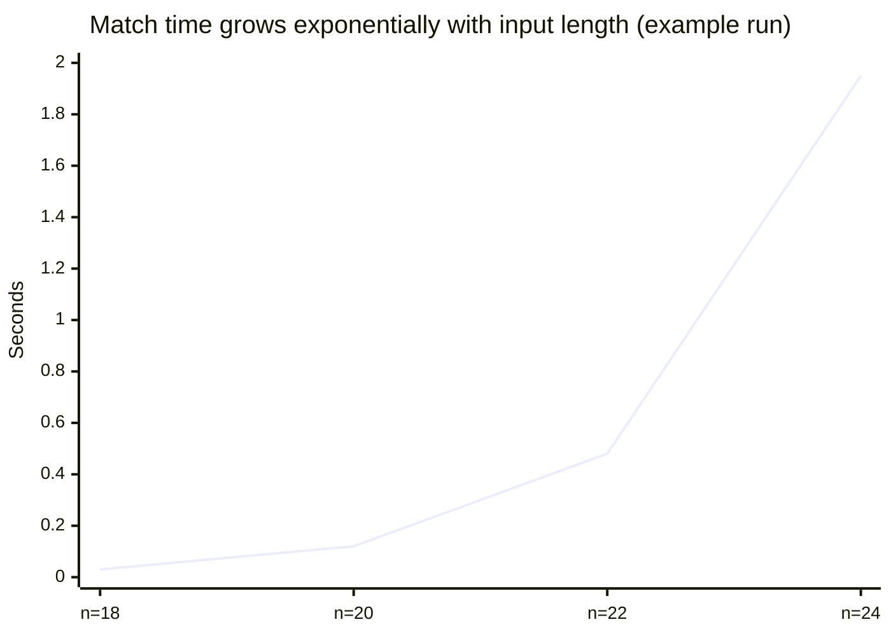

# CPU usage

## Summary

CPU usage is the share of time a processor spends executing work instead of idling. On Linux it is split into categories (user code, kernel code, waiting for I/O, handling interrupts, time stolen by a hypervisor), and that split tells you what kind of problem you have. A CPU stuck near 100 percent has a small number of typical causes: infinite loops, background processes, traffic spikes, resource-intensive applications, memory shortage that causes paging, too many concurrent processes, busy waiting, catastrophic regular expression backtracking, and malware. Diagnosing busy CPUs means finding which process, which thread and which code path consume the time, then deciding whether the load is legitimate (scale out) or a defect (fix it).

## Prerequisites

- [Operating system overview](../operating-system-overview.md) for processor management.
- [Processes](processes.md) and [Threads](threads.md).

## Core concepts

### How CPU time is accounted

The kernel counts, per CPU, how many clock ticks were spent in each state. Tools such as `top`, `vmstat` and `mpstat` show the percentages:

| Field | Meaning | High value usually means |
| --- | --- | --- |
| `us` (user) | Running application code in user mode | The application itself is busy (algorithms, loops, serialization) |
| `sy` (system) | Running kernel code for processes (system calls, scheduling) | Many system calls, context switches, network or file operations |
| `ni` (nice) | User code of processes with lowered priority | Background batch work |
| `id` (idle) | Nothing to run | Spare capacity |
| `wa` (iowait) | Idle while some task waits for disk I/O | Slow storage; the CPU is not actually busy |
| `hi`, `si` (hard and soft IRQ) | Handling hardware interrupts and deferred kernel work | Very high packet rates, network-heavy workloads |
| `st` (steal) | Time the hypervisor gave to other VMs | A noisy neighbor or an oversubscribed host in the cloud |

*Analogy.* A chef's working day. Cooking (user), filling in paperwork for the kitchen (system), waiting for a delivery while nothing else can be cooked (iowait), answering the doorbell (interrupts), and the restaurant owner borrowing the chef for another restaurant (steal). Saying "the chef is 100 percent busy" means little until you know which of these filled the day. The analogy breaks because a CPU core does exactly one of these at a time, measured to the tick, while a chef multitasks loosely.

### Load average compared with CPU usage

Linux load average is the exponentially weighted average number of tasks that are runnable or in uninterruptible sleep (usually waiting for disk) over 1, 5 and 15 minutes. On a 4-core machine a load of 4 means full use; 8 means tasks are waiting. Because uninterruptible tasks count, a high load with low CPU usage points at I/O.

### The nine common causes of 100 percent CPU usage

Understanding these causes helps diagnose problems and improve efficiency. The figure summarizes them.


| Cause | What happens | How to recognize it | Fix |
| --- | --- | --- | --- |
| 1. Infinite loops | A loop condition never becomes false (for example `while (1) { executeTask(); }`) | One thread at 100 percent of one core, constant, `us` time | Fix the code; add timeouts and iteration limits |
| 2. Background processes | System services run silently (automatic updates, scheduled scans, indexing, backups) | Known daemons at the top of `top` at regular times | Schedule them off-peak, lower priority with `nice` and `ionice`, limit with cgroups |
| 3. High traffic volume | Web servers are overwhelmed by sudden traffic spikes | CPU follows request rate; latency rises | Scale out, cache, rate limit, autoscale |
| 4. Resource-intensive applications | CPU-heavy computation such as video editing, encoding, simulations, compression | Expected processes at high `us` | Accept, schedule, add cores, or offload to GPUs |
| 5. Insufficient memory | Excessive paging and swapping make the CPU work to compensate for missing RAM; kernel threads (`kswapd`) burn CPU | High `sy` and `wa`, `si`/`so` non-zero in `vmstat` | Add memory, fix leaks, set memory limits |
| 6. Concurrent processes | Many applications compete for CPU at the same time | Run queue (`r` in `vmstat`) much larger than the core count, many context switches | Reduce parallelism, use worker pools sized to cores |
| 7. Busy waiting | Repeated checks (status polling, tight software timers) keep the processor from other work | A thread spinning at 100 percent while "waiting" | Block on events (sleep, condition variables, `epoll`) instead of polling |
| 8. Regex matching | Inefficient patterns with greedy, nested quantifiers trigger catastrophic backtracking | One request pins a core; input-dependent | Rewrite patterns, use linear-time engines (RE2), limit input size |
| 9. Viruses and malware | Malicious software hijacks resources for unauthorized tasks (cryptocurrency mining is the most common) | Unknown processes, odd names, outbound connections to mining pools | Isolate the host, investigate, rebuild from a known good image |

### Diagnostic workflow



## Worked example

Reproduce and diagnose a regular expression that burns CPU. Untested; Python 3.12 and Linux procps tools, checked 2026-11.

```python
# redos.py: catastrophic backtracking with a nested quantifier
import re, time
pattern = re.compile(r"^(a+)+$")
for n in (18, 20, 22, 24):
    s = "a" * n + "!"             # the "!" forces the match to fail after trying every split
    t = time.perf_counter()
    pattern.match(s)
    print(n, round(time.perf_counter() - t, 3), "s")
```

Example output on a laptop (times roughly double with each extra character, so they vary by machine):

```text
18 0.03 s
20 0.12 s
22 0.48 s
24 1.95 s
```



Diagnosis while it runs with a larger `n`:

```bash
top -b -n 1 | head -12          # python at about 100 percent of one core, us time high
top -H -p "$(pgrep -f redos.py)"  # one thread is hot
py-spy dump --pid "$(pgrep -f redos.py)"   # stack shows re.match: the culprit
```

The fix is to remove the nested quantifier (`^a+$` matches the same strings in linear time) or to use an engine without backtracking.

## Trade offs and when to use it

- **High CPU is not always bad.** A batch job at 100 percent is using what you pay for; a web server at 100 percent has no headroom for spikes. Keep latency-sensitive services below about 60 to 70 percent sustained.
- **Limiting** with cgroups (`cpu.max` in cgroup v2, container CPU limits) protects neighbors but causes throttling, which adds latency even when the host has idle CPU.
- **Scaling out** fixes legitimate load; it does not fix loops, busy waiting or bad regexes, which simply consume more machines.

## Common mistakes

- **Treating iowait as CPU usage.** The CPU is idle in `wa`. Fix: investigate storage.
- **Ignoring steal time in the cloud.** Fix: watch `st`; burstable instance types also throttle when their credits run out.
- **Killing the process without capturing evidence.** Fix: take a stack dump or profile first, then restart.
- **Misreading `top` on multi-core machines.** A process at 400 percent uses four full cores; press `1` in `top` for per-core figures.

## Practice

1. A server shows 90 percent `wa` and a load average of 12 on 4 cores. Is the CPU overloaded?
2. Which `top` field reveals a noisy neighbor in a VM?
3. Why does busy waiting waste CPU, and what should replace it?
4. Why does adding one character to the input double the time in the worked example?

Answers:

1. No. The CPUs are mostly idle and waiting for I/O; the load is high because tasks are blocked on disk. Investigate storage.
2. `st` (steal time).
3. The thread repeatedly checks a condition and uses the CPU without doing work. It should block until notified (sleep, condition variables, event APIs such as `epoll`).
4. The nested quantifier lets the engine split the string of `a` characters in exponentially many ways, and it tries all of them before failing.

## Further reading

- [proc_stat(5)](https://man7.org/linux/man-pages/man5/proc_stat.5.html) (Linux man-pages project): the CPU time fields behind `top` and `vmstat`.
- *Systems Performance*, 2nd edition (Brendan Gregg, Addison-Wesley, 2020): the CPU chapter and the USE method.
- [Linux load averages: solving the mystery](https://www.brendangregg.com/blog/2017-08-08/linux-load-averages.html) (Brendan Gregg, 2017): why load includes uninterruptible tasks.
- [OWASP: Regular expression denial of service](https://owasp.org/www-community/attacks/Regular_expression_Denial_of_Service_-_ReDoS) (OWASP): catastrophic backtracking as an attack.
