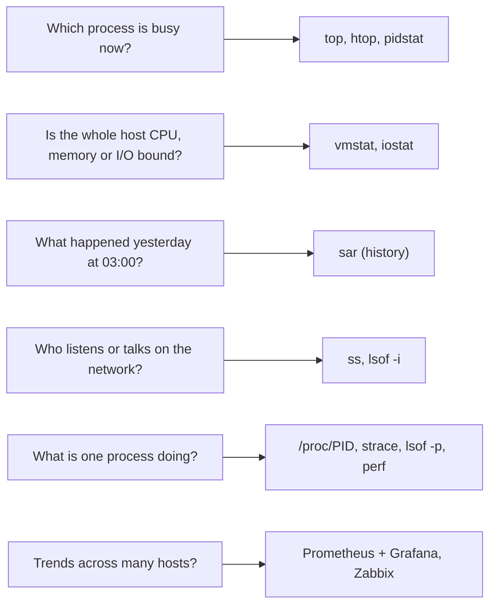

# Process monitoring

## Summary

Process monitoring is the tracking of processes and the system resources they use (CPU, memory, disk I/O, network, file descriptors) in order to keep a system healthy, find performance bottlenecks, and catch unexpected behavior and failures early. On a single Linux host it is done interactively with built-in tools (`top`, `htop`, `ps`, `vmstat`, `iostat`, `ss`, `pidstat`, `sar`); across a fleet it is done continuously with monitoring systems such as Prometheus with Grafana, Nagios, Zabbix or Datadog. The same few problems recur: stealth (hidden) processes, zombies, high CPU, memory leaks, deadlocks and resource contention, each with its own detection method and fix.

## Prerequisites

- [Processes](processes.md) for states, signals and PIDs.
- [CPU usage](cpu-usage.md) for the CPU time categories.

## Core concepts

### Why monitor processes

Most production incidents on a host come down to a process that uses too much of something (CPU, memory, file descriptors, disk I/O), stops responding, or dies. Monitoring answers four questions: what is running, how much does each process use, how does that change over time, and is anything running that should not be.

*Analogy.* A hospital ward. Bedside monitors (top, htop) show each patient's vital signs right now; the chart at the foot of the bed (sar, Prometheus) shows the trend over days; and security (rootkit scanners) checks that nobody in a bed is not a real patient. The analogy breaks because a process can lie about its vital signs if it controls the kernel (rootkits), which patients cannot.

### Key metrics and parameters

| Metric | Meaning | Where to read it |
| --- | --- | --- |
| CPU usage | Share of CPU time used by each process | `top`, `ps -o pcpu`, `pidstat -u` |
| Memory usage | Physical (RSS) and virtual (VSZ) memory per process | `top`, `ps -o rss,vsz`, `pidstat -r`, `/proc/PID/status` |
| Disk I/O | Read and write operations per process | `pidstat -d`, `iotop`, `/proc/PID/io` |
| Network activity | Data sent and received per process and socket | `ss -tp`, `nethogs` |
| Process states | Running, sleeping, waiting (D), stopped, zombie | `ps -o stat`, `top` |
| Thread count | Threads per process | `ps -o nlwp`, `/proc/PID/status` (`Threads:`) |
| Process lifetime | How long a process has been running | `ps -o etime,lstart` |
| Open files and sockets | File descriptors in use against the limit | `ls /proc/PID/fd | wc -l`, `lsof -p PID`, `/proc/PID/limits` |

### Built-in Linux tools

| Tool | Description | Key metrics | Example |
| --- | --- | --- | --- |
| `top` | Real-time, dynamic view of processes | CPU, memory, load average, states, PID, user, command | `top`, then `1` per-core, `M` sort by memory, `H` threads |
| `htop` | Enhanced, interactive `top`: colors, sorting, tree view, process details | Same as top, easier to read | `htop` |
| `ps` | Snapshot of active processes | PID, TTY, time, command, CPU and memory | `ps aux`, `ps -eo pid,ppid,stat,pcpu,rss,cmd --sort=-pcpu` |
| `vmstat` | Virtual memory statistics: processes, memory, paging, block I/O, traps, CPU | Run queue, swap activity, I/O, context switches | `vmstat 1` |
| `iostat` | CPU and device I/O statistics (sysstat package) | Device utilization, throughput, latency (`await`) | `iostat -x 1` |
| `netstat` | Connections, routing tables, interface statistics, masquerade connections, multicast memberships (net-tools, deprecated on most distributions) | Active connections, interface statistics | `netstat -tuln` |
| `ss` | The modern replacement for `netstat` (iproute2) | Sockets, states, owning processes | `ss -tulpn` |
| `dstat` | Combined vmstat, iostat and netstat view (the original is unmaintained; `dool` or `pcp-dstat` replace it) | CPU, memory, disk, network | `dstat` |
| `pidstat` | Statistics per task (process) by PID (sysstat) | CPU, memory, I/O, context switches per process | `pidstat 1`, `pidstat -d 1` |
| `sar` | Collects, reports and saves system activity history (sysstat) | CPU, memory, I/O, network over days | `sar -u 1`, `sar -r -f /var/log/sysstat/sa09` |

The diagram shows which tool answers which question.



### Monitoring systems

| Tool | Description | Key features | Typical use |
| --- | --- | --- | --- |
| Prometheus | Open source monitoring and alerting toolkit built for reliability and scale | Multi-dimensional data model with labels, PromQL, alerting with Alertmanager; `node_exporter` and `process-exporter` expose host and process metrics | Collect metrics from applications, system components and infrastructure |
| Grafana | Open source platform for visualizing time-series data | Dashboards, alerting, many data sources including Prometheus | Visualize and analyze metrics |
| [Nagios](../../observability/monitoring-tools/nagios.md) | Monitoring system for IT infrastructure problems | Checks of network services and host resources, alerting | Service and threshold checks with notifications |
| Zabbix | Enterprise monitoring platform for networks, servers and applications | Agents and SNMP collection, alerting, visualization | Comprehensive dashboards and alerts across mixed infrastructure |
| Datadog | SaaS monitoring and analytics for cloud-scale applications | Real-time monitoring, dashboards, alerting, many cloud integrations, live process view | Metrics from applications, infrastructure and cloud services |

See [Monitoring](../../observability/monitoring.md) for alerting principles.

### Process-related issues

**Stealth processes.** Malicious processes designed to avoid detection by ordinary tools, often with rootkits that hide them from the process table, `/proc` and tool output. Detection tools (to be run from trusted media when compromise is suspected, because a kernel rootkit can lie to them too):

```bash
chkrootkit               # scans for known rootkit signatures
rkhunter --check         # checks for rootkits, backdoors and local exploits
lynis audit system       # security audit and hardening suggestions
```

Other signs: CPU usage in `top` that does not add up, unexplained outbound connections, PIDs present in `/proc` but missing from `ps`, and file integrity changes (AIDE, package verification with `rpm -Va` or `debsums`). Practice these only on systems you own or are authorized to test; a confirmed compromise means isolating and rebuilding the host.

**Zombie processes.** Processes that finished but still have an entry in the process table, because the parent has not read the child's exit status. Detect them:

```bash
ps -eo pid,ppid,stat,cmd | awk '$3 ~ /^Z/'
```

Handling: sending `SIGCHLD` to the parent (`kill -s SIGCHLD <parent_pid>`) can prompt a parent that has a handler to reap its children; if the parent is broken, restart or kill the parent so that init adopts and reaps the zombies. Killing the zombie itself does nothing. See [Processes](processes.md#process-states).

**High CPU usage.** Processes consuming excessive CPU degrade the system. Detect with `top` or `htop`, identify the process and thread, capture evidence (`perf top -p PID`, a stack dump), then optimize, limit or terminate it: `kill <pid>` first (SIGTERM), `kill -9 <pid>` only if it does not exit. See [CPU usage](cpu-usage.md).

**Memory leaks.** A process that continuously consumes more memory over time until the system runs out (and the OOM killer acts). Watch RSS over time (`pidstat -r 60`, Prometheus `process_resident_memory_bytes`) and confirm in development with leak detectors:

```bash
valgrind --leak-check=yes ./your_program
```

For managed runtimes, use heap dumps and profilers (`jmap`, `tracemalloc`, `pprof`). See [Memory management](../memory-management/memory-management.md).

**Deadlocks.** Two or more processes or threads wait indefinitely for resources held by each other. Symptoms: processes in `S` or `D` state using no CPU while requests time out. Identify with logs, thread dumps (`jstack`, `py-spy dump`, `gdb -p PID -batch -ex "thread apply all bt"`) and database lock views; resolve by redesigning code to avoid circular waits (consistent lock ordering, timeouts).

**Resource contention.** Several processes compete for the same CPU, memory or I/O, degrading performance. Monitor with `top`, `htop`, `iostat` and `vmstat`, and limit the offenders with control groups. The classic cgroup v1 tools:

```bash
cgcreate -g cpu:/limited
cgset -r cpu.shares=512 limited          # half the default weight of 1024 (cgroup v1)
cgexec -g cpu:limited your_command
```

Current distributions use cgroup v2, where systemd is the usual interface:

```bash
systemd-run --scope -p CPUWeight=50 -p MemoryMax=2G your_command   # weight 50 of default 100, hard memory cap
systemctl set-property backup.service CPUQuota=25%                  # cap an existing service at a quarter of one CPU
```

## Worked example

A web service slows down every night around 02:00. Investigation on the host the next morning (untested; sysstat 12.x on Ubuntu 24.04, checked 2026-11; output shortened and illustrative):

```bash
sar -u -s 01:50:00 -e 02:20:00          # CPU history
```

```text
01:50:01   %user  %nice %system %iowait  %idle
02:00:01    18.2    0.1     4.0    41.7   36.0
02:10:01    17.9    0.1     3.8    44.1   34.1
```

High `%iowait`, not CPU. Disk history:

```bash
sar -d -s 01:50:00 -e 02:20:00 -p       # per-device I/O, with device names
```

```text
02:00:01   DEV   tps   rkB/s    wkB/s   await  %util
02:00:01   sda   980   1200.0  98000.0  45.30  99.6
```

The disk is saturated by writes. Which process? `pidstat` was not recording then, so repeat the next night with `pidstat -d 60 > /tmp/pidstat.log &` or check the scheduled jobs:

```bash
systemctl list-timers --all | grep -i 02:00
# Sun 2026-11-09 02:00:00  ...  backup.timer  backup.service
```

The backup job writes 98 MB/s to the same disk the database uses. Fixes, from cheapest: lower its I/O priority (`IOSchedulingClass=idle` in the unit), cap its bandwidth (`IOWriteBandwidthMax=/dev/sda 20M`), or move backups to another disk or a replica.

## Trade offs and when to use it

- **Interactive tools** are for diagnosis on one host, now; **history** (`sar`, Prometheus) is needed for problems that happened while nobody was watching. Install sysstat collection on every server.
- **Per-process metrics at scale** create high cardinality in monitoring systems; collect them for named, important processes (process-exporter groups) rather than every PID.
- **Agent-based monitoring** (Zabbix, Datadog) is easy to roll out; **exporters with Prometheus** are open and flexible but need more assembly.

## Common mistakes

- **Using `kill -9` on everything** (as some quick guides suggest). Fix: SIGTERM first; capture evidence before killing.
- **Trusting `ps` on a compromised host.** Fix: investigate from trusted media or a forensic copy.
- **Reading VSZ as memory use.** Virtual size includes reserved, unused address space. Fix: use RSS, or PSS (`smem`) for shared pages.
- **No historical data.** Fix: enable sysstat (`sar`) and central metrics.

## Practice

1. Which tool shows yesterday's CPU usage at 03:00 without any monitoring system?
2. Why does killing a zombie process not work, and what does?
3. What is the cgroup v2 equivalent of `cpu.shares=512` in systemd terms?
4. A process's RSS grows by 50 MB every hour and never shrinks. What do you suspect, and how do you confirm it?
5. Why should rootkit scans be run from trusted media after a suspected compromise?

Answers:

1. `sar` from the sysstat package, if its data collection is enabled.
2. A zombie is already dead; only its process table entry remains. The parent must reap it, or the parent must exit so that init adopts and reaps it.
3. `CPUWeight=50` (half the default weight of 100).
4. A memory leak; confirm by tracking RSS over time and using a leak detector or heap profiler (valgrind, heap dumps).
5. A kernel-level rootkit can hide processes and files from tools running on the compromised system.

## Further reading

- *Systems Performance*, 2nd edition (Brendan Gregg, Addison-Wesley, 2020): methodology and tools for Linux performance analysis.
- [sysstat documentation](https://sysstat.github.io/) (sysstat project): `sar`, `iostat` and `pidstat`.
- [proc(5)](https://man7.org/linux/man-pages/man5/proc.5.html) (Linux man-pages project): the `/proc` interface behind every tool above.
- [Control Group v2](https://docs.kernel.org/admin-guide/cgroup-v2.html) (Linux kernel documentation): resource control used for contention.
- [Prometheus node exporter](https://github.com/prometheus/node_exporter) (Prometheus project): host metrics for long-term monitoring.
