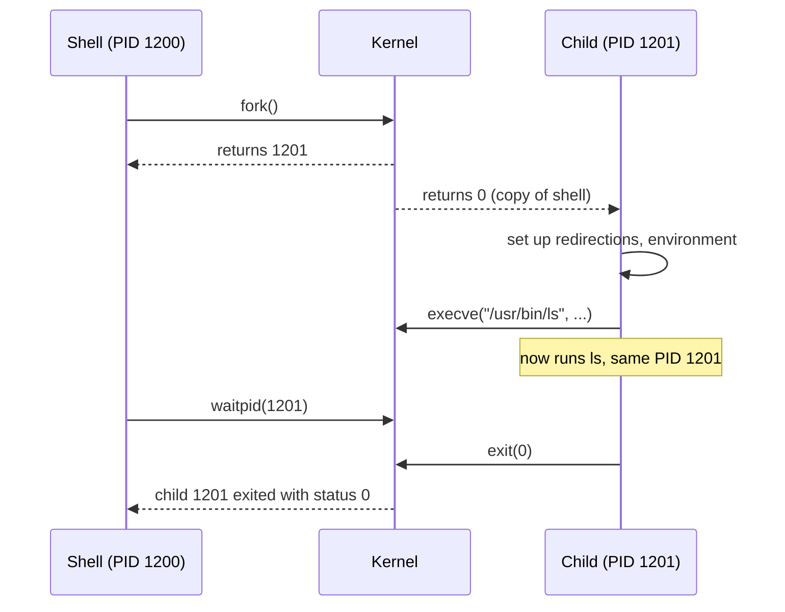
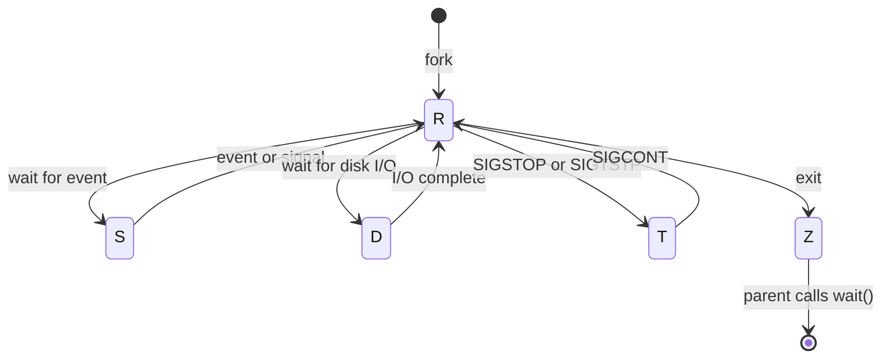
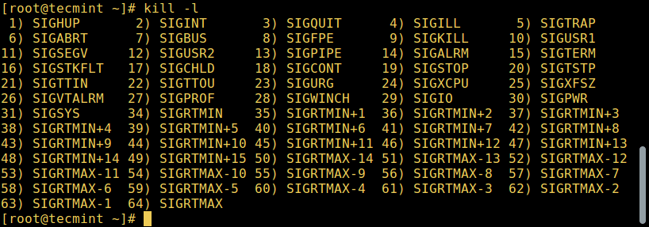

# Processes

## Summary

A process is a program in execution: a running instance of a program together with its memory, open files, environment, credentials and state, identified by a process ID (PID). On Linux, new processes are created by an existing process copying itself (`fork`) and usually replacing the copy's program (`exec`), so every process except PID 1 has a parent (PPID). Processes move between states (running, waiting, stopped, zombie), run in the foreground attached to a terminal or in the background, and long-running background services are called daemons. Administrators observe processes with `ps`, `top` and similar tools, control them with signals (`kill`, `pkill`) and influence scheduling with nice values.

## Prerequisites

- [Operating system overview](../operating-system-overview.md) for processor management and system calls.
- Basic shell use ([Terminal](../shell-and-terminal/terminal.md)).

## Core concepts

### Definition

A *process* is a program in execution. A program is a passive file on disk; a process is the active entity that the kernel schedules. It consists of the program instructions, data read from files, other programs or user input, and the kernel's bookkeeping about it. For each process the kernel keeps a *process control block* (on Linux, `struct task_struct`) with:

- PID, PPID, user and group IDs,
- state and scheduling information (priority, nice value, CPU affinity),
- the memory map (code, data, heap, stack, shared libraries),
- open file descriptors, current directory, environment, signal handlers,
- resource limits and accounting.

*Analogy.* A recipe compared with cooking. The recipe in a book is the program; a cook actually preparing it, with ingredients on the counter, pans on the stove and a current step, is the process. Two cooks can follow the same recipe at the same time as two separate processes. The analogy breaks at creation: a new cook in the kitchen is not hired from outside but by an existing cook cloning themselves, which is how `fork` works.

### Types of processes

- **Foreground processes** (interactive): started and controlled from a terminal session. A user must be connected to start them; they are not started automatically as part of system services.
- **Background processes** (non-interactive or automatic): not connected to a terminal and not expecting user input.
- **Daemons**: a special kind of background process that starts at system startup and keeps running as a service. They are started as system tasks and controlled by the init system (on most distributions systemd, see [Startup management](../system-administration/startup-management.md)). By tradition their names end in `d` (`sshd`, `crond`, `systemd-journald`).

### Creating processes

A new process is normally created when an existing process makes a copy of itself in memory. The child has the same environment as its parent; its process ID differs.

- **`fork()` and `exec()`.** `fork` duplicates the calling process (copy-on-write makes this cheap: memory pages are shared until one side writes). The child then calls an `exec` function to replace its program with a new one. Splitting the two steps lets the child adjust its environment (redirect file descriptors, drop privileges, change directory) before running the new program. This is how every shell starts commands. It is flexible, fast and secure.
- **`system()`.** A C library function that runs a command string through `/bin/sh -c`. It is simple but inefficient (an extra shell process) and risky: if the string contains untrusted input, it enables shell injection.
- Newer interfaces: `posix_spawn()` combines fork and exec efficiently, and Linux's `clone()` creates processes and threads with fine-grained control over what is shared (it is also how containers get new namespaces).



### Identifying processes: PID, PPID and init

Linux is a multi-user system, so each running instance of a program must be identified uniquely by the kernel. A process is identified by its *process ID* (PID) and its *parent process ID* (PPID). This gives two roles:

- **Parent processes** create other processes at runtime.
- **Child processes** are created by other processes at runtime.

The **init process** is the parent of all processes. It is the first program executed when Linux boots, started by the kernel itself, so it has no parent process in principle (its PPID is 0). It always has PID 1, manages the other processes and adopts orphaned processes (children whose parent died). On most modern distributions init is systemd; `pidof` finds the PID of a running program:

```bash
pidof systemd
pidof top
pidof httpd
```

In a container, the application usually runs as PID 1 of its own PID namespace, so it inherits init's duties: reaping orphaned children and handling `SIGTERM` (the kernel does not apply default signal actions to PID 1 for signals it has no handler for). Tiny init programs such as `tini` (`docker run --init`) solve this.

### Foreground and background jobs

Running a command (for example `cloudcmd`, a web file manager) starts a foreground process connected to the terminal; the user can send it input:

```bash
cloudcmd
```

Shell *job control* moves processes between foreground and background:

- `command &` starts a process in the background; it does not read input from the terminal until moved to the foreground.
- `Ctrl+Z` suspends the foreground process by sending it `SIGTSTP` (terminal stop); it becomes stopped (idle).
- `bg` resumes a stopped job in the background, `fg` brings a job to the foreground, `jobs` lists jobs.
- `nohup command &` or `setsid` keeps a process running after the terminal closes; for real services use systemd units instead.

### Process states

During execution a process changes state depending on its circumstances. The classic textbook model has five states: a process is *created*, admitted to *ready*, dispatched by the scheduler to *running*, moved to *waiting* when it needs I/O or an event, back to *ready* when the event completes, interrupted back to *ready* when its time slice ends, and *terminated* when it exits.


Linux states, as shown in the `STAT` column of `ps`:

| Linux state | `ps` code | Meaning |
| --- | --- | --- |
| Running or runnable | `R` | Currently executing on a CPU, or ready and waiting in the run queue for a CPU |
| Interruptible sleep | `S` | Waiting for an event or resource (input, a timer, a lock); wakes up on signals |
| Uninterruptible sleep | `D` | Waiting directly on hardware conditions (usually disk or NFS I/O); cannot be interrupted by signals, not even `SIGKILL` |
| Stopped | `T` | Stopped by a signal (`SIGSTOP`, `SIGTSTP`), for example a job suspended with `Ctrl+Z` |
| Traced | `t` | Stopped by a debugger |
| Zombie | `Z` | Terminated, but its entry stays in the process table until the parent reads its exit status with `wait()` |
| Idle kernel thread | `I` | Kernel threads that are idle |



A zombie uses no CPU or memory, only a process table slot and its PID. Many zombies mean a parent that does not reap its children; killing the zombie has no effect, but killing or fixing the parent lets init adopt and reap them.

### Viewing processes

- **`ps`** displays a snapshot of selected processes:

  ```bash
  ps                      # processes of the current terminal
  ps -e | head            # every process (POSIX syntax)
  ps aux                  # every process with user, CPU, memory, state (BSD syntax)
  ps -ef --forest         # full listing with the parent and child tree
  ps -o pid,ppid,stat,ni,pcpu,rss,cmd -p 2308   # chosen columns for one PID
  ```

- **`top`** gives a dynamic real-time view of a running system (`htop` is a friendlier alternative).
- **`glances`** is a newer monitoring tool with a broader overview (CPU, memory, disk, network, sensors, containers).
- **`pstree`** shows the process tree; **`/proc/<PID>/`** exposes everything the kernel knows about a process (`status`, `cmdline`, `fd/`, `limits`).

See [Process monitoring](process-monitoring.md) for these tools in depth.

### Controlling processes

`kill`, `pkill`, `pgrep` and `killall` find and signal processes:

```bash
pgrep -u alice top         # PIDs of top processes owned by alice
kill 2308                  # send SIGTERM to PID 2308
pgrep -u alice top         # no output: it is gone
pgrep -u alice glances
pkill glances              # signal by name
pgrep -u alice glances
killall nginx              # signal all processes with that exact name
```

### Signals

Signals are the fundamental way to control processes: small asynchronous notifications delivered by the kernel. `kill -l` lists them; Linux has 31 standard signals plus real-time signals (`SIGRTMIN` to `SIGRTMAX`).



A program reacts to a signal with its default action (terminate, terminate with core dump, stop, continue or ignore) unless it installs its own handler; `SIGKILL` and `SIGSTOP` cannot be caught, blocked or ignored. Most signals are used internally by the system or by programmers. Those useful to administrators:

| Signal | Number | Sent when | Default action |
| --- | --- | --- | --- |
| `SIGHUP` | 1 | The controlling terminal is closed; by convention daemons reload configuration on it | Terminate |
| `SIGINT` | 2 | The user presses `Ctrl+C` | Terminate |
| `SIGQUIT` | 3 | The user presses `Ctrl+\` (`Ctrl+D` is not a signal, it sends end-of-file to the input) | Terminate with core dump |
| `SIGKILL` | 9 | Explicit kill; terminates immediately without any cleanup | Terminate (cannot be caught) |
| `SIGTERM` | 15 | Polite termination request; `kill` sends it by default | Terminate (can be caught to clean up) |
| `SIGCHLD` | 17 | A child stopped or exited | Ignore |
| `SIGCONT` | 18 | Resume a stopped process | Continue |
| `SIGSTOP` | 19 | Stop unconditionally | Stop (cannot be caught) |
| `SIGTSTP` | 20 | The user presses `Ctrl+Z` (terminal stop) | Stop |

Signal numbers above follow Linux on x86 and ARM; some differ on other architectures, so scripts should use names (`kill -TERM`).

### Process priority and nice values

All processes have a priority and a *nice value*. Processes with higher priority normally get more CPU time. The nice value ranges from -20 (highest priority, least nice to others) to 19 (lowest priority); the default is 0. Normal users can set values from 0 to 19 on their own processes and can only increase them; only root can set negative values or lower a value.

```bash
nice -n 10 tar czf backup.tgz /data      # start with nice 10
renice +8 2687                           # change the nice value of PID 2687 to 8
renice +8 -p 2103                        # same for PID 2103
ionice -c3 -p 2103                       # I/O priority: idle class
```

With the Completely Fair Scheduler (and its successor EEVDF since Linux 6.6), each nice step changes the CPU weight by about 10 percent relative to a neighbor.

## Worked example

Find and fix a process tree that leaks zombies. Untested; Ubuntu 24.04 with procps-ng, checked 2026-11. PIDs are illustrative.

```bash
ps -eo pid,ppid,stat,cmd | awk '$3 ~ /Z/'
```

```text
  4310  4100 Z    [worker] <defunct>
  4311  4100 Z    [worker] <defunct>
  4312  4100 Z    [worker] <defunct>
```

All zombies share PPID 4100. Inspect the parent:

```bash
ps -o pid,ppid,stat,etime,cmd -p 4100
# 4100  1 Sl  3-02:11:45  python3 /opt/jobs/dispatcher.py
```

The dispatcher starts workers but never calls `wait()`. Killing the zombies does nothing (`kill -9 4310` has no effect). Options:

1. Fix the code to reap children (`subprocess.Popen(...).wait()`, or a `SIGCHLD` handler).
2. As a workaround, restart the parent: `kill -TERM 4100`. Its children are re-parented to PID 1, which reaps them, and the zombies disappear.
3. In a container, run with an init (`docker run --init`) so orphans are reaped.

## Trade offs and when to use it

- **`SIGTERM` before `SIGKILL`.** Always give a process a chance to flush data and release locks; send `SIGKILL` only after a timeout (systemd and Kubernetes both do this, with a default grace period of 90 and 30 seconds respectively).
- **Background jobs with `&` and `nohup`** are fine for ad hoc work; anything that must survive reboots, restart on failure or log properly belongs in a systemd service.
- **Nice values** influence CPU share among competing processes but do not cap usage; use cgroups for hard limits.

## Common mistakes

- **`kill -9` as the first resort.** Data is not flushed, temporary files and locks remain. Fix: `SIGTERM`, wait, then `SIGKILL`.
- **Trying to kill a process in `D` state.** It ignores signals until the I/O completes. Fix: find the stuck device or NFS server.
- **Trying to kill zombies.** They are already dead. Fix: make the parent reap them.
- **Using `system()` with user input.** Shell injection. Fix: `execve` or `posix_spawn` with an argument list, or `subprocess.run([...])` without `shell=True`.

## Practice

1. What is the difference between a program and a process?
2. Why does Unix split process creation into `fork` and `exec`?
3. Which signal does `Ctrl+Z` send, and which one does `Ctrl+C` send?
4. A process is in state `D` and ignores `kill -9`. Why?
5. Which PID adopts orphaned processes, and why does this matter in containers?

Answers:

1. A program is a passive file with instructions; a process is a running instance with memory, state and resources.
2. So that the child can adjust its environment (redirections, privileges, directory) between copying the parent and starting the new program.
3. `SIGTSTP` for `Ctrl+Z` and `SIGINT` for `Ctrl+C`.
4. It is in uninterruptible sleep waiting on hardware I/O; signals are delivered only after the operation completes.
5. PID 1. In a container the application often is PID 1, so it must reap orphans and handle termination signals itself, or run under a small init.

## Further reading

- [fork(2)](https://man7.org/linux/man-pages/man2/fork.2.html), [execve(2)](https://man7.org/linux/man-pages/man2/execve.2.html) and [signal(7)](https://man7.org/linux/man-pages/man7/signal.7.html) (Linux man-pages project): process creation and signals.
- [ps(1)](https://man7.org/linux/man-pages/man1/ps.1.html) (Linux man-pages project): process state codes and output formats.
- *The Linux Programming Interface* (Michael Kerrisk, No Starch Press, 2010): chapters on process creation, signals and process groups.
- *Operating System Concepts*, 10th edition (Silberschatz, Galvin, Gagne, Wiley, 2018): the process state model.
