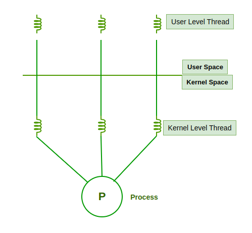

# Threads

## Summary

A thread is a single sequential flow of execution within a process. A process can contain many threads; they share the process's address space (code, data, heap), open files and signal handlers, but each thread has its own program counter, registers and stack. Because they share memory, threads are cheaper to create and to switch between than processes and can communicate without inter-process communication, which makes them the basic tool for concurrency and for using multiple CPU cores in one program. The price is that shared data must be synchronized, and bugs such as race conditions and deadlocks appear. Threads can be managed in user space, by the kernel, or by a combination of both; on Linux every thread is a kernel-scheduled task.

## Prerequisites

- [Processes](processes.md) for address spaces, scheduling and the process control block.

## Core concepts

### Definition

A thread is a single sequence stream within a process, also called a *thread of execution* or *thread of control*. Threads are called *lightweight processes* because they have some properties of processes (they are scheduled, have states such as ready, running and blocked, and have priorities), but each thread belongs to exactly one process. In an operating system that supports multithreading, a process consists of one or more threads.

Threads give real parallelism only with more than one CPU core; on a single core, two threads take turns through context switches, which still helps responsiveness (one thread can wait for I/O while another works) but not raw throughput.

*Analogy.* A process is a kitchen; threads are the cooks working in it. They share the fridge, the counter and the recipes (memory, files), so they can hand ingredients to each other directly. But two cooks reaching for the same knife at once need a rule about who takes it (synchronization), or they collide (race condition). Separate kitchens (processes) never collide but must send dishes through a hatch (inter-process communication). The analogy breaks on cost: in software, adding a thread costs only a stack and a control block.

### Why threads are used

- **Parallelism.** Threads run in parallel on multiple cores, which improves application performance. Each thread has its own CPU state and stack but shares the address space and environment of the process.
- **Shared data.** Threads share common data, so they need no inter-process communication.
- **Scheduling.** Like processes, threads have states (ready, executing, blocked) and priorities; the scheduler picks the highest priority ready thread.
- **Thread control block (TCB).** Each thread has its own TCB. On a thread context switch, register contents are saved in the TCB. Because threads share the address space and resources, their activities must be synchronized.

### What threads share and what they own

The figure contrasts a single-threaded process with a multithreaded one: in both, code, data and files belong to the process; in the multithreaded process each thread has its own registers, stack and program counter.


| Per process (shared by all threads) | Per thread |
| --- | --- |
| Address space: code section, data section, heap | Program counter |
| Open files and sockets | Register set |
| Signal handlers and process ID | Stack (local variables, return addresses) |
| Current directory, credentials, environment | Thread ID, scheduling state and priority |
| | Thread-local storage, signal mask |

The basic per-thread components are therefore the stack space, the register set and the program counter.

### Process compared with thread

The primary difference is that threads of the same process run in a shared memory space, while processes run in separate memory spaces. Threads are not independent of one another as processes are: they share code, data and OS resources such as open files and signals. Like a process, a thread has its own program counter, register set and stack.

| Aspect | Process | Thread |
| --- | --- | --- |
| Memory | Own address space | Shares the process address space |
| Creation cost | Higher (new address space, page tables) | Lower (stack and control block) |
| Context switch | Slower (address space switch, TLB effects) | Faster (same address space) |
| Communication | IPC: pipes, sockets, shared memory | Directly through shared memory |
| Fault isolation | A crash affects one process | A crash (for example a segmentation fault) kills the whole process |
| Synchronization needs | Only for explicitly shared resources | For all shared data |

### User-level and kernel-level threads

Threads come in two types: user-level threads, managed in user space, and kernel-level threads, managed by the operating system. The figure shows user-level threads in user space mapped onto kernel-level threads in kernel space, all belonging to one process.



**User-level threads** are created and managed by a library in user space without system calls; the kernel does not know about them and sees only the process (a single kernel-level entity).

- Advantages: easier to implement than kernel threads; context switches are faster (no kernel transition); more efficient for many small tasks; simple representation, since a thread consists only of a program counter, register set and stack space.
- Disadvantages: no coordination between threads and the kernel, so the kernel cannot schedule them on several cores; when one thread blocks (for example on a page fault or a blocking system call), the whole process blocks.

**Kernel-level threads** are recognized and managed by the operating system, which keeps a thread table of all threads in the system.

- Advantages: the kernel has up-to-date information on all threads and can schedule them on multiple cores; applications that block frequently are handled well because one blocked thread does not block the others; the kernel can give more CPU time to a process with many threads.
- Disadvantages: slower than user-level threads (creation and switches need kernel transitions); more complex to implement.

Threading models map one onto the other:

| Model | Mapping | Examples |
| --- | --- | --- |
| Many-to-one | All user threads on one kernel thread | Early green threads; no parallelism |
| One-to-one | Each user thread is a kernel thread | Linux NPTL (`pthread`), Windows threads, Java platform threads |
| Many-to-many (M:N) | Many user threads multiplexed on fewer kernel threads | Go goroutines, Java virtual threads (Java 21), Erlang processes |

On Linux, threads are created with `clone()` sharing memory and files with the parent; the kernel treats each as a task with its own thread ID (TID). `ps -eLf` and `top -H` show them.

### Multithreading

Multithreading divides a process into multiple threads to achieve parallelism and responsiveness. In a word processor, one thread can format text while another processes input and a third checks spelling; in a browser, different tabs or rendering tasks run on different threads (modern browsers also use separate processes per site for isolation). Multithreading lets multiple threads share the resources of one process, such as CPU time, memory and I/O devices.

### Benefits

- **Responsiveness.** When a process is divided into threads, the result of one finished thread can be returned immediately, and a long task does not freeze the user interface.
- **Faster context switches.** Switching between threads costs less than switching between processes, which needs more CPU overhead.
- **Effective use of multiprocessors.** Threads of one process are scheduled on several processors, so execution is faster.
- **Resource sharing.** Code, data and files are shared among all threads of a process; stacks and registers are not shared, each thread has its own.
- **Communication.** Threads communicate easily through the common address space; processes need specific IPC mechanisms.
- **Higher throughput.** If each thread's function is one job, more jobs complete per unit of time.

### Synchronization and its failure modes

Shared memory requires coordination. Without it:

- **Race condition.** The result depends on the timing of threads, for example two threads incrementing a counter and losing updates.
- **Deadlock.** Two threads each hold a lock the other needs and wait forever.
- **Starvation and priority inversion.** A thread never gets a resource, or a low-priority thread holding a lock blocks a high-priority one.

Tools: mutexes, read-write locks, semaphores, condition variables, atomic operations, and higher-level structures such as concurrent queues. Languages with a global interpreter lock (CPython before the optional free-threaded build of 3.13) run only one thread of Python code at a time, so they use processes or native code for CPU parallelism.

## Worked example

A lost update caused by a race, and the fix. Untested; Python 3.12 (CPython with the GIL; the race still appears because `+=` is several bytecode steps), checked 2026-11.

```python
import threading

counter = 0
lock = threading.Lock()

def unsafe(n):
    global counter
    for _ in range(n):
        counter += 1          # read, add, write: another thread can interleave between steps

def safe(n):
    global counter
    for _ in range(n):
        with lock:            # only one thread at a time executes the critical section
            counter += 1

for worker in (unsafe, safe):
    counter = 0
    threads = [threading.Thread(target=worker, args=(1_000_000,)) for _ in range(4)]
    for t in threads: t.start()
    for t in threads: t.join()
    print(worker.__name__, counter)
```

Typical output (the unsafe value varies between runs, and some runs may be correct by chance):

```text
unsafe 2873102
safe 4000000
```

Inspecting threads of a running process on Linux:

```bash
ps -o pid,tid,stat,pcpu,comm -L -p "$(pgrep -f worker.py)"   # one line per thread (TID)
ls /proc/"$(pgrep -f worker.py)"/task                        # one directory per thread
```

## Trade offs and when to use it

- **Threads** for shared-memory parallelism inside one program and for overlapping I/O with computation, when the team can manage synchronization.
- **Processes** for isolation (a crash or memory corruption stays contained) and in languages with a global interpreter lock.
- **Asynchronous I/O and event loops** (`epoll`, async/await, Node.js) for very many concurrent connections that mostly wait, with less memory per connection than threads.
- **M:N runtimes** (goroutines, virtual threads) to have millions of lightweight tasks with blocking-style code.
- **Thread pools** sized to the number of cores for CPU work, larger for I/O work, instead of a thread per request.

## Common mistakes

- **Unsynchronized shared state.** Fix: locks, atomics or message passing; minimize shared mutable data.
- **Lock ordering inconsistencies.** Deadlocks. Fix: always acquire locks in the same global order, use timeouts.
- **One thread per request at high concurrency.** Memory and context switching explode (each thread stack is often 8 MB of reserved virtual memory on Linux). Fix: pools, async I/O or lightweight threads.
- **Assuming more threads means more speed.** Beyond the core count, CPU-bound threads only add switching overhead.

## Practice

1. What does a thread own, and what does it share with other threads of the same process?
2. Why can a blocking system call stop all user-level threads of a process?
3. Which threading model does Linux `pthread` use?
4. In the worked example, why does `counter += 1` lose updates?
5. When would you choose processes instead of threads?

Answers:

1. It owns its program counter, registers, stack and thread-local data; it shares the address space (code, data, heap), open files and signal handlers.
2. The kernel sees only one schedulable entity for the process; when it blocks, the user-level library cannot run any other thread.
3. One-to-one: each pthread is a kernel task.
4. The operation is a read, an add and a write; two threads can read the same old value and both write the same new value.
5. When isolation matters (one crash must not take down the rest), when a global interpreter lock prevents CPU parallelism, or when components run different programs.

## Further reading

- *Operating System Concepts*, 10th edition (Silberschatz, Galvin, Gagne, Wiley, 2018): chapter on threads and concurrency, including threading models.
- [pthreads(7)](https://man7.org/linux/man-pages/man7/pthreads.7.html) and [clone(2)](https://man7.org/linux/man-pages/man2/clone.2.html) (Linux man-pages project): POSIX threads on Linux and the underlying system call.
- [Operating Systems: Three Easy Pieces, concurrency chapters](https://pages.cs.wisc.edu/~remzi/OSTEP/) (Arpaci-Dusseau, 2023): threads, locks and condition variables.
- *The Art of Multiprocessor Programming*, 2nd edition (Maurice Herlihy, Nir Shavit, Morgan Kaufmann, 2020): synchronization in depth.
