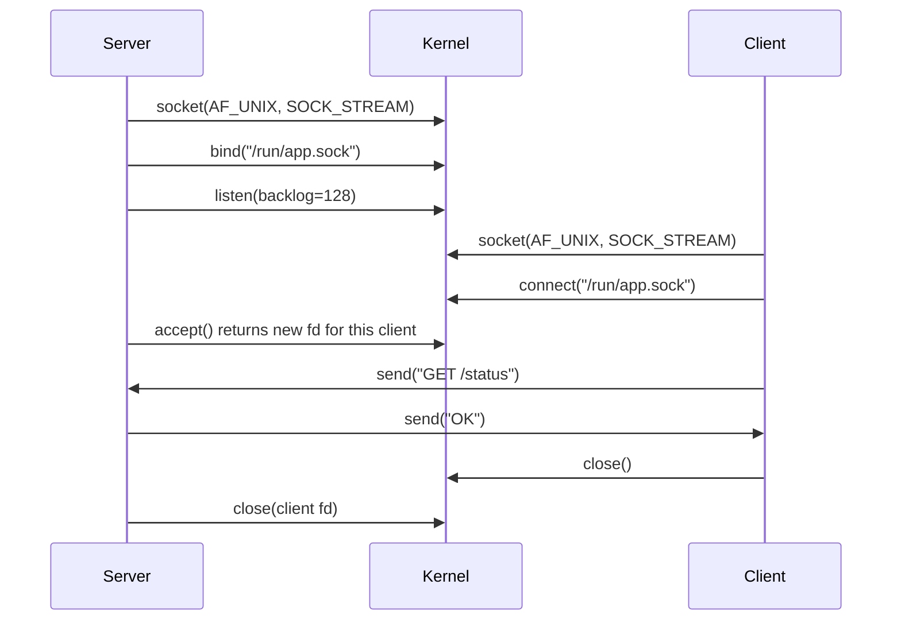

# Unix sockets

## Summary

A socket is a software endpoint for bidirectional communication between processes, either on the same machine or across a network. In Unix-like systems a socket is a file descriptor created with the `socket()` system call and described by three choices: a *domain* (address family) such as `AF_INET`, `AF_INET6` or `AF_UNIX`, a *type* such as `SOCK_STREAM` (reliable byte stream) or `SOCK_DGRAM` (independent datagrams), and a protocol. Network sockets carry TCP or UDP traffic between hosts; Unix domain sockets connect processes on the same host through a path in the file system, faster than going through the network stack and protected by file permissions. Web servers, databases, Docker, systemd and container runtimes all rely on them.

## Prerequisites

- [Processes](processes.md) and [File descriptors](../storage-and-io/file-descriptors.md).
- [TCP/IP model](../../networking/network-models/tcp-ip-model.md) and [Ports](../../networking/transport-layer/ports.md) for network sockets.

## Core concepts

### Definition and the problem sockets solve

Processes have separate address spaces, so they cannot read each other's memory. They need a channel provided by the kernel: inter-process communication (IPC). Pipes work only between related processes in one direction; shared memory needs separate synchronization. Sockets give one general interface for two-way communication that works the same way between processes on one host and between hosts on different continents. The same `read` and `write` calls used for files work on a connected socket.

*Analogy.* Telephones. A network socket is a phone line with a phone number (IP address and port) that anyone in the world can dial; a Unix domain socket is an intercom between rooms of the same building, reachable only from inside and only by people with the key to the room (file permissions). Both let two parties talk in both directions. The analogy breaks for datagram sockets, which are more like sending postcards than holding a call.

### Communication domains

- **Network sockets** communicate across networks with the TCP/IP protocols. Data is sent in packets that carry the destination socket's address (IP address and port). Domains: `AF_INET` (IPv4) and `AF_INET6` (IPv6).
- **Unix domain sockets** (`AF_UNIX`, also `AF_LOCAL`) connect processes on the same system, like private pipes between programs. Their address is a path in the file system (for example `/run/docker.sock`) or, on Linux, a name in the *abstract namespace* (starting with a NUL byte, not visible in the file system). They never touch the network stack, so they avoid checksums, routing and TCP overhead, and they can pass file descriptors and the peer's credentials (`SO_PEERCRED`) between processes.

### Construction of a socket

- **Domain.** The address family and protocol family, for example `AF_INET` for TCP/IP or `AF_UNIX` for domain sockets.
- **Type.** The communication style, for example `SOCK_STREAM` for reliable byte streams or `SOCK_DGRAM` for datagrams. `SOCK_SEQPACKET` (reliable, ordered, message boundaries kept) and `SOCK_RAW` (direct access to IP packets) also exist.
- **File descriptor.** The small integer the kernel returns, used to access and manipulate the socket.
- **Address.** What identifies the socket: an IP address and port for network sockets, a file system path for Unix domain sockets.

### Socket types

| Type | Behavior | Analogy | Network protocol | Typical use |
| --- | --- | --- | --- | --- |
| Stream (`SOCK_STREAM`) | Reliable, ordered, connection-oriented byte stream; no message boundaries | A flowing river, or a document whose pages arrive in order | TCP | HTTP, databases, SSH |
| Datagram (`SOCK_DGRAM`) | Independent messages; over the network no guarantee of delivery or order | Postcards mailed independently | UDP | DNS, syslog, metrics (StatsD), streaming |

Over `AF_UNIX`, datagram sockets are reliable and ordered in practice on Linux, because no network is involved.

### How it works

A server and a client go through different sequences of system calls:

1. **Socket creation.** Both call `socket(domain, type, protocol)` to get a descriptor.
2. **Binding (server).** The server assigns its address with `bind()`: an IP address and port, or a path.
3. **Listening (server) or connecting (client).** The server calls `listen()` to accept incoming connections into a queue, then `accept()` for each one, which returns a *new* descriptor for that connection. The client calls `connect()` to the server's address.
4. **Data transfer.** Once connected, both use `send()` and `recv()` (or `read()` and `write()`), and finally `close()`.



For datagram sockets there is no `listen`, `accept` or `connect` requirement: the sender uses `sendto()` with the destination address and the receiver `recvfrom()`.

### Advantages and disadvantages

Advantages:

- **Flexibility.** One interface for local IPC and network communication.
- **Scalability.** Sockets handle large data volumes and many concurrent connections (with `epoll` or `kqueue`), more than pipes.
- **Robustness.** Stream sockets provide error handling and reliable delivery, which protects data integrity.

Disadvantages:

- **Complexity.** Socket programming needs more code and understanding than simple pipes.
- **Overhead.** Network sockets add resource use and latency compared with Unix domain sockets on the same host.
- **Security concerns.** Exposed sockets need access control and encryption to prevent unauthorized access and data breaches.

### Applications

- **Web servers** such as Apache and nginx accept browser connections on network sockets and often talk to application servers (PHP-FPM, Gunicorn) over Unix domain sockets.
- **Networking tools**: `ping` uses raw or ICMP datagram sockets, `netcat` and `socat` open arbitrary TCP, UDP and Unix sockets for troubleshooting.
- **Inter-process communication**: databases (PostgreSQL at `/var/run/postgresql/.s.PGSQL.5432`, MySQL), D-Bus, systemd and the X and Wayland display servers use Unix domain sockets on the same host.
- **Containerized applications**: the Docker CLI talks to the daemon through `/var/run/docker.sock`, Kubernetes' kubelet talks to containerd through a CRI socket, and containers use sockets to talk to each other and to the host.
- **Socket activation**: systemd can own a listening socket and start the service on the first connection (see [Startup management](../system-administration/startup-management.md)).

### Programming interfaces

1. **Berkeley sockets (BSD sockets) API.** The foundational C API from 4.2BSD (1983), standardized by POSIX: `socket`, `bind`, `listen`, `accept`, `connect`, `send`, `recv`.
2. **The GNU C library (glibc) networking functions.** Build on the same API and add higher-level functions such as name resolution (`getaddrinfo`) and address conversion (`inet_pton`).
3. **Python `socket` module.** Wraps the same calls for concise network and IPC code; higher-level libraries (`asyncio`, `socketserver`) build on it.

### Security

- **Authentication.** Use TLS to verify the identity of the communicating parties on network sockets; on Unix sockets, check peer credentials.
- **Authorization.** Restrict who can connect: file permissions and ownership on Unix socket paths, access control in the application.
- **Data encryption.** Encrypt data sent over networks to prevent eavesdropping.
- **Firewalling.** Allow incoming and outgoing connections only for authorized applications and ports (see [Firewalls](../../networking/network-security/firewalls.md)).
- **Error handling.** Handle errors and partial reads and writes robustly to prevent crashes and vulnerabilities.

Access to a socket can equal privilege: anyone who can write to `/var/run/docker.sock` can start a privileged container and effectively become root on the host.

## Worked example

A minimal Unix domain socket echo server and client in Python, then inspection with standard tools. Untested; Python 3.12 on Linux, checked 2026-11.

```python
# server.py
import os, socket

PATH = "/tmp/echo.sock"
if os.path.exists(PATH):
    os.unlink(PATH)                          # bind fails if the path already exists

with socket.socket(socket.AF_UNIX, socket.SOCK_STREAM) as srv:
    srv.bind(PATH)
    os.chmod(PATH, 0o660)                    # only owner and group may connect
    srv.listen()
    while True:
        conn, _ = srv.accept()               # a new socket per client
        with conn:
            data = conn.recv(1024)
            conn.sendall(b"echo: " + data)
```

```python
# client.py
import socket
with socket.socket(socket.AF_UNIX, socket.SOCK_STREAM) as c:
    c.connect("/tmp/echo.sock")
    c.sendall(b"hello")
    print(c.recv(1024).decode())            # prints: echo: hello
```

Inspect and test from the shell:

```bash
ls -l /tmp/echo.sock                         # srw-rw---- : the leading "s" marks a socket file
ss -xlp | grep echo.sock                     # listening Unix socket with the owning process
echo "hi" | socat - UNIX-CONNECT:/tmp/echo.sock   # prints: echo: hi
ss -tlnp                                      # for comparison: listening TCP sockets with ports
```

## Trade offs and when to use it

- **Unix domain sockets** for same-host communication (reverse proxy to app server, sidecar to agent): lower latency, no port allocation, permissions as access control.
- **TCP sockets** when the peer may move to another host, or across containers without a shared volume for the socket file.
- **Stream versus datagram.** Choose streams for correctness and ordering; datagrams for small, independent, loss-tolerant messages where latency matters.
- **Higher-level protocols** (HTTP, gRPC, message queues) on top of sockets usually beat a custom socket protocol for maintainability.

## Common mistakes

- **Leaving a stale socket file.** The next `bind()` fails with "Address already in use". Fix: unlink the path before binding, or use systemd socket activation.
- **World-writable sockets.** Any local user can talk to the service. Fix: restrictive permissions and group ownership.
- **Assuming one `recv` returns one message on a stream socket.** Streams have no boundaries; data can arrive split or merged. Fix: length prefixes or delimiters.
- **Mounting the Docker socket into containers.** Fix: avoid it or use a filtering proxy.

## Practice

1. What three parameters define a socket at creation?
2. Which calls does a TCP server make that a client does not?
3. Why are Unix domain sockets faster than TCP over localhost?
4. What does the `s` at the start of `srw-rw----` mean?
5. Why is access to `/var/run/docker.sock` dangerous?

Answers:

1. The domain (address family), the type and the protocol.
2. `bind`, `listen` and `accept`.
3. They do not go through the TCP/IP stack: no headers, checksums, routing or congestion control; the kernel copies data between the processes directly.
4. The file is a socket.
5. The Docker API can start privileged containers that mount the host file system, so socket access equals root access on the host.

## Further reading

- [socket(7)](https://man7.org/linux/man-pages/man7/socket.7.html) and [unix(7)](https://man7.org/linux/man-pages/man7/unix.7.html) (Linux man-pages project): generic and Unix domain socket behavior.
- *UNIX Network Programming, Volume 1*, 3rd edition (W. Richard Stevens, Bill Fenner, Andrew M. Rudoff, Addison-Wesley, 2003): the classic on the sockets API.
- [Python socket module](https://docs.python.org/3/library/socket.html) (Python Software Foundation): the API used in the example.
- [systemd.socket(5)](https://www.freedesktop.org/software/systemd/man/latest/systemd.socket.html) (systemd project): socket activation.
