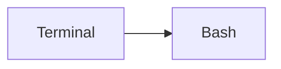

# Shell and terminal

Working on the command line: the terminal toolbox for processes, performance, networking and text, and the Bash shell and scripting language.

## Map

The diagram shows the notes in reading order; subareas are marked with (subarea).

## Notes in reading order

1. [Terminal](terminal.md): multiplexers, monitoring, networking and text manipulation tools.
2. [Bash](bash.md): syntax, variables, scripting, debugging and safe scripting practices.

## Planned topics

- Text processing in depth: grep, sed and awk
- Regular expressions
- Shell scripting style and testing (ShellCheck, bats)
- Zsh and shell customization
- Vim essentials
