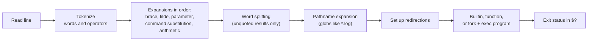

# Bash

## Summary

Bash (Bourne Again Shell) is a command-line interpreter and scripting language for Unix-like systems, written for the GNU Project and first released in 1989 as a free replacement for the Bourne shell. It is the default interactive shell on most Linux distributions and the most common language for automation glue in DevOps: provisioning scripts, CI steps, container entrypoints and cron jobs. It offers command history, aliases, redirection, variables, functions, conditionals and loops on top of POSIX `sh`. Bash is excellent for orchestrating other programs and poor for complex logic or data structures, where Python or Go are better choices.

## Prerequisites

- [Terminal](terminal.md) for the tools Bash scripts call.
- [POSIX](../posix.md) for what is portable and what is a Bash extension.

## Core concepts

### Definition and purpose

Bash is both:

- a command-line shell that provides a text interface to the operating system, and
- a scripting language for automating repetitive tasks and system administration.

It is used to execute commands interactively, to automate tasks with scripts (saving time and reducing errors), and to perform administration such as file manipulation, process management and network configuration. macOS shipped Bash as the default shell until macOS 10.15 (2019), which switched to zsh; Bash 3.2 is still installed there, while Linux distributions ship Bash 5.x (checked 2026-11).

*Analogy.* Bash is a foreman who does little work alone but tells specialists (programs) what to do, in what order, with what materials (arguments and files), and checks their results (exit codes). The analogy breaks when the foreman is asked to do arithmetic on large tables or manage complex records: that is not what Bash is good at.

### Features

- Command history and aliases.
- Input and output redirection and pipes.
- Variables, arrays and functions.
- Conditionals, loops and other programming constructs.
- Job control, globbing, brace expansion, command substitution, parameter expansion.

### How Bash processes a command line

Understanding the expansion order explains most surprising Bash behavior (word splitting of unquoted variables, globbing in filenames).



### Basic syntax

A command has the structure:

```bash
command [options] [arguments]
```

- **command**: the program, builtin or function to run.
- **options**: modifiers of its behavior (`-l`, `-h`).
- **arguments**: data or targets (file names, directories).

```bash
ls -l /home
cp file1.txt /backup
rm -r old_directory
```

Special characters:

| Character | Meaning |
| --- | --- |
| `#` | Comment |
| `\|` | Pipe: standard output of one command becomes standard input of the next |
| `>` | Redirect output to a file (overwrite) |
| `>>` | Append output to a file |
| `<` | Read input from a file |
| `2>` and `2>&1` | Redirect standard error, or merge it into standard output |
| `&&` | Run the next command only if the previous succeeded (exit status 0) |
| `\|\|` | Run the next command only if the previous failed |
| `;` | Run commands in sequence regardless of result |
| `&` | Run in the background |
| `$( )` | Command substitution |

### Basic commands

| Command | Description |
| --- | --- |
| `ls` | Lists files and directories |
| `cd` | Changes the current directory (a builtin) |
| `pwd` | Prints the current directory |
| `mkdir` | Creates a directory |
| `rm` | Removes files or directories (no recycle bin) |
| `cp` | Copies files or directories |
| `mv` | Moves or renames |
| `echo` | Prints text or variables |
| `cat` | Displays file contents |
| `chmod` | Changes permissions ([Permissions](../system-administration/permissions.md)) |
| `grep` | Searches for patterns in files |

### Variables

Define without spaces around `=`, and reference with `$`, always in double quotes:

```bash
name="John Doe"
echo "Hello, $name"
```

*Environment variables* are exported to child processes (global for all programs started from the shell):

```bash
export PATH="$PATH:/new/directory"
```

Reading user input:

```bash
echo "Enter your name:"
read -r name          # -r keeps backslashes literal
echo "Hello, $name"
```

Special parameters: `$0` script name, `$1`...`$9` positional arguments, `$#` count, `"$@"` all arguments as separate words, `$?` exit status of the last command, `$$` PID of the shell.

### Bash scripting

A Bash script is a text file with commands executed in sequence by the interpreter. To create one:

1. Create a file, conventionally with a `.sh` extension (for example `script.sh`).
2. Add the *shebang* line at the top, which tells the kernel which interpreter to use: `#!/bin/bash` (or `#!/usr/bin/env bash` to find Bash on the `PATH`).
3. Write the commands.
4. Make it executable: `chmod +x script.sh`.
5. Run it: `./script.sh`.

```bash
#!/bin/bash
echo "Enter your name:"
read -r name
echo "Hello, $name! Welcome to Bash scripting."
```

**Conditionals.** `[ ]` is the POSIX `test` command; `[[ ]]` is the safer Bash keyword (no word splitting, supports `==` patterns and `=~` regular expressions):

```bash
if [[ "$1" == "hello" ]]; then
  echo "You said hello!"
else
  echo "You didn't say hello."
fi
```

**Loops.**

```bash
for i in {1..5}; do
  echo "Iteration $i"
done

count=1
while [ "$count" -le 5 ]; do
  echo "Count is $count"
  ((count++))
done
```

**Functions.**

```bash
log() { printf '%s %s\n' "$(date -u +%FT%TZ)" "$*" >&2; }
log "starting backup"
```

### Use cases

- **Automating tasks**, for example backups: `tar -czvf backup.tar.gz /path/to/directory`.
- **System administration**, for example disk usage reports: `df -h > disk_usage.txt`.
- **Parsing log files**, for example extracting errors: `grep "ERROR" /var/log/app.log > error_log.txt`.
- **Setting up environments**, for example installing dependencies: `sudo apt update && sudo apt install -y git docker-compose-v2`.
- **CI/CD steps and container entrypoints**.

### Debugging and error handling

- `set -x` prints each command after expansion (tracing); `bash -x script.sh` does the same for one run.
- `set -e` exits when a command fails.
- `set -u` treats unset variables as errors; `set -o pipefail` makes a pipeline fail if any command in it fails.
- The common *strict mode* header is `set -euo pipefail`. `set -e` has surprising exceptions (commands in `if` conditions, `&&` lists), so critical steps should still check results explicitly.

```bash
#!/bin/bash
set -x
echo "Debugging this script."
```

Checking the exit status of the last command:

```bash
some_command
if [ $? -ne 0 ]; then
  echo "An error occurred." >&2
  exit 1
fi
# more idiomatic: if ! some_command; then ...; fi
```

`trap` runs cleanup on exit or on signals: `trap 'rm -f "$tmp"' EXIT`.

### Advantages and limitations

Advantages:

1. **Cross-platform.** Works on most Unix-like systems and on Windows through WSL or Git Bash.
2. **Simplicity.** Easy to learn for basic scripting.
3. **Efficiency.** Automates repetitive tasks and reduces manual effort.
4. **Integration.** Interacts directly with the operating system and all command-line tools.

Limitations:

1. **Performance.** Slower than compiled languages for heavy computation (each external command is a new process).
2. **Complexity.** Large scripts become hard to manage, test and review.
3. **Limited portability.** Differences between shells (Bash, zsh, dash) and between Bash versions (macOS 3.2 compared with Linux 5.x) and GNU or BSD tools cause failures.
4. **Error-prone semantics.** Quoting, word splitting and silent failures cause subtle bugs.

## Worked example

A safe backup script with strict mode, argument checking, cleanup and logging. Untested; Bash 5.2 on Ubuntu 24.04, checked 2026-11.

```bash
#!/usr/bin/env bash
# backup.sh: archive a directory to a destination, keep the last 7 archives
set -euo pipefail

usage() { echo "usage: $0 SOURCE_DIR DEST_DIR" >&2; exit 2; }
[[ $# -eq 2 ]] || usage
src=$1 dest=$2
[[ -d "$src" ]] || { echo "not a directory: $src" >&2; exit 1; }
mkdir -p "$dest"

tmp=$(mktemp "$dest/.backup.XXXXXX")
trap 'rm -f "$tmp"' EXIT                 # never leave a half-written archive behind

stamp=$(date -u +%Y%m%dT%H%M%SZ)
tar -czf "$tmp" -C "$(dirname "$src")" "$(basename "$src")"
mv "$tmp" "$dest/backup-$stamp.tar.gz"   # atomic rename: the archive appears only when complete

# keep the 7 newest archives (names sort by time because of the timestamp format)
ls -1 "$dest"/backup-*.tar.gz | sort | head -n -7 | xargs -r rm -f --
echo "backup written: $dest/backup-$stamp.tar.gz"
```

```bash
chmod +x backup.sh
./backup.sh /var/www /srv/backups      # backup written: /srv/backups/backup-20261109T101500Z.tar.gz
./backup.sh /nonexistent /srv/backups  # not a directory: /nonexistent, exit status 1
shellcheck backup.sh                   # static analysis for quoting and portability issues
```

If `tar` fails (disk full), `set -e` stops the script, the `trap` removes the temporary file and no broken archive is left.

## Trade offs and when to use it

- **Use Bash** for gluing commands together, short automation, entrypoints and CI steps: up to about 100 lines with simple logic.
- **Use Python or Go** when you need data structures, JSON handling, error handling across many steps, tests or reuse.
- **Use POSIX `sh`** when the script must run in minimal containers (Alpine, BusyBox) or on many Unix systems.
- **Use configuration management** (Ansible) instead of long provisioning scripts, for idempotency ([Configuration management](../../infrastructure-as-code/configuration-management.md)).

## Common mistakes

- **Unquoted variables.** `rm -rf $dir/*` with an empty `dir` becomes `rm -rf /*`. Fix: quote everything (`"$dir"`), use `set -u` and `${dir:?}`.
- **Parsing `ls` output.** Breaks on spaces and newlines in names. Fix: globs or `find -print0 | xargs -0`.
- **Ignoring failures in pipelines.** Fix: `set -o pipefail`.
- **`#!/bin/sh` with Bash features.** Fails on dash. Fix: the correct shebang.
- **Secrets on the command line or in `set -x` output.** Visible in `ps` and logs. Fix: environment or files, disable tracing around secrets.

## Practice

1. What do `&&` and `||` do?
2. Why should `"$@"` be preferred over `$*`?
3. What does `set -euo pipefail` change?
4. Why does the worked example write to a temporary file and then `mv` it?

Answers:

1. `&&` runs the next command only if the previous succeeded; `||` only if it failed.
2. `"$@"` keeps each argument as a separate word, even with spaces; `$*` joins them and splits again.
3. Exit on errors, error on unset variables, and fail a pipeline if any of its commands fails.
4. So that a complete archive appears atomically; an interrupted run never leaves a partial archive with a final name.

## Further reading

- [GNU Bash Reference Manual](https://www.gnu.org/software/bash/manual/) (GNU Project): expansions, builtins and options.
- [ShellCheck](https://www.shellcheck.net/) (Vidar Holen): a linter that catches most common Bash bugs.
- [Bash Pitfalls](https://mywiki.wooledge.org/BashPitfalls) (Greg's Wiki): a catalog of classic mistakes and fixes.
- [Google Shell Style Guide](https://google.github.io/styleguide/shellguide.html) (Google): when to use shell and how to write it.
