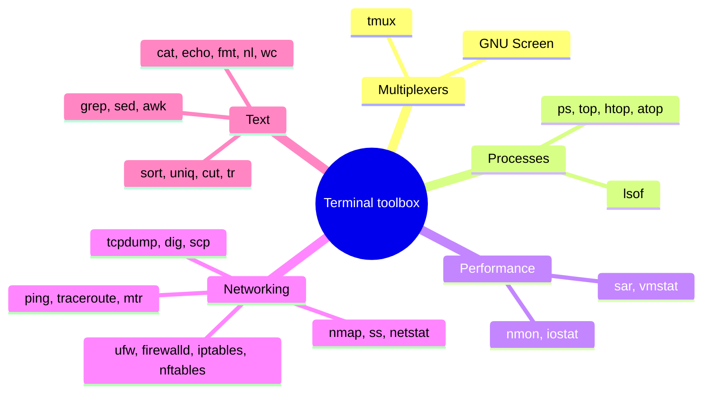

# Terminal

## Summary

The terminal is where most DevOps work on Linux happens: a text interface in which a shell (usually Bash) runs commands. This note is a working toolbox organized by job: terminal multiplexers to manage many sessions, process and performance monitoring commands, networking tools for troubleshooting connectivity, DNS and firewalls, and text manipulation commands that are combined with pipes into small data-processing programs. Knowing which tool answers which question, and how to chain them, is what makes an engineer fast at diagnosing a server.

## Prerequisites

- [Operating system overview](../operating-system-overview.md).
- [Bash](bash.md) for the shell language itself; [POSIX](../posix.md) for portability of commands.

## Core concepts

### Terminal, terminal emulator, shell

- A *terminal* was originally a hardware device (keyboard and screen) connected to a computer; today a *terminal emulator* (GNOME Terminal, Konsole, iTerm2, Windows Terminal) or an SSH session plays that role through a *pseudo-terminal* (pty, `/dev/pts/N`).
- The *shell* (Bash, zsh, dash) is the program inside the terminal that reads commands and starts processes.
- The *Unix philosophy* behind the toolbox: small programs that do one thing, read text from standard input, write text to standard output, and are combined with pipes (`|`).

*Analogy.* A workshop bench. The terminal is the bench, the shell is your hands, and each command is a specialized hand tool; pipes are the conveyor between tools. The analogy breaks because you can build a new tool in seconds by chaining existing ones, which no workshop allows.



### Terminal multiplexers

A *terminal multiplexer* runs many terminal sessions inside one terminal window and keeps them alive when you disconnect. The name is confusing: in electronics, a multiplexer receives several input signals and forwards the selected one to a single output; a terminal multiplexer can do the opposite, taking input from one keyboard and sending it to many panes (for example `tmux` with `synchronize-panes` typing into a group of servers at once). The US meaning of "multiplex" (a cinema with many screens) describes it better: many screens within one frame.

Tools:

- **tmux**: sessions, windows and panes, detach and reattach (`tmux new -s ops`, `Ctrl+b d`, `tmux attach -t ops`). The usual choice today.
- **GNU Screen**: the older multiplexer with the same core idea (`screen -S ops`, `Ctrl+a d`, `screen -r ops`).
- **Konsole** and **Terminator**: terminal emulators with split views and broadcast input to several panes; they are not multiplexers in the strict sense, because sessions do not survive closing the window or losing the SSH connection.

The most important practical use: run long operations (upgrades, migrations) inside tmux on the server, so a dropped SSH connection does not kill them.

### Process monitoring

A process is a running instance of a program, identified by a unique process ID (PID) assigned automatically at creation. Common commands:

| Command | Purpose |
| --- | --- |
| `ps` | Reports a snapshot of current processes; by default a header and the processes with a controlling terminal |
| `top` | Periodically displays a sorted list of processes (sorted by CPU by default in procps `top`; by PID in some BSD versions) |
| `htop` | Interactive ncurses process viewer: vertical and horizontal scrolling, mouse support, tree view, full command lines, acting on several processes at once |
| `atop` | Advanced monitor of system load that also logs history and shows per-process disk and network use |
| `lsof` | Lists open files, including sockets and deleted files still held open |

Details are in [Process monitoring](../process-management/process-monitoring.md).

### Performance monitoring

| Command | Purpose |
| --- | --- |
| `nmon` | Fully interactive performance monitor for Linux and AIX: CPU, memory, network, disks, file systems, NFS, top processes, resources and power micro-partitions; can record data for later analysis |
| `iostat` | CPU statistics and I/O statistics for devices, partitions and network file systems; it observes how long devices are active relative to their transfer rates, which helps balance I/O across disks |
| `sar` | System Activity Report: CPU, memory and paging, device load and network over time, from saved history |
| `vmstat` | Virtual memory statistics: memory, paging, processes, I/O, CPU |

### Networking tools

Networking tools troubleshoot problems, monitor traffic and test connectivity.

| Command | Purpose |
| --- | --- |
| `ping` | Packet Internet Groper: sends ICMP echo requests to a host (IP address or name) and records the round-trip time (latency) of replies |
| `traceroute` | Prints the route packets take to a destination, which helps find the slow or broken hop |
| `mtr` | Combines `traceroute` and `ping`: continuous per-hop loss and latency |
| `nmap` | Network Mapper: discovers hosts and scans for open ports, used to audit firewalls and security (only on networks you are authorized to scan) |
| `netstat` | Shows TCP, UDP and Unix socket connections, listening sockets, routing tables, interface statistics, masquerade connections and multicast memberships; deprecated on most distributions in favor of `ss` and `ip` |
| `ss` | The modern socket statistics tool (`ss -tulpn` for listening sockets with processes) |
| `ufw`, `firewalld` | Firewall management front ends: ufw (uncomplicated firewall) on Debian, Ubuntu and Arch aims at simplicity; firewalld (zones) on the Red Hat family |
| `iptables`, `nftables` | Kernel packet filtering through netfilter; iptables organizes rules in tables, chains and targets; nftables is its successor |
| `tcpdump` | Captures and filters packets, displays them readably or saves them for later analysis (Wireshark) |
| `dig` | Domain Information Groper: queries DNS servers to verify and troubleshoot DNS; more detailed than the older `nslookup` and `host`, which are still available |
| `scp` | Secure copy of files over SSH, encrypted in transit; `rsync` over SSH or `sftp` are often preferred, and newer OpenSSH versions run scp over the SFTP protocol by default |

See the [Networking](../../networking/README.md) area for the protocols behind these tools.

### Text manipulation

Text manipulation commands search, replace and transform text in files and streams.

| Command | Purpose |
| --- | --- |
| `grep` | Global regular expression print: prints lines matching a pattern; often combined with other commands (`ps aux \| grep nginx`) |
| `sed` | Stream editor: search and replace, insert and delete lines without opening an editor |
| `awk` | A pattern-scanning and processing language for extracting fields and producing reports |
| `sort` | Sorts lines; lexically by default (according to the locale), numerically with `-n`, human sizes with `-h` |
| `cut` | Cuts selected fields or character ranges from each line |
| `uniq` | Reports or omits repeated adjacent lines (so input is usually sorted first); `-c` counts |
| `cat` | Concatenates files and prints them; also used to view and create files |
| `echo` | Prints a line of text, for status messages or variables in scripts (`printf` is more portable) |
| `fmt` | Simple text formatting to a uniform line width |
| `tr` | Translates or deletes characters from standard input |
| `nl` | Numbers lines |
| `wc` | Counts lines, words and bytes |

## Worked example

Find the top client IP addresses that caused HTTP 5xx errors in an nginx access log, then check whether the busiest one is reachable. Untested; GNU coreutils, gawk and iputils on Ubuntu 24.04, checked 2026-11. Log path and addresses are examples.

```bash
# combined log format: $1 = client IP, $9 = status code
awk '$9 ~ /^5/ {print $1}' /var/log/nginx/access.log \
  | sort | uniq -c | sort -rn | head -5
```

```text
    412 203.0.113.45
     87 198.51.100.7
     12 192.0.2.33
```

Read the pipeline left to right: `awk` filters 5xx lines and prints the IP, `sort` groups equal IPs, `uniq -c` counts them, `sort -rn` orders by count, `head` keeps five.

```bash
grep -c ' 503 ' /var/log/nginx/access.log          # how many 503 responses overall
sed -n '/14:00:/,/14:05:/p' /var/log/nginx/access.log | wc -l   # requests between 14:00 and 14:05
mtr -rwc 20 203.0.113.45                            # per-hop loss and latency report
```

Run long investigations inside `tmux` so they survive a dropped connection.

## Trade offs and when to use it

- **Pipelines of small tools** are ideal for one-off questions on one host; for recurring analysis across many hosts, use a log platform ([Log management](../../observability/log-management/log-management-overview.md)).
- **`awk` versus a script.** Beyond a few lines of awk, Python is easier to read and test.
- **Modern replacements** (`ss` for netstat, `ip` for ifconfig, `nft` for iptables, `rg` for grep) are faster or better maintained, but the classic tools exist everywhere.

## Common mistakes

- **`uniq` without `sort`.** Only adjacent duplicates are merged. Fix: `sort | uniq -c`.
- **Locale-dependent sorting.** Fix: `LC_ALL=C sort` when byte order is wanted.
- **`grep pattern` matching itself in `ps` output.** Fix: `pgrep`, or `ps aux | grep '[n]ginx'`.
- **Running long jobs directly in an SSH session.** Fix: tmux or screen, or a systemd unit.
- **Scanning networks with nmap without permission.** Fix: scan only systems you own or are authorized to test.

## Practice

1. Why does a terminal multiplexer protect long-running jobs?
2. Which tool replaces `netstat` on current Linux distributions?
3. Write a pipeline that counts unique users in `/etc/passwd` whose shell is `/bin/bash`.
4. What is the difference between `ping` and `mtr`?

Answers:

1. The session runs on the server inside the multiplexer process, so disconnecting the terminal or SSH does not send it a hangup.
2. `ss` (with `ip` for interfaces and routes).
3. `awk -F: '$7 == "/bin/bash" {print $1}' /etc/passwd | sort -u | wc -l`.
4. `ping` measures end-to-end reachability and latency; `mtr` measures loss and latency at every hop along the route, continuously.

## Further reading

- [GNU Coreutils manual](https://www.gnu.org/software/coreutils/manual/) (GNU Project): sort, cut, uniq, tr, wc and more.
- [The GNU Awk User's Guide](https://www.gnu.org/software/gawk/manual/) (GNU Project): awk in depth.
- [tmux wiki](https://github.com/tmux/tmux/wiki) (tmux project): sessions, windows and panes.
- *The Linux Command Line*, 2nd edition (William Shotts, No Starch Press, 2019, free online): the shell toolbox.
