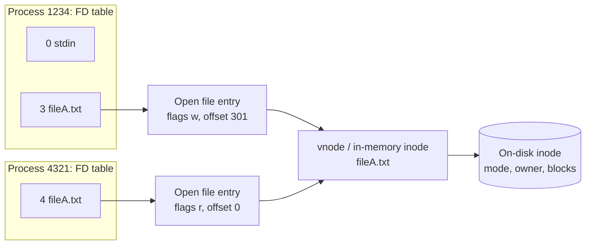

# File descriptors

## Summary

A file descriptor (FD) is a small non-negative integer that a process uses to refer to an open file, socket, pipe or device. `open()` returns the lowest free number, and every later `read`, `write` or `close` uses it. Behind that number are three kernel tables: the per-process *file descriptor table*, the system-wide *open file table* (status flags, current offset), and the *vnode/inode* layer with the file's static information, which finally points to the inode and data blocks on disk. Descriptors 0, 1 and 2 are reserved for standard input, output and error. Understanding the layers explains shell redirection, shared file offsets after `fork`, "Too many open files" errors and disk space that is not freed after deleting a file.

## Prerequisites

- [Processes](../process-management/processes.md) and [File systems](file-systems.md) (inodes).

## Core concepts

### From number to data

*Analogy.* A cloakroom ticket. The number on your ticket (the FD) means something only at this cloakroom (this process). The attendant's ledger (open file table) notes which hanger and whether your coat is being brushed (offset, flags), and the hanger holds the actual coat (inode and data). Two tickets can point to the same ledger line. The analogy breaks because two different ledger lines can also refer to the same coat, which in Unix happens when a file is opened twice.

**In user space.** When process 1234 opens `fileA.txt`, it gets descriptor `fd1`, equal to 3 (0 to 2 are taken), and passes it to functions to write data. Process 4321 opening `root` gets 4 in its own numbering.

**In kernel space.**

- The kernel's **process table** has an entry per process; each process has a **file descriptor table** indexed by FD. Descriptors 0, 1 and 2 are reserved in every table for stdin, stdout and stderr.
- Each FD entry points to an entry in the **open file table**, shared across all processes, which holds file status flags (read, write, append), the current offset and a reference count. Several descriptors can point to the same entry, for example 0, 1 and 2 of an interactive shell usually all refer to the same terminal entry.
- Because many open file entries can describe the same file, storing the static information in each would waste resources, so another layer, the **vnode table**, holds it: file type, function pointers for operations, reference counts and a pointer to the inode. (Linux implements this layer with in-memory `inode` and `dentry` objects in the VFS; "vnode" is the BSD and System V name.)

**In the file system.** The on-disk inode stores the actual file information (permission mode, owners, timestamps, size, block count) and points to the data blocks.

![Linux file descriptor illustrated: in user space, process 1234 has fd1 = 3 from open("fileA.txt") and process 4321 has fd2 = 4 from open("root"); in kernel space, each process table entry has a file descriptor table whose entries point to open file table entries (status flags, offset, vnode pointer, reference count), which point to vnode table entries (file type, function pointers, inode, reference count); in the file system, the inode array holds mode, owners, timestamps and block count and points to directory and data blocks. Graphic by ByteByteGo, kept for personal study.](../../_assets/operating-systems/file-descriptors-tables.png)



### What happens on close

The question "which entries are deleted when a file is closed?" has a layered answer:

1. The process's FD table slot is freed immediately; the number can be reused by the next `open`.
2. The open file table entry's reference count drops; the entry is freed only when no descriptor (in any process, after `fork` or `dup`) refers to it.
3. The vnode/in-memory inode reference count drops; it can be evicted from memory when unused.
4. The on-disk inode and data are freed only if the link count is zero (the file was deleted) and no open file entries remain. This is why a deleted log file still fills the disk until the process holding it closes it.

### Standard streams and redirection

| FD | Name | Default |
| --- | --- | --- |
| 0 | stdin | Keyboard or pipe input |
| 1 | stdout | Terminal or pipe output |
| 2 | stderr | Terminal; unbuffered error output |

Shell redirection manipulates these slots before `exec`: `cmd > out.log 2>&1` opens `out.log` as FD 1, then duplicates FD 1 into FD 2 (`dup2`), so both point to the same open file entry and share an offset. Order matters: `2>&1 > out.log` sends errors to the old stdout (the terminal).

### Inheritance and sharing

- After `fork`, the child gets a copy of the FD table pointing to the same open file entries, so parent and child share offsets.
- `O_CLOEXEC` (or `FD_CLOEXEC`) closes a descriptor on `exec`, preventing leaks into child programs.
- Unix domain sockets can pass descriptors between unrelated processes.

### Limits

Each process has a limit on open descriptors (`ulimit -n`, `RLIMIT_NOFILE`; often 1024 soft by default, systemd services can set `LimitNOFILE=`), and the system has a global limit (`/proc/sys/fs/file-max`). Busy servers (proxies, databases) need high limits because every connection is a descriptor.

## Worked example

Inspect descriptors and recover space held by a deleted file. Untested; Linux with lsof 4.9x, checked 2026-11.

```bash
exec 3> /tmp/demo.log          # open FD 3 of the current shell for writing
ls -l /proc/$$/fd               # 0,1,2 -> /dev/pts/0 ; 3 -> /tmp/demo.log
echo "hello" >&3                # write through FD 3
rm /tmp/demo.log                # unlink: the name is gone
ls -l /proc/$$/fd/3             # 3 -> '/tmp/demo.log (deleted)': data still allocated
lsof +L1 | head                 # lists open files with link count 0 system-wide
exec 3>&-                       # close FD 3: now the inode and blocks are freed
ulimit -n                       # current soft limit on open files
```

In production, `lsof +L1` finding a multi-gigabyte deleted log held by a daemon explains why `df` shows a full disk while `du` does not; restarting or signaling the daemon to reopen its logs (log rotation with `copytruncate` or `postrotate` reload) frees the space.

## Trade offs and when to use it

- **Raising FD limits** is necessary for high-concurrency servers but hides descriptor leaks; monitor the count per process.
- **Truncating instead of deleting** a file held open (`: > file.log`) frees space immediately without restarting the writer.

## Common mistakes

- **Descriptor leaks** (opening without closing in loops) end in `EMFILE: Too many open files`. Fix: close in `finally`/`with` blocks, monitor `/proc/PID/fd`.
- **Deleting a big log of a running process** to free space. Fix: truncate it or make the process reopen it.
- **Wrong redirection order** (`2>&1 >file`). Fix: `>file 2>&1`.

## Practice

1. Which FD does the first `open()` in a new process usually return, and why?
2. Why do parent and child share a file offset after `fork`?
3. After `rm` of a file that a process has open, when is the space freed?

Answers:

1. 3, because 0, 1 and 2 are taken by the standard streams and `open` returns the lowest free number.
2. Their FD tables point to the same open file table entry, which holds the offset.
3. When the last descriptor referring to it is closed (the link count is already zero).

## Further reading

- [open(2)](https://man7.org/linux/man-pages/man2/open.2.html), [dup(2)](https://man7.org/linux/man-pages/man2/dup.2.html) and [close(2)](https://man7.org/linux/man-pages/man2/close.2.html) (Linux man-pages project).
- *The Linux Programming Interface* (Michael Kerrisk, No Starch Press, 2010): chapter on the relationship between descriptors and open files.
- [lsof(8)](https://man7.org/linux/man-pages/man8/lsof.8.html) (Linux man-pages project).
