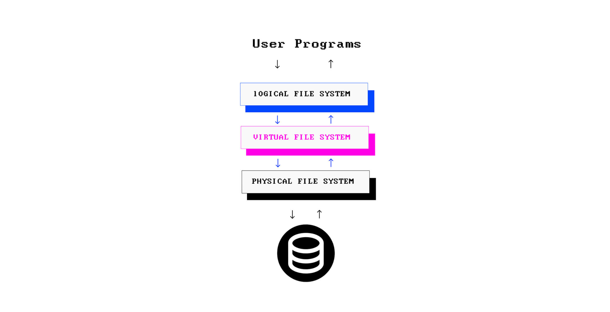
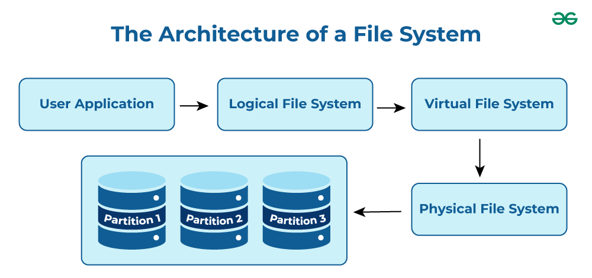
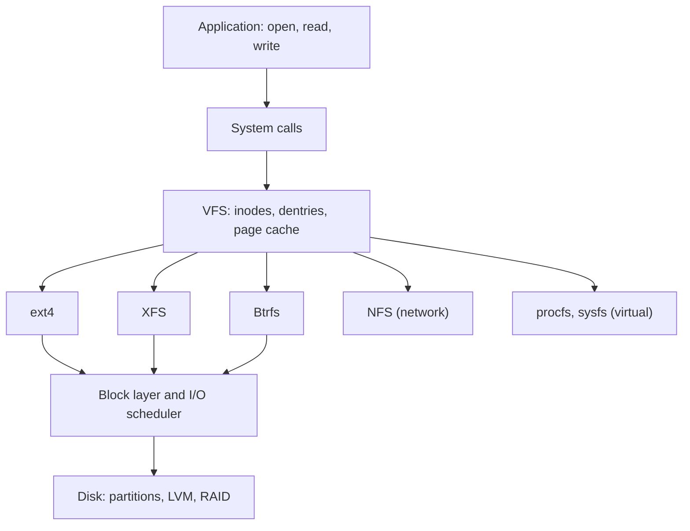

# File systems

## Summary

A file system defines how data is named, organized, stored and retrieved on a storage device. In Linux it is built in three layers: the *logical file system* that applications talk to (open, read, write, close), the *virtual file system* (VFS) that gives all concrete file systems one common interface, and the *physical file system* that manages blocks on the disk. Concrete file systems differ in journaling, scalability and features: ext4 is the general-purpose default, XFS excels at large volumes and parallel I/O, Btrfs adds copy-on-write snapshots and checksums, SquashFS is compressed and read-only, and NTFS and exFAT exist for interoperability with Windows. All of them hang from one directory tree rooted at `/`.

## Prerequisites

- [Operating system overview](../operating-system-overview.md) for file management.
- [File descriptors](file-descriptors.md) for how processes refer to open files.

## Core concepts

### Three layers

The Linux file system architecture has three layers, from top to bottom:

- **Logical file system.** The interface between user applications and the file system: operations such as opening, reading and closing files, path lookup and permission checks. It is the front end that lets applications work with files in the way users expect.
- **Virtual file system (VFS).** A kernel layer that lets many physical file systems run at the same time behind one standard interface (inodes, dentries, superblocks, file operations). An application calls `read()` the same way on ext4, XFS, NFS or `/proc`; the VFS dispatches to the right implementation.
- **Physical file system.** Manages the physical blocks on the disk: allocation, storing and retrieving data, interacting with the block device layer and hardware, which determines performance and reliability.





*Analogy.* A library. Readers ask the front desk for a book by title (logical layer). The catalog system works the same way for every branch, whether the books are in the main building, a warehouse or another city (VFS). Each branch arranges its own shelves its own way (physical file systems). The analogy breaks because a single path in Linux can cross several "branches" (mount points) without the reader noticing.



### Inodes and directories

On Unix file systems, each file has an *inode*: a structure with its metadata (type, permissions, owner, size, timestamps, link count) and pointers to its data blocks (or *extents*). The file name is not in the inode; a directory is a table that maps names to inode numbers. Consequences:

- *Hard links* are several names for one inode; the data is freed when the link count reaches zero and no process has it open.
- *Symbolic links* are small files that contain a path.
- A file system can run out of inodes while it still has free space (`df -i`).

### Characteristics of a file system

- **Space management.** How data is stored on the device: block size, allocation strategy and fragmentation.
- **File names.** Restrictions on length (255 bytes on ext4), allowed characters and case sensitivity (Linux file systems are case-sensitive).
- **Directories.** Files are organized linearly or hierarchically, with an index of the entries in each directory.
- **Metadata.** For each file: data length, access permissions, device type, modification time and other attributes.
- **Utilities.** Creating (`mkfs`), checking and repairing (`fsck`), resizing, deleting, renaming, moving, copying, backup, recovery and access control.
- **Design limits.** Every implementation limits the maximum file and volume size.

### Journaling

A *journaling* file system writes the intended metadata changes (and optionally data) to a log before applying them. After a crash it replays or discards the journal in seconds instead of scanning the whole disk with `fsck`, which used to take hours on large volumes. Copy-on-write file systems (Btrfs, ZFS, bcachefs) achieve consistency differently: they never overwrite live blocks, they write new ones and switch a pointer atomically.

### File systems compared

| File system | Type | Key features | Usage |
| --- | --- | --- | --- |
| ext (1992) | Traditional | The first file system designed for Linux, no journaling | Historical, replaced |
| ext2 (1993) | Non-journaling | Separate timestamps for access, inode change and modification; slow recovery after crashes | Small flash media where journaling overhead matters; mostly historical |
| ext3 (2001) | Journaling | Journaling added to ext2 (shorter recovery after crashes), online growth, HTree indexes for large directories | Superseded by ext4 |
| ext4 (2008) | Journaling | Backward compatible with ext3 and ext2; large volumes (1 EiB) and files (16 TiB); extents; persistent preallocation; delayed allocation; unlimited subdirectories with HTree; journal and metadata checksums; nanosecond and creation timestamps; transparent encryption; lazy inode table initialization; write barriers by default | Default on Debian, Ubuntu and many others |
| Xiafs (1993) | Traditional | A competitor of ext2 with less functionality | Obsolete, removed from the kernel |
| JFS (IBM) | Journaling | High performance under varied loads, efficient with large files | Rarely used now |
| ReiserFS | Journaling | Tail packing to reduce internal fragmentation, B+ trees for directories | Was the SUSE default until SUSE switched to ext3 around 2006 (version 10.2 era); deprecated and removed from the Linux kernel in version 6.13 (2025) |
| Reiser4 | Advanced | Successor of ReiserFS, never merged into the mainline kernel | Niche, out-of-tree |
| XFS (SGI, 1994) | 64-bit journaling | Excellent parallel I/O and very large volumes, allocation groups, online growth and defragmentation, variable block sizes; can grow but not shrink; no native snapshots (use LVM) | Default on RHEL and its rebuilds; large-scale storage |
| SquashFS | Compressed read-only | High compression, low overhead | Live CDs, embedded systems, Snap packages, container and firmware images |
| Btrfs | Copy-on-write | Snapshots, subvolumes, drive pooling, checksums with scrubbing and self-healing, compression, online defragmentation, built-in RAID (RAID 5 and 6 still not recommended) | Default on Fedora Workstation and openSUSE; systems needing snapshots |
| bcachefs | Copy-on-write | Encryption, compression, snapshots, checksums; aimed to outperform Btrfs and ext4 | Merged in Linux 6.7 (2024) as experimental, later moved out of the mainline kernel to external maintenance (TODO: verify the kernel version) |
| NTFS, exFAT | Non-native | NTFS: Windows journaling file system with large files and ACLs; exFAT: for flash media, large files, no journaling; neither carries Unix permissions | Interoperability with Windows and removable drives (NTFS3 and exFAT drivers are in the kernel) |

Ext4 or XFS are the safe choices for most servers: both are mature, and for most workloads they perform similarly. XFS has an edge for very large file systems (above about 50 TiB) and highly parallel workloads.

### Technical differences

- **Journaling and non-journaling.** Journaling file systems (ext3, ext4, XFS, JFS) and copy-on-write file systems (Btrfs) recover quickly and reliably after crashes; non-journaling ext2 needs a full check.
- **Performance and scalability.** XFS and Btrfs handle large volumes and parallel I/O well.
- **Advanced features.** Btrfs and bcachefs offer snapshots, drive pooling and scrubbing for complex storage needs.
- **Special purposes.** SquashFS for read-only images; NTFS and exFAT for Windows interoperability.

### The directory tree and mounting

Linux has one tree rooted at `/`. Other file systems are *mounted* on directories (mount points); `/etc/fstab` lists the mounts made at boot. The Filesystem Hierarchy Standard (FHS) defines the purpose of the main directories:

| Directory | Contents |
| --- | --- |
| `/etc` | Host configuration |
| `/home` | User home directories |
| `/var` | Variable data: logs (`/var/log`), spools, caches, databases |
| `/usr` | Installed programs and libraries (read-only in principle) |
| `/tmp` | Temporary files, often tmpfs in RAM |
| `/boot` | Kernel, initramfs, boot loader files |
| `/dev` | Device files |
| `/proc`, `/sys` | Virtual file systems exposing kernel and process information |
| `/opt` | Add-on software packages |
| `/run` | Runtime data since boot (PID files, sockets) |

## Worked example

Create, mount and check an XFS file system on a new disk. Untested; xfsprogs 6.x on RHEL 9 or Ubuntu 24.04, checked 2026-11. Warning: `mkfs` destroys existing data on the device; verify the device name first.

```bash
lsblk -f                                    # identify the new, empty disk, for example /dev/sdb
sudo mkfs.xfs -L data /dev/sdb              # DESTRUCTIVE: creates a new file system
sudo mkdir -p /srv/data
uuid=$(sudo blkid -s UUID -o value /dev/sdb)
echo "UUID=$uuid /srv/data xfs defaults,noatime 0 0" | sudo tee -a /etc/fstab
sudo mount -a                               # test fstab: an error here would also break boot
df -hT /srv/data                            # type xfs, size, usage
df -i /srv/data                             # inode usage
```

Using the UUID instead of `/dev/sdb` in fstab keeps the mount correct when device names change between boots. `noatime` avoids a metadata write on every read.

## Trade offs and when to use it

- **ext4**: the conservative default, can shrink offline, well understood.
- **XFS**: large files and volumes, parallel workloads, databases; cannot shrink.
- **Btrfs**: snapshots, rollback of system updates, checksums; more complex to operate, avoid its RAID 5 and 6.
- **ZFS** (out of tree on Linux because of its CDDL license): strongest data integrity and pooling, popular on storage servers.
- **Network file systems** (NFS, SMB, CephFS) when many hosts need the same files, with different consistency and performance.

## Common mistakes

- **Running out of inodes** with millions of small files while `df -h` shows free space. Fix: monitor `df -i`, choose inode density at `mkfs` time.
- **Device names in fstab.** Fix: UUIDs or labels.
- **A typo in fstab** prevents boot. Fix: `mount -a` (and `findmnt --verify`) before rebooting; `nofail` for non-critical mounts.
- **Deleted files still using space.** A process keeps them open. Fix: `lsof +L1`, restart the process.

## Practice

1. What does the VFS layer do?
2. Why can a disk have free space but no room for new files?
3. What problem does journaling solve?
4. Which file system would you choose for a 100 TiB volume with many parallel writers, and why?

Answers:

1. It gives all concrete file systems a common interface, so applications use the same system calls regardless of the file system.
2. It has run out of inodes; every file needs one.
3. Long and risky recovery after a crash: the journal lets the file system restore consistency quickly without a full scan.
4. XFS, because of its scalability for very large volumes and parallel I/O with allocation groups.

## Further reading

- [Overview of the Linux Virtual File System](https://docs.kernel.org/filesystems/vfs.html) (Linux kernel documentation): VFS objects and operations.
- [ext4 Data Structures and Algorithms](https://docs.kernel.org/filesystems/ext4/index.html) (Linux kernel documentation): extents, journaling and features.
- [XFS documentation](https://docs.kernel.org/filesystems/xfs/index.html) (Linux kernel documentation).
- [Btrfs documentation](https://btrfs.readthedocs.io/) (Btrfs project): features and the status of each.
- [Filesystem Hierarchy Standard 3.0](https://refspecs.linuxfoundation.org/FHS_3.0/fhs/index.html) (Linux Foundation, 2015).
