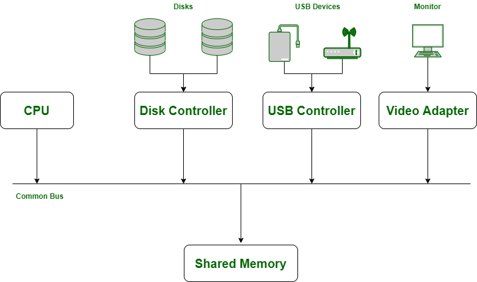
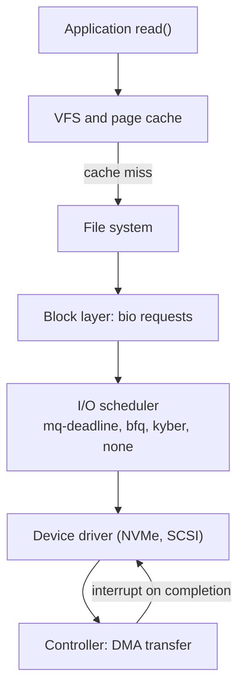
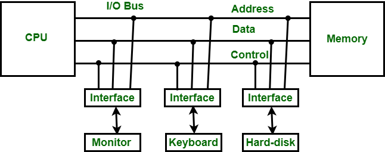

# I/O management

## Summary

I/O management (device management) is the part of the operating system that controls input and output devices: disks, keyboards, microphones, printers, USB ports, scanners, network cards and control channels. Through device drivers it gives processes a uniform interface to very different hardware, keeps track of device status, decides which process gets a device and for how long, schedules requests efficiently and handles interrupts and data transfers. Devices are classified as block, character or network devices, and by allocation as dedicated, shared or virtual. At the hardware level, an interface unit with data buffers, ports and control and status registers connects the CPU bus to each peripheral. For operations engineers, the visible end of all this is disk and network I/O performance: queue depth, latency and the I/O scheduler.

## Prerequisites

- [Operating system overview](../operating-system-overview.md) (device management).
- [File systems](file-systems.md).

## Core concepts

### Definition

Device management controls I/O devices. Processes need resources such as memory, files and devices; when a resource is available it is allocated and control returns to the CPU; when it is not, the request is delayed. The OS uses device controllers to manage physical or virtual devices and check their availability.

*Analogy.* An airport's ground control. Planes (I/O requests) need runways and gates (devices); ground control (the I/O traffic controller) knows which are free, picks a route, and makes planes wait when everything is busy, while a schedule (the I/O scheduler) orders departures to keep runways efficient. The analogy breaks because the "planes" in a computer can be merged (adjacent disk requests combined), which no airport can do.

### Device categories

1. **Block devices** store data in fixed-size blocks, each with its own address, and allow random access, for example disks and SSDs (`/dev/sda`, `/dev/nvme0n1`).
2. **Character devices** transmit or accept a stream of characters that cannot be addressed individually, for example keyboards, serial ports and printers (`/dev/ttyS0`, `/dev/null`).
3. **Network devices** transmit data packets (`eth0`, `ens3`); in Linux they are not files in `/dev` but interfaces managed through sockets.

### Responsibilities

The OS communicates with devices through their drivers and offers a uniform interface for devices with different physical characteristics. Functions of device management:

1. Keeps track of data, status, location and use of devices (and of files, through the file system).
2. Enforces predetermined policies and decides which process gets a device, when and for how long.
3. Improves the performance of specific devices (buffering, caching, request merging).
4. Monitors the status of every device, including printers and storage drives.
5. Allocates and deallocates devices efficiently. Deallocation happens at two levels: temporarily when an I/O command completes, and permanently when the job finishes.

### Allocation types

- **Dedicated devices** are assigned to one task at a time until it releases them: plotters, printers, tape drives. Sharing them simultaneously would be impractical, but the device sits idle whenever the owning job is not using it.
- **Shared devices** serve many processes by interleaving their requests, for example a disk (DASD, direct access storage device). The device manager controls the interleaving according to policies.
- **Virtual devices** are dedicated devices turned into shared ones. A *spooler* sends print jobs to disk first and forwards each complete job to the printer, which turns one physical printer into many virtual printers.

### I/O operations and the kernel I/O stack

A computer has CPUs and several device controllers on a common bus with access to shared memory; device drivers are the software that talks to each controller.



Requests are served by three components:

1. **I/O traffic controller.** Keeps track of the status of all devices, control units and channels. Its tasks: check that at least one path to the device is available; if there are several, choose one; if all are busy, determine which will be free first.
2. **I/O scheduler.** Applies the policies for allocating and accessing devices, control units and channels, ordering requests efficiently, avoiding deadlock and serving all waiting processes. Scheduling in general allocates resources (processors, network links, expansion cards) to tasks (processes, threads, data flows), to keep resources busy, share them fairly among users or reach a service level.
3. **I/O device handler.** Services device interrupts and manages data transfer.



Transfer methods: *programmed I/O* (the CPU polls and copies), *interrupt-driven I/O* (the device interrupts when ready) and *direct memory access* (DMA: the controller copies data to memory itself and interrupts when done; used by all fast devices).

Linux I/O schedulers (multi-queue block layer): `none` for fast NVMe devices, `mq-deadline` for SATA SSDs and servers, `bfq` for desktop fairness, `kyber` for latency targets. Check with `cat /sys/block/sda/queue/scheduler`.

### Input-output interface

The I/O interface transfers information between internal storage (memory) and external peripherals. Peripherals differ from the CPU in speed, data format and operating mode, so special communication links (interface units) resolve the differences.



A classic programmable interface unit (in the style of the Intel 8255 peripheral interface) contains:


- **Data bus buffer.** Communicates with the CPU over the bidirectional data bus; all control words, data and status pass through it.
- **Port A and port B.** Transfer data between the I/O device and the interface unit; each has bidirectional input and output buffers. Devices that need input, output or both (modem, external disk) connect through them.
- **Control and status registers.** The CPU writes control information to the control register, which governs transfers between CPU and device. Status register bits report the state of the data registers and ports and record errors during transfers.
- **Read/write control logic.** Generates control signals for the device, accepts all CPU commands, and reads chip select (CS), read (RD) and write (WR) from the system bus and S0, S1 from the address bus. Read transfers data from the interface to the CPU, write from the CPU to the interface:

```text
Read operation:  CPU <---- I/O device
Write operation: CPU ----> I/O device
```

The two least significant address lines (A0, A1) drive the select lines S0 and S1, which choose one of the four registers. CS, RD and WR are active low (0 means asserted):

| CS | RD | WR | S0 | S1 | Operation | Register |
| --- | --- | --- | --- | --- | --- | --- |
| 0 | 0 | 1 | 0 | 0 | Read | Port A |
| 0 | 0 | 1 | 0 | 1 | Read | Port B |
| 0 | 0 | 1 | 1 | 0 | Read | Control register |
| 0 | 0 | 1 | 1 | 1 | Read | Status register |
| 0 | 1 | 0 | 0 | 0 | Write | Port A |
| 0 | 1 | 0 | 0 | 1 | Write | Port B |
| 0 | 1 | 0 | 1 | 0 | Write | Control register |
| 0 | 1 | 0 | 1 | 1 | Write | Status register |

Examples: S0 S1 = 0 1 selects the port B data register for a transfer between CPU and device; S0 S1 = 1 0 selects the control register to store control information from the CPU.

## Worked example

Diagnose slow disk I/O. Untested; sysstat 12.x, Linux 6.x, checked 2026-11. Output illustrative.

```bash
iostat -xz 1 3
```

```text
Device   r/s    w/s   rkB/s    wkB/s  r_await w_await aqu-sz  %util
nvme0n1  120.0  80.0   4800.0  3200.0   0.21    0.35   0.08   4.0
sda       35.0 410.0    560.0 52480.0  18.40   92.70  38.20  99.8
```

`sda` is saturated: `%util` near 100, a queue of 38 requests (`aqu-sz`) and write latency of 93 ms, while the NVMe disk is idle. Next steps: `iotop -o` or `pidstat -d 1` to find the writing process, `cat /sys/block/sda/queue/scheduler` to check the scheduler, then reduce or move the writes (see the night backup case in [Process monitoring](../process-management/process-monitoring.md)).

## Trade offs and when to use it

- **Caching and write-back** give speed but risk data loss on power failure unless the application uses `fsync` and the hardware honors flushes.
- **Scheduler choice**: no scheduling on NVMe saves CPU; fairness schedulers help interactive or mixed workloads on slow disks.
- **Direct I/O** (`O_DIRECT`) bypasses the page cache for databases that manage their own cache.

## Common mistakes

- **Reading `%util` as capacity on SSDs and NVMe.** Parallel devices can be at 100 percent util and still accept more work. Fix: watch latency (`await`) and queue size.
- **Confusing iowait with CPU load.** Fix: see [CPU usage](../process-management/cpu-usage.md).
- **Calling block devices "boot devices".** The category is block devices; a boot device is just the one the firmware boots from.

## Practice

1. Name the three device categories with an example each.
2. How does spooling turn a dedicated device into a virtual one?
3. What are the three tasks of the I/O traffic controller?
4. With CS = 0, RD = 1, WR = 0, S0 = 1, S1 = 0, which register is used and in which direction?

Answers:

1. Block (disk), character (keyboard), network (Ethernet interface).
2. Jobs are written to disk first and sent to the device one complete job at a time, so many processes can "print" simultaneously.
3. Check whether a path to the device is available, choose among several paths, and predict when a path will be free if all are busy.
4. The control register, in a write from the CPU to the interface.

## Further reading

- *Operating System Concepts*, 10th edition (Silberschatz, Galvin, Gagne, Wiley, 2018): I/O systems chapter.
- [Block layer and I/O schedulers](https://docs.kernel.org/block/index.html) (Linux kernel documentation).
- [iostat(1)](https://man7.org/linux/man-pages/man1/iostat.1.html) (Linux man-pages project).
- *Computer System Architecture*, 3rd edition (M. Morris Mano, Prentice Hall, 1993): input-output interface chapter.
