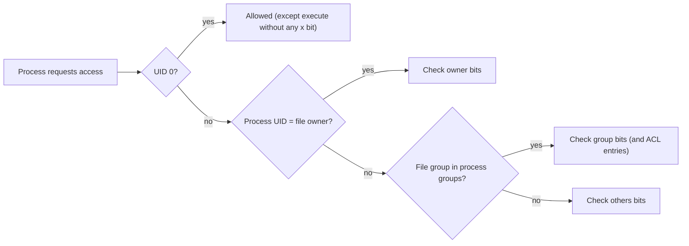

# Permissions

## Summary

Linux permissions control who can read, write and execute each file and directory. Every file has an owner (a user), a group, and three permission sets of read, write and execute bits: for the owner, for members of the group, and for everyone else. Permissions are shown as a string like `-rwxr-xr--` or an octal number like `754`, changed with `chmod`, and ownership with `chown` and `chgrp`. Special bits (SUID, SGID, sticky) change how programs run and how shared directories behave, `umask` sets defaults for new files, and access control lists (ACLs) add per-user and per-group rules when three sets are not enough. This discretionary model is the first layer of Linux security, often complemented by SELinux or AppArmor.

## Prerequisites

- [Terminal](../shell-and-terminal/terminal.md) and [File systems](../storage-and-io/file-systems.md) (inodes store the permission bits).

## Core concepts

### Users, groups and others

Each file and directory has an **owner** and belongs to a **group**:

- **Owner (user)**: by default the user who created the file.
- **Group**: a set of users who share permissions.
- **Others**: all users who are neither the owner nor in the file's group.

```bash
ls -l file.txt
# -rw-r--r-- 1 alice devs 1234 Feb  3 10:00 file.txt
#            owner=alice  group=devs
```

The kernel checks access in order and stops at the first match: if you are the owner, only the owner bits apply; otherwise if you are in the group, the group bits; otherwise the others bits. Root (UID 0) bypasses read and write checks (execute still needs at least one `x` bit).

*Analogy.* An office building's key system: the room's assigned occupant (owner), the department that shares the floor (group), and visitors (others), each with a different key level for reading documents, changing them or using the equipment. The analogy breaks at the first-match rule: an occupant with a weaker key than the department does not get the department's rights, which surprises people in Linux too.

### The permission string

Permissions are shown as a 10-character string such as `-rwxr-xr--`:

```text
 -    rwx    r-x    r--
type  owner  group  others
```

The first character is the file type: `-` regular file, `d` directory, `l` symbolic link (also `c` character device, `b` block device, `s` socket, `p` named pipe). Then three characters each for owner, group and others.

| Bit | On a file | On a directory |
| --- | --- | --- |
| `r` read | View the contents | List the names in it |
| `w` write | Modify the contents | Create, delete and rename entries in it |
| `x` execute | Run it as a program | Enter it (`cd`) and access entries by name |

Deleting or renaming a file is governed by write permission on the *directory*, not on the file itself.

| Symbol | Meaning |
| --- | --- |
| `r--` | Read only |
| `rw-` | Read and write |
| `r-x` | Read and execute |
| `rwx` | Read, write and execute |

### Changing permissions with chmod

**Symbolic mode.**

```bash
chmod u+x file.txt     # add execute for the owner
chmod g-w file.txt     # remove write for the group
chmod o+r file.txt     # add read for others
chmod ugo=r file.txt   # set read-only for everyone (same as a=r)
```

Who: `u` owner, `g` group, `o` others, `a` all. Operator: `+` add, `-` remove, `=` set exactly.

**Numeric (octal) mode.** Each permission has a value, and each digit is the sum for one class: `r` = 4, `w` = 2, `x` = 1, none = 0.

```bash
chmod 754 file.txt
# 7 owner  = 4+2+1 = rwx
# 5 group  = 4+0+1 = r-x
# 4 others = 4+0+0 = r--
```

| Octal | Symbolic | Meaning |
| --- | --- | --- |
| `777` | `rwxrwxrwx` | Full access for everyone (almost never correct) |
| `755` | `rwxr-xr-x` | Executable and readable by everyone, writable only by the owner |
| `644` | `rw-r--r--` | Read and write for the owner, read-only for others |
| `600` | `rw-------` | Private: only the owner reads and writes (SSH keys, secrets) |



### Changing ownership with chown and chgrp

```bash
chown newuser file.txt              # change the owner (root only)
chown newuser:newgroup file.txt     # owner and group
chgrp newgroup file.txt             # group only (owner may change to a group they belong to)
chown -R newuser:newgroup mydir/    # recursive
```

### Special permissions

**SUID (set user ID), octal 4000.** An executable runs with the privileges of the file's owner instead of the user who started it. Example: `/usr/bin/passwd` is owned by root and SUID (`-rwsr-xr-x`), so ordinary users can update `/etc/shadow` through it. Set with `chmod u+s program`. Linux ignores SUID on interpreted scripts (`#!` files) for security reasons; it only works on binaries.

**SGID (set group ID), octal 2000.** On an executable, it runs with the file's group. On a directory, new files inherit the directory's group instead of the creator's primary group, which is useful for collaborative directories. Shown as `s` in the group field; set with `chmod g+s directory/`.

**Sticky bit, octal 1000.** On a directory, users can delete or rename only files they own, even if the directory is writable by all; common on `/tmp` (`drwxrwxrwt`). Set with `chmod +t directory/`.

An uppercase `S` or `T` means the special bit is set but the underlying `x` bit is not.

### Default permissions with umask

`umask` removes bits from the default mode of new files (666) and directories (777):

```bash
umask        # show the current value, for example 0022
umask 022    # new directories 755 (rwxr-xr-x), new files 644 (rw-r--r--)
umask 077    # new directories 700 (rwx------), new files 600 (rw-------)
```

For services, systemd sets it with `UMask=` in the unit.

### Access control lists (ACLs)

ACLs give fine-grained permissions beyond the three classes, for example an extra user or group with specific rights:

```bash
setfacl -m u:username:rwx file.txt   # give one user full access
setfacl -m g:groupname:r file.txt    # give one group read access
getfacl file.txt                     # view ACLs
setfacl -x u:username file.txt       # remove one entry
setfacl -d -m g:devs:rwx shared/     # default ACL: inherited by new files in shared/
```

A `+` at the end of the `ls -l` permission string (`-rw-rwxr--+`) shows that an ACL exists. The ACL *mask* limits the maximum rights of named users and groups.

### Beyond the classic model

- **Capabilities** split root's power into pieces (`CAP_NET_BIND_SERVICE` to bind ports below 1024) that can be given to a binary (`setcap`) instead of SUID root.
- **Mandatory access control**: SELinux (Red Hat family) and AppArmor (Debian, Ubuntu, SUSE) enforce policies even against root-owned processes.
- **sudo** grants specific commands with elevated rights, with logging.

## Worked example

A shared project directory for the `devs` group in which everyone can create files, files stay group-owned, nobody can delete others' files, and an auditor can read everything. Untested; coreutils and acl on Ubuntu 24.04, checked 2026-11.

```bash
sudo groupadd devs
sudo usermod -aG devs alice; sudo usermod -aG devs bob
sudo mkdir /srv/project
sudo chown root:devs /srv/project
sudo chmod 3770 /srv/project          # 3 = SGID (2) + sticky (1); 770 = rwx for owner and group, nothing for others
sudo setfacl -m u:auditor:rx /srv/project
sudo setfacl -d -m u:auditor:rX /srv/project   # default ACL for new files (X: execute only on directories)
ls -ld /srv/project
# drwxrws--T+ 2 root devs 4096 Nov  9 10:00 /srv/project
```

Expected behavior: a file created by alice is owned by `alice:devs` (SGID); bob can read and edit it if alice's umask allows group write (use `umask 002` for the team); bob cannot delete it (sticky bit, uppercase `T` because others have no `x`); `auditor` can list and read files through the ACL; other users cannot enter the directory.

## Trade offs and when to use it

- **Classic bits** are simple and fast and cover most cases; **ACLs** handle exceptions but are less visible and not preserved by every tool (use `cp -a`, `rsync -A`).
- **SUID binaries** are a frequent privilege escalation path; prefer capabilities or `sudo` rules.
- **Groups** are the scalable way to grant access; per-user ACLs become unmanageable.

## Common mistakes

- **`chmod -R 777`** to "fix" an access problem. Everyone can modify or replace the files. Fix: find which user the process runs as and grant the minimum to that user or group.
- **Forgetting `x` on directories.** A file with `r` is unreadable if a parent directory lacks `x`. Fix: check every path component (`namei -l /path/to/file`).
- **Wrong permissions on SSH files.** sshd refuses keys if `~/.ssh` or `authorized_keys` are group- or world-writable. Fix: `700` and `600`.
- **Assuming write on a file allows deleting it.** Deletion depends on the directory.

## Practice

1. What does `chmod 640 report.txt` give each class?
2. Why can a user delete a read-only file?
3. What do SGID and the sticky bit do on a directory?
4. With umask 027, what are the default modes of new files and directories?

Answers:

1. Owner read and write, group read, others nothing.
2. Because deletion is controlled by write and execute permission on the containing directory, not by the file's own bits.
3. SGID makes new files inherit the directory's group; the sticky bit lets only a file's owner (or the directory owner, or root) delete or rename it.
4. Files 640 (`rw-r-----`), directories 750 (`rwxr-x---`).

## Further reading

- [chmod(1)](https://man7.org/linux/man-pages/man1/chmod.1.html) and [inode(7)](https://man7.org/linux/man-pages/man7/inode.7.html) (Linux man-pages project): modes and special bits.
- [acl(5)](https://man7.org/linux/man-pages/man5/acl.5.html) (Linux man-pages project): POSIX ACLs and the mask.
- [capabilities(7)](https://man7.org/linux/man-pages/man7/capabilities.7.html) (Linux man-pages project).
- [Red Hat Enterprise Linux: Using SELinux](https://docs.redhat.com/en/documentation/red_hat_enterprise_linux/9/html/using_selinux/index) (Red Hat): mandatory access control on top of permissions.
