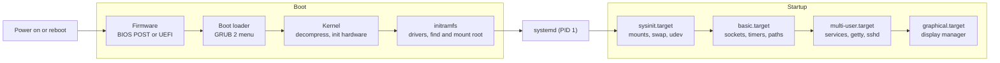
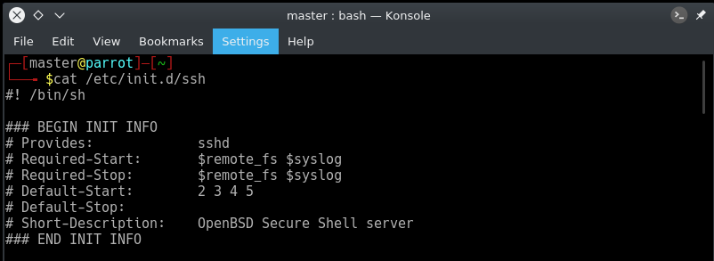

# Startup management

## Summary

Making a Linux computer usable takes two sequences of events. The *boot* sequence starts at power-on and ends when the kernel is initialized and has started the first user-space process; the *startup* sequence then brings the system to an operational state by mounting file systems and starting services. Boot goes through firmware (BIOS POST or UEFI), a boot loader (usually GRUB 2), the kernel with its initial RAM file system, and finally the init system. On almost every current distribution that init system is systemd: PID 1, the parent of all processes, which starts *units* in parallel according to their dependencies until it reaches a *target* such as `multi-user.target`. Administrators manage services, logs and boot behavior with `systemctl`, `journalctl` and unit files; older SysV init scripts in `/etc/init.d` survive mainly as compatibility.

## Prerequisites

- [Processes](../process-management/processes.md) for PID 1, daemons and signals.
- [File systems](../storage-and-io/file-systems.md) for mounting and `/etc/fstab`.

## Core concepts

### Boot and startup

The overall flow is: firmware POST, boot loader (GRUB 2), kernel initialization, then systemd, the parent of all processes. The figure shows the eight steps in one picture.


*Analogy.* Opening a theater for an evening show. The building's power and safety checks (firmware POST) come first, then the stage manager (boot loader) picks tonight's play (kernel) and calls the director (init). The director brings in crews in the right order: lights and sound need power, actors need the stage, the box office needs the network (units and dependencies), and doors open when everything for the target show is ready. The analogy breaks on parallelism: a director calls crews roughly one after another, while systemd starts everything whose dependencies are met at the same time.



### The boot process

**Initiating the boot.** Turning the power on starts the boot process; a reboot started by a local user (GUI or command line) performs a shutdown and restart.

**Firmware: BIOS POST or UEFI.**

- *BIOS* (legacy) initializes hardware, runs the *power-on self-test* (POST) to check that hardware works, then searches bootable devices for a boot sector and loads the first valid boot record (the master boot record, MBR, 512 bytes) into RAM and runs it.
- *UEFI* (all current hardware) also initializes hardware, but reads boot entries from NVRAM and loads an EFI executable (for example `\EFI\ubuntu\shimx64.efi` then `grubx64.efi`) from the FAT-formatted EFI system partition. *Secure Boot* verifies signatures along this chain.

**Boot loader: GRUB 2.** GRUB 2 (GRand Unified Bootloader) is the primary boot loader for most Linux distributions. It can boot many Linux versions and other operating systems (multiboot), and its menu lets the user choose between kernels, for example an older one after a bad update. On legacy BIOS systems it works in stages:

- **Stage 1.** The BIOS loads the boot sector (GRUB 2 `boot.img`, traditionally called stage 1) from the MBR into memory; its only job is to load the next stage.
- **Stage 1.5.** The next stage (`core.img` in GRUB 2, traditionally stage 1.5) sits in the gap after the MBR and contains drivers for common file systems (ext, FAT, NTFS, XFS, Btrfs, LVM), so it can read files.
- **Stage 2.** GRUB then loads its modules and configuration from `/boot/grub2` (Red Hat family) or `/boot/grub` (Debian family), shows the pre-boot menu, and loads the selected kernel and initramfs into RAM.

On UEFI, the firmware loads GRUB directly as an EFI application, so the MBR stages do not exist. The configuration file `grub.cfg` is generated (`grub2-mkconfig` or `update-grub`) from `/etc/default/grub` and `/etc/grub.d/`; it should not be edited by hand.

**Kernel execution.** The kernel decompresses itself, initializes the CPU, memory management and built-in drivers, and mounts the *initramfs* (initial RAM file system), a small archive loaded by GRUB. The initramfs contains the drivers and tools needed to find and mount the real root file system (disk controller modules, LVM, RAID, encryption with LUKS, network root). After switching to the real root, the kernel starts `/sbin/init`, which is systemd, the replacement for SysV init.

**End of the boot process.** The kernel and systemd are running; the system is ready for startup and user tasks.

### The startup process

The startup process brings the computer to an operational state in which it is usable for productive work.

**System initialization.** systemd manages startup, replacing the old init program. Its primary functions are mounting file systems and starting and managing system services.

**File system mounting.** systemd reads `/etc/fstab` (converted into mount and swap units by a generator) and mounts file systems and swap. It reads its configuration files, including `/etc/systemd/system/default.target`, to determine the target state.

**Determining the target state.** The default target is the link `/etc/systemd/system/default.target` (see it with `systemctl get-default`):

| Target | Typical use | SysV equivalent |
| --- | --- | --- |
| `graphical.target` | Desktop workstations: graphical login | Runlevel 5 |
| `multi-user.target` | Servers: all services, text login | Runlevel 3 |
| `rescue.target` | Single-user maintenance with basic services | Runlevel 1 |
| `emergency.target` | Minimal shell, root file system read-only | Similar to single-user mode with nothing started |
| `poweroff.target`, `reboot.target` | Shutdown and restart | Runlevels 0 and 6 |

Targets and services are both *units* in systemd terms.

**Starting dependencies.** Each target lists its dependencies in its unit file (`Wants=`, `Requires=`) and in `.wants/` directories. systemd starts the services needed for that level of functionality, in parallel where ordering (`After=`, `Before=`) allows. It also checks the legacy SysV init directories and wraps any scripts it finds in generated units.

**systemd checkpoints.**

- **`sysinit.target`**: low-level services such as mounting file systems, setting up swap, starting udev (device management), setting the clock and loading kernel modules, performed in parallel.
- **`basic.target`**: additional foundations such as sockets, timers and path units, and paths to executable directories; it precedes the user-level targets so that the basics are ready.

**User-level targets.** `multi-user.target` must be reached before `graphical.target`; `graphical.target` starts the display manager with the graphical login screen.

### SysV init and `/etc/init.d`

Before systemd, the first process was the SysV `init` program. It read `/etc/inittab`, chose a *runlevel* and ran shell scripts stored in `/etc/init.d/` through symbolic links in `/etc/rc<N>.d/` (`S` links start, `K` links stop, ordered by number). `/etc/init.d` is therefore not a daemon itself but the directory of service scripts that init (or a compatibility layer) runs; together with the runlevel links it acted as init's configuration database. Each script accepted `start`, `stop`, `restart` and `status`. The LSB header at the top declared dependencies, as the figure shows for the SSH server script.



SysV init started services one after another, had no supervision (a crashed daemon stayed down) and relied on PID files. Upstart (Ubuntu, 2006 to 2014) and then systemd replaced it. Some distributions still use other init systems: OpenRC (Alpine, Gentoo), runit (Void) and s6.

### systemd

systemd is an init system and system manager that has become the standard on most Linux distributions (Red Hat family, Debian, Ubuntu, SUSE, Arch). As PID 1 it is the parent of all processes and brings the host into a state in which productive work can be done. It supervises the whole system from boot to shutdown: services and daemons, mounts, devices, sockets, timers, logging and resource control through cgroups. Its functions are far more extensive than the old init program. It replaces SysV init and Upstart, gives better control over system state and services, and describes everything with *unit files*.

**Unit types.**

| Unit type | Describes | Example |
| --- | --- | --- |
| `.service` | A process or daemon | `sshd.service` |
| `.target` | A synchronization point grouping other units | `multi-user.target` |
| `.socket` | A listening socket for socket activation | `sshd.socket` |
| `.timer` | A schedule that starts a unit (cron replacement) | `logrotate.timer` |
| `.mount`, `.automount` | A file system mount point | `home.mount` |
| `.path` | A watched file system path | `cups.path` |
| `.slice` | A cgroup for resource management | `system.slice` |

Unit files live in `/usr/lib/systemd/system/` (installed by packages) and `/etc/systemd/system/` (local administrator changes, which take precedence). `systemctl edit unit` creates a drop-in override instead of editing the package file.

A minimal service unit: the `[Unit]` section describes it and its ordering, `[Service]` says what to run and how, `[Install]` says which target pulls it in when enabled.

![A unit file: [Unit] Description=Entering Time Machine, After=logRuin@user.service; [Service] Type=simple, ExecStart=/bin/bash /root/Desktop/timeMachine.sh; [Install] WantedBy=default.target. Third-party screenshot, kept for personal study.](../../_assets/operating-systems/startup-management-systemd-unit-file.png)

`systemctl status` shows a service's state, the unit file path and whether it is enabled, how long it has been active, its main PID, the cgroup with all its processes, and the last journal lines:


**systemd utilities.**

| Tool | Purpose |
| --- | --- |
| `systemctl` | Controls the system and services: start, stop, restart, reload, enable, disable, status, list units |
| `journalctl` | Queries the journal, systemd's logging system |
| `hostnamectl` | Shows and sets the host name |
| `localectl` | Configures the system locale and keyboard layout |
| `timedatectl` | Sets the time, date, time zone and NTP synchronization |
| `systemd-cgls` | Shows the cgroup tree and the processes in each group |
| `systemd-analyze` | Measures boot time (`blame`, `critical-chain`) and verifies unit files |
| `systemadm` | A graphical front end for `systemctl` from early systemd versions; no longer shipped by current distributions |

Common commands:

```bash
systemctl status nginx              # state, PID, cgroup, recent logs
systemctl enable --now nginx        # start now and at every boot
systemctl daemon-reload             # reread unit files after editing
systemctl list-units --failed       # what failed during boot
journalctl -u nginx -b              # logs of one unit since the current boot
journalctl -p err -b -1             # errors from the previous boot
systemd-analyze blame               # which units took longest to start
systemctl set-default multi-user.target
```

## Worked example

Turn a script into a robust service that starts at boot, restarts on failure and runs without root. Untested; systemd 255 (Ubuntu 24.04), checked 2026-11.

```ini
# /etc/systemd/system/metrics-agent.service
[Unit]
Description=Metrics agent
Wants=network-online.target
After=network-online.target          # start only once the network is configured

[Service]
Type=simple
User=metrics                         # never run as root without a reason
ExecStart=/opt/metrics-agent/bin/agent --config /etc/metrics-agent.yaml
Restart=on-failure
RestartSec=5s
# hardening: read-only system, private /tmp, no new privileges
ProtectSystem=strict
ProtectHome=true
PrivateTmp=true
NoNewPrivileges=true
MemoryMax=256M                       # cgroup limit: the OOM killer acts inside this unit only

[Install]
WantedBy=multi-user.target
```

```bash
sudo systemd-analyze verify /etc/systemd/system/metrics-agent.service
sudo systemctl daemon-reload
sudo systemctl enable --now metrics-agent
systemctl status metrics-agent       # active (running), enabled
sudo kill -9 "$(systemctl show -p MainPID --value metrics-agent)"
journalctl -u metrics-agent -n 5     # "Main process exited, code=killed, status=9/KILL" then "Scheduled restart job"
systemd-analyze security metrics-agent   # exposure score after hardening
```

After the `kill -9`, systemd restarts the agent within five seconds; SysV init would have left it down. After a reboot, `systemctl is-enabled metrics-agent` returns `enabled` and the agent is running before any login.

## Trade offs and when to use it

- **systemd** gives parallel boot, supervision, dependency management, socket activation, timers, cgroup resource control and a structured journal in one consistent tool set. Critics point to its scope and coupling, which is why some distributions (Alpine, Devuan, Void) choose simpler init systems.
- **Containers** usually run a single process without systemd; supervision moves to the container runtime or Kubernetes.
- **Timers or cron.** systemd timers log to the journal, can catch up missed runs (`Persistent=true`) and get resource limits; cron is simpler and portable.

## Common mistakes

- **Editing unit files under `/usr/lib/systemd/system/`.** Package updates overwrite them. Fix: `systemctl edit` drop-ins or copies in `/etc/systemd/system/`.
- **Forgetting `daemon-reload`.** systemd keeps using the old definition. Fix: reload after every change.
- **Ordering without dependency.** `After=` only orders; it does not start the other unit. Fix: combine `Wants=` or `Requires=` with `After=`.
- **Using `network.target` when the network must be usable.** Fix: `network-online.target` with `Wants=`.
- **Editing `grub.cfg` directly.** It is regenerated. Fix: change `/etc/default/grub` and run `update-grub` or `grub2-mkconfig -o ...`.

## Practice

1. Where does the boot sequence end and the startup sequence begin?
2. What is the role of the initramfs?
3. Which systemd target corresponds to SysV runlevel 3?
4. What is the difference between `Wants=` and `After=`?
5. Why is `/etc/init.d` not "the first process"?

Answers:

1. Boot ends when the kernel is initialized and has started systemd (PID 1); startup is everything systemd does afterwards to reach the default target.
2. It provides the drivers and tools the kernel needs to find and mount the real root file system (storage drivers, LVM, RAID, encryption).
3. `multi-user.target`.
4. `Wants=` pulls the other unit in (starts it); `After=` only defines ordering if both are started.
5. It is a directory of service scripts; the first process is `init` (today systemd), which runs those scripts in SysV-style systems.

## Further reading

- [systemd documentation](https://systemd.io/) and [systemd.unit(5)](https://www.freedesktop.org/software/systemd/man/latest/systemd.unit.html) (systemd project): units, dependencies and ordering.
- [bootup(7)](https://www.freedesktop.org/software/systemd/man/latest/bootup.html) (systemd project): the official chart of the boot and startup targets.
- [GNU GRUB Manual](https://www.gnu.org/software/grub/manual/grub/) (GNU Project): boot loader configuration and images.
- [An introduction to the Linux boot and startup processes](https://opensource.com/article/17/2/linux-boot-and-startup) (David Both, Opensource.com, 2017): a readable walk through the same sequence.
- [Rethinking PID 1](https://0pointer.de/blog/projects/systemd.html) (Lennart Poettering, 2010): the design rationale of systemd.
