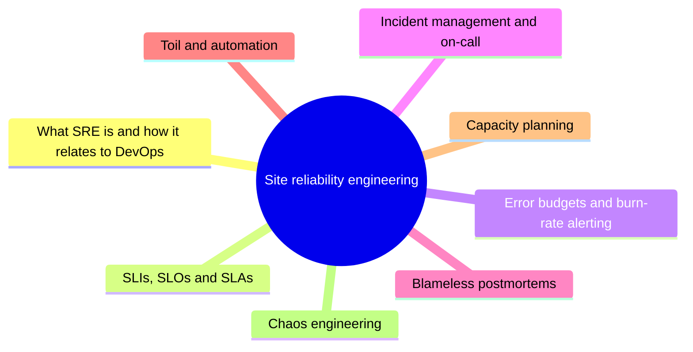

# Site reliability engineering

Reliability as an engineering discipline: service level objectives, error budgets, incident management, postmortems and reducing toil.

## Map of the area

This area has no notes yet. The mind map shows the planned topics.

TODO: Write the first notes of this area.

## Planned topics

- What SRE is and how it relates to DevOps
- SLIs, SLOs and SLAs
- Error budgets and burn-rate alerting
- Incident management and on-call
- Blameless postmortems
- Toil and automation
- Capacity planning
- Chaos engineering
