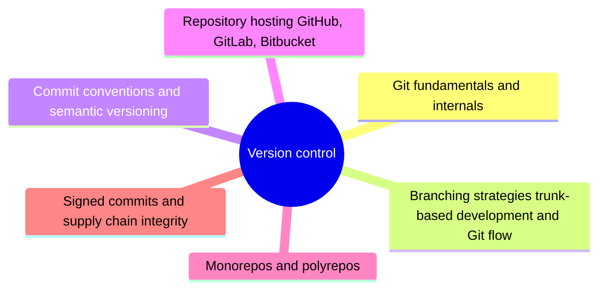

# Version control

Version control systems, branching strategies and repository hosting: the foundation that CI/CD, GitOps and infrastructure as code build on.

## Map of the area

This area has no notes yet. The mind map shows the planned topics.

TODO: Write the first notes of this area.

## Planned topics

- Git fundamentals and internals
- Branching strategies: trunk-based development and Git flow
- Commit conventions and semantic versioning
- Repository hosting: GitHub, GitLab, Bitbucket
- Monorepos and polyrepos
- Signed commits and supply chain integrity
